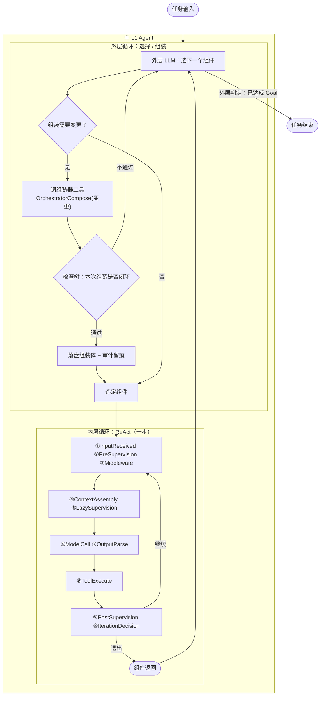

# L1 双层循环 · 总览

> **适用范围**：单 L1 agent 的双层结构、两个前提、L2 单层对照。
> **相关模块**：[02-组装器与算子闭集](02-组装器与算子闭集.md) · [05-上下文作用域](05-上下文作用域.md)
> **上级索引**：[00-索引.md](00-索引.md)　|　**状态**：文中「现状 / ❌ / 不存在」各列均为**设计期快照**，不作为当前事实 —— 落地情况一律以 [28-设计实现覆盖清点](28-设计实现覆盖清点.md) 为准（2026-10-15：14 号组件闭集 18 项均有 TS 落点；**生产链路未装配** G4 · **未提交 git**）

---
## 0. 两个前提（决定了后面所有图的形状）

1. **组装器本质上是工具** —— 外层不是"特殊代码路径"，而是**外层 LLM 调一个工具**。
   这样"组装"可审计、可审批、可拒绝，与 `registerTool` 拒注同形。
2. **分裂必须在内层可达** —— 若分裂只在外层（组装层）可用，那么一旦进入内层 ReAct 执行，
   agent 就再也无法分裂。**分裂是任务执行中的判断，不是组装期的判断**，所以它必须在内层工具表里。

## 1. 总览：单 L1 agent 的双层循环

**读法**：外层决定"跑哪个组件"，内层负责"把它跑完"。`I6 → O1` 是内层回到外层的唯一出口。

