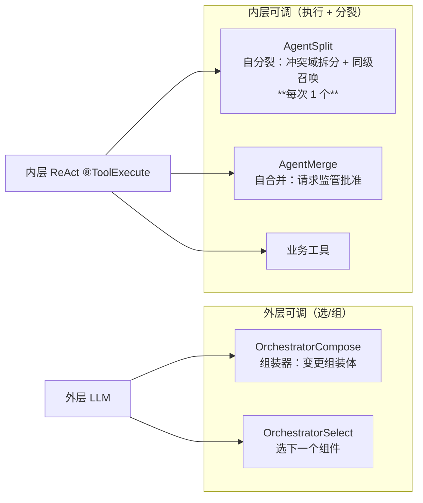
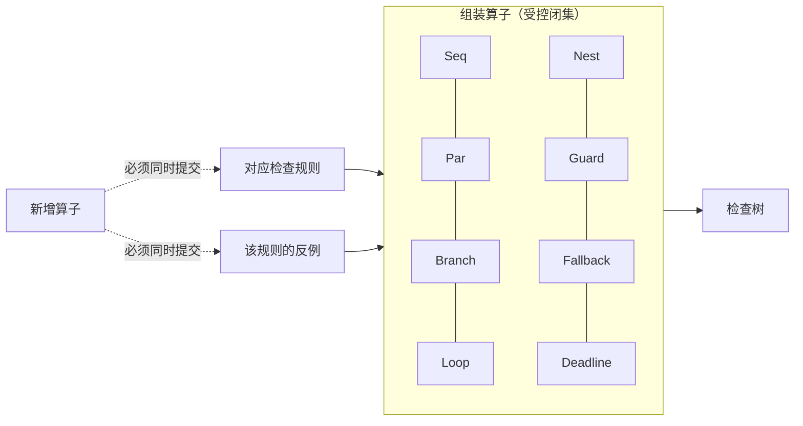

# 组装器与算子闭集

> **适用范围**：组装器是工具、工具表按层划分、组装算子的受控闭集。
> **三集合**：[10-组件的三集合](10-组件的三集合.md)（输入=可见上下文 / 输出=交给谁 / 工具=有哪些）`n> **相关模块**：[03-组装检查树](03-组装检查树.md) · [04-递归组合与P&E](04-递归组合与P&E.md)
> **上级索引**：[00-索引.md](00-索引.md)　|　**状态**：文中「现状 / ❌ / 不存在」各列均为**设计期快照**，不作为当前事实 —— 落地情况一律以 [28-设计实现覆盖清点](28-设计实现覆盖清点.md) 为准（2026-10-15：14 号组件闭集 18 项均有 TS 落点；**生产链路未装配** G4 · **未提交 git**）

---
## 2. 工具表按层划分（这是"区分组装与执行"的具体落地）

| 层 | 动作 | 工具 | 语义 |
|---|---|---|---|
| 外层 | **组装** | `OrchestratorCompose` | 改**结构**（执行件图） |
| 外层 | 选择 | `OrchestratorSelect` | 决定下一组件 |
| 内层 | **执行** | 业务工具 | 推进任务 |
| 内层 | **分裂** | `AgentSplit` | 任务太难以至子代理也解决不了时，按冲突域拆、同级召唤 |
| 内层 | 合并请求 | `AgentMerge` | 发现工作高度相关时，向监管请求合并 |

**判断（需你确认）**：`OrchestratorCompose` **仅外层可达** —— 若内层也能改组装体，
就会出现"边执行边改结构"，检查树对"本次组装"的闭环判定立刻失效（检查的对象在检查期间被改掉了）。

## 6. 算子闭集（检查树能穷尽的前提）

只有算子表是**封闭**的，闭环检查才能穷尽；新增算子若不补规则与反例，就是绕过检查树的后门。

