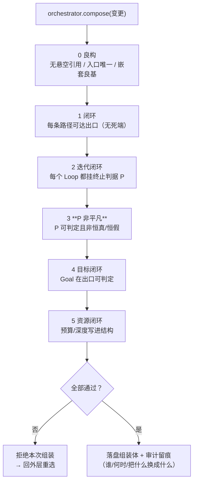

# 组装检查树

> **适用范围**：组装体写入前的结构判定：良构 / 闭环 / P 非平凡 / 目标 / 资源。
> **相关模块**：[02-组装器与算子闭集](02-组装器与算子闭集.md) · [06-父子等待与join](06-父子等待与join.md)
> **上级索引**：[00-索引.md](00-索引.md)　|　**状态**：设计稿（未实现，未提交 git）

---
## 5. 组装器工具内部（检查树）

**第 3 条是这棵树里最容易被忽略、也最要紧的一条**：结构闭环 ≠ 行为不死循环。
一个 Loop 挂了**恒真**的 P，结构上完全符合"有终止判据"，行为上是死循环。

## 6. 判据与反例集（**归口处**）

> **为什么归口到这里**：检查树判据此前散落在 12/13 各节（插件、前缀、外部控制…），
> 但没有**一条**配了反例。判据不配反例＝装饰——这是本仓反复踩的坑（守卫必须能"真的拦住"）。
> 故**判据的单一真源放在本节**，其他各节只做指回。

**格式**：每条判据都配「**造出来就必须被拒**」的反例，并标注**强制执行点**
（静态可查 / 需真实调用 / 需场景）。强制点标"真实调用"的，说明仅静态匹配不足以证明——
与 Benchmark 里 `attestation=static` 与 `executed` 必须裁开是同一条纪律。

| # | 分组 | 判据 | 反例（造这个必须被拒） | 强制点 |
|---|---|---|---|---|
| 1 | 良构 | 组装体引用了未注册的执行件 | 组装体引用了未注册的执行件（悬空引用） | 静态 |
| 2 | 良构 | 存在两个入口，或某节点无路径可达出口 | 存在两个入口，或某节点无路径可达出口（死端） | 静态 |
| 3 | 良构 | A 的 body 里含 A | A 的 body 里含 A（自引用嵌套） | 静态 |
| 4 | 良构 | 嵌套深度超过 MAX_NEST | 嵌套深度超过 MAX_NEST | 静态 |
| 5 | 闭包 | Loop 节点没有挂任何终止判据 P | Loop 节点没有挂任何终止判据 P | 静态 |
| 6 | 闭包 | Loop 的 P 恒为真 | Loop 的 P 恒为真（结构闭环、行为死循环） | 静态+场景 |
| 7 | 闭包 | Goal 未声明"在出口如何判定" | Goal 未声明"在出口如何判定" | 静态 |
| 8 | 闭包 | 预算/深度只靠运行时兜底，结构上没有写界 | 预算/深度只靠运行时兜底，结构上没有写界 | 静态 |
| 9 | 算子 | 新增算子 | 新增算子（如 Retry）但检查树无对应规则 | 静态 |
| 10 | 算子 | 新增算子有规则但无反例 | 新增算子有规则但无反例 | 静态 |
| 11 | Join | 召唤了子代 | 召唤了子代（recruit/split）却未声明 join 语义（wait/detach/abandon-on-timeout） | 静态 |
| 12 | Join | plan→execute 未声明 minCompleteness | plan→execute 未声明 minCompleteness | 静态 |
| 13 | Join | Join.deps 引用了不存在的子代/组件 | Join.deps 引用了不存在的子代/组件 | 静态 |
| 14 | 状态 | 在"有未收敛子代"时把状态置为 terminate 或 success | 在"有未收敛子代"时把状态置为 terminate 或 success | 真实调用 |
| 15 | 状态 | 组件自行宣称 success | 组件自行宣称 success（未经外层"全部收敛"推导） | 真实调用 |
| 16 | 插件 | 注册一个能短路返回 success 的钩子处理器 | 注册一个能短路返回 success 的钩子处理器 | 静态 |
| 17 | 插件 | 两个 conflict_domain 相同的插件同时启用 | 两个 conflict_domain 相同的插件同时启用 | 静态 |
| 18 | 插件 | 插件写出的数据不走输出集 | 插件写出的数据不走输出集（直接改共享上下文） | 静态+真实调用 |
| 19 | 插件 | 插件使用了 afterAgent，但内层循环并未派发该钩子 | 插件使用了 afterAgent，但内层循环并未派发该钩子 | 真实调用 |
| 20 | 前缀 | 进上下文的某类数据未声明稳定键 | 进上下文的某类数据未声明稳定键（直接 push 到 messages 中间） | 静态 |
| 21 | 前缀 | 同一 agent 内两个组件声明了不同的工具区 | 同一 agent 内两个组件声明了不同的工具区 | 静态 |
| 22 | 前缀 | 把最易变的分区排在稳定分区之前 | 把最易变的分区排在稳定分区之前（违反变更频率升序） | 静态 |
| 23 | 前缀 | 在每轮都重拉检索/共享内容 | 在每轮都重拉检索/共享内容（内容每轮变⇒回合段每轮失效） | 静态+场景 |
| 24 | 会话 | 新对话直接拼接上一对话的 messages | 新对话直接拼接上一对话的 messages | 静态 |
| 25 | 会话 | 恒定区跨对话哈希不一致 | 恒定区跨对话哈希不一致（每对话重建系统提示） | 静态 |
| 26 | 会话 | 切换对话时清空 ContextStore | 切换对话时清空 ContextStore（未写边界键） | 静态 |
| 27 | 外部控制 | 组件代码里自造 state 或 control | 组件代码里自造 state 或 control（未经外部注入） | 静态 |
| 28 | 外部控制 | 运行中自增工具/插件/可见面 | 运行中自增工具/插件/可见面（超出 Grants） | 真实调用 |
| 29 | 外部控制 | L2 的 ReactInput 不是由父构造 | L2 的 ReactInput 不是由父构造（L2 自造输入） | 静态 |
| 30 | 外部控制 | 外部丢弃了 needs_decision 中的某一项 | 外部丢弃了 needs_decision 中的某一项 | 真实调用 |
| 31 | 双向插入 | 子件声明"可见全部上下文" | 子件声明"可见全部上下文"（输入集 = 宿主全集） | 静态 |
| 32 | 双向插入 | 插件的可见面超出宿主输入集 | 插件的可见面超出宿主输入集（借宿主提权） | 静态 |
| 33 | 双向插入 | 插入图成环 | 插入图成环（A 插 B、B 又插 A） | 静态 |
| 34 | 双向插入 | 动态挂载插件但未记入组装体 | 动态挂载插件但未记入组装体（无法归因） | 静态 |
| 35 | 共享上下文 | 把中间推理/草稿投进 shared-ctx | 把中间推理/草稿投进 shared-ctx（说不出"防止了什么冲突"） | 静态 |
| 36 | 共享上下文 | 跨域写入未带 expectedVersion | 跨域写入未带 expectedVersion | 真实调用 |
| 37 | 数据总表 | 新增一类数据只加进总表，未声明方向/可见级/落盘/处理规则 | 新增一类数据只加进总表，未声明方向/可见级/落盘/处理规则 | 静态 |

**统计**：共 37 条。其中静态可查 28 条 · 需真实调用 6 条 · 静态+真实调用 1 条 · 含场景 2 条。

**缺口自陈**：标"真实调用"或"含场景"的条目**当前无法验证**（本设计未实现），
故它们现在只是**承诺**；实现后必须逐条补上可复现的负向用例，否则这些判据不得声称"已生效"。
