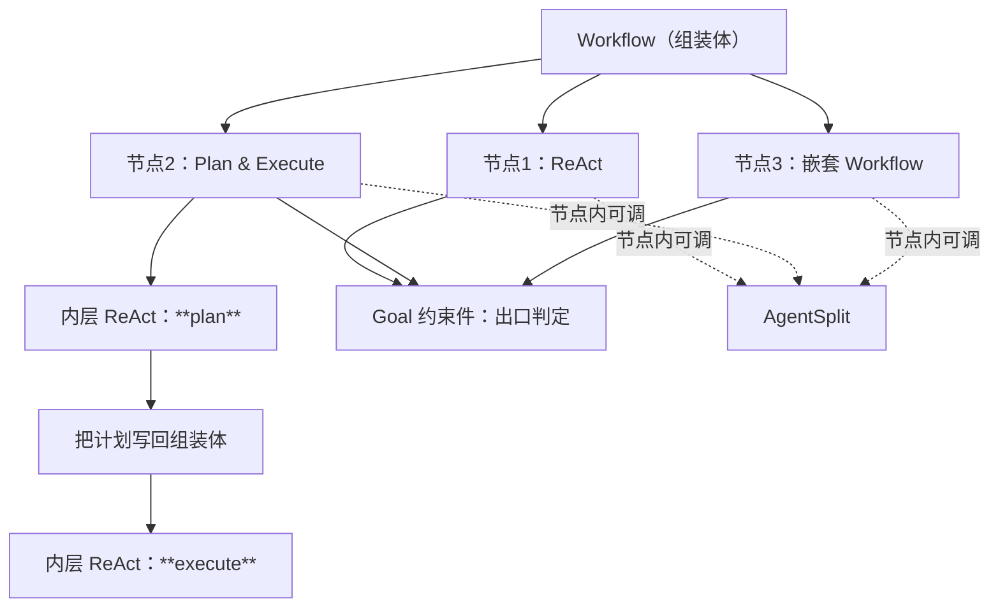
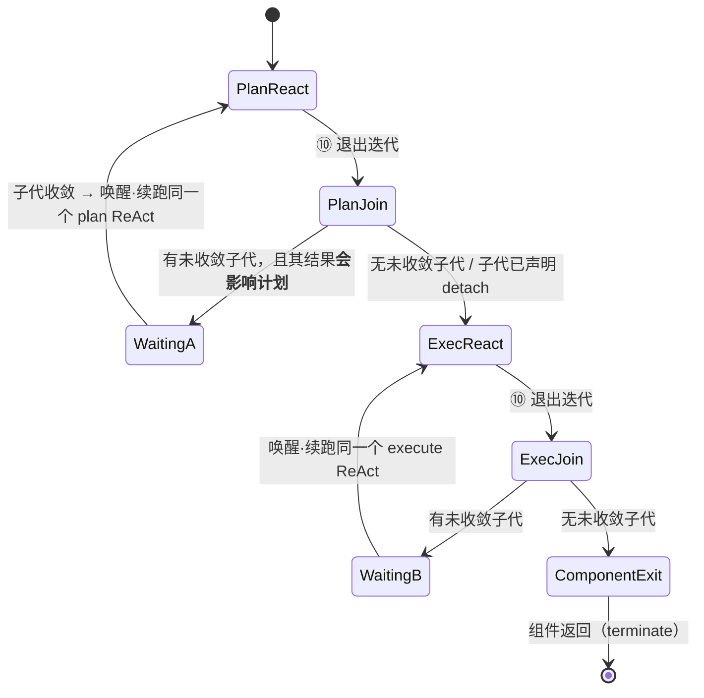

# 递归组合与 P&E

> **适用范围**：Workflow 节点内嵌执行件；P&E = 两个 ReAct + join 门；父能否退出 ReAct。
> **相关模块**：[03-组装检查树](03-组装检查树.md) · [06-父子等待与join](06-父子等待与join.md)
> **上级索引**：[00-索引.md](00-索引.md)　|　**状态**：文中「现状 / ❌ / 不存在」各列均为**设计期快照**，不作为当前事实 —— 落地情况一律以 [28-设计实现覆盖清点](28-设计实现覆盖清点.md) 为准（2026-10-15：14 号组件闭集 18 项均有 TS 落点；**生产链路未装配** G4 · **未提交 git**）

---
## 4. 递归：Workflow 的节点体内可以是任何执行件



**P&E = 两个 ReAct** 在这里是自然结果：`plan` 与 `execute` 各是一次内层运行，由外层串起来。

## 11. P&E 里的 ReAct：父能否退出这个 ReAct

### 11.0 先消歧：这里的"父"有两个

| "父"指谁 | 能否退出 | 说明 |
|---|---|---|
| **这个 ReAct 组件本身**（它召唤了子代） | **能退出**，但退出分两种：**终止** 或 **挂起** | 受 join 声明约束（见 [11-共享上下文](11-共享上下文.md).2） |
| **外层 L1 agent** | **不能** Done | 只要还有未收敛子代，它就进 `Waiting` 而非 `Done` |

混着说就会得出"父被卡在 ReAct 里出不来"这种错误结论——**卡住的不是父，是"能不能算完成"这个判定**。

### 11.1 内层 ReAct 的退出**不受子代影响**

⑩ IterationDecision 该退出就退出。**否则父会在 ReAct 里空转等子代**——那既烧 token，又违反
"`Waiting` 期间不消耗 token"（§10.4）。

**所以"能否退出"的答案是：能。真正要判的不是"能否退出"，而是"退出后去哪里"。**

### 11.2 退出判定：三种去向，一种禁止

| ⑩ 的判定 | 条件 | 语义 |
|---|---|---|
| `terminate` | 无未收敛子代 | 组件正常返回（**同一份外层上下文**，§9） |
| `suspend` | 有未收敛子代 **且** join=`wait` | 组件**挂起**：状态落盘；子代收敛事件唤醒后，**续跑同一个组件**（不是新建） |
| `handoff` | 有未收敛子代 **且** join=`detach` | 交给上层/同伴负责（同级分裂场景），父不再等 |
| ❌ `success` | 有未收敛子代 | **禁止**——这就是 `false_success` |

**关键**：`suspend` 之后续跑的是**同一个 ReAct 组件**（它的上下文一直在外层那份里，§9.2），
不是"重新开一个组件"。因为子代是在**这个** ReAct 内部被召唤的，这次推理在逻辑上仍然开着。

### 11.3 P&E 的真实结构：**两个 ReAct + 两个 join 门**

你说"P&E 本质是两个 ReAct"——我同意；但**一旦允许组件内召唤子代，就必须承认两半之间还有一个门**：



即：

```
react(plan) → [join 门] → react(execute) → [join 门] → 出口
```

**为什么 plan 与 execute 之间必须有门**：计划是 execute 的输入。若 plan 退出时仍有子代在跑，
而**这个子代的结果会改变计划**，那计划还不能定稿——此时进入 execute 等于**用未定稿的计划执行**。
所以它要么 `suspend` 等，要么在计划里**显式声明该子代 detach**（不依赖其结果）。

### 11.4 由此给组装算子表加一个算子：`Join`

`Join` 是**结构件**，不是流程步骤：它声明"此处的后继可以开始的条件"。

```
Join { mode: 'wait' | 'detach', deps: [子代/组件引用], deadline? }
```

- `wait`：后继必须等 `deps` 收敛
- `detach`：不等，但**必须在组装体里留痕**（谁负责那个未收敛的子代）
- `deadline` 到期 → 转 §10.5 的 `Abandoning`

**没有 `Join` 声明的召唤 = 开环**（§10.6）⇒ 检查树拒绝。

### 11.5 一个反直觉但必要的结论

**退出 ReAct 是自由的，但"退出后成为 terminate"不是自由的**：

```
能退出        （⑩ 该退就退，不许空转）
不能自称完成   （有未收敛子代时，terminate 与 success 都被禁）
必须交代去向   （suspend / handoff，二者都要在组装体里可查）
```

这与整个设计的调子一致：**结构上允许的动作，必须有人负责**。父退出 ReAct 本身没错；
错的是**退了之后没人知道那个子代归谁**。

### 11.6 需要你确认

1. **`suspend` 后续跑同一个组件**（我按"上下文一直在外层那份里"设计）——若你认为应当**新建**组件续跑，
   那 §9 的"上下文同一份"就要改，两者必须一致。
2. **plan→execute 的门是否只在"子代会影响计划"时生效**？我按最小必要设计（不影响就 `detach` 放行）；
   若你要求**一律等**（plan 必须完全定稿才执行），P&E 会变成串行且更慢，但更可预测。

