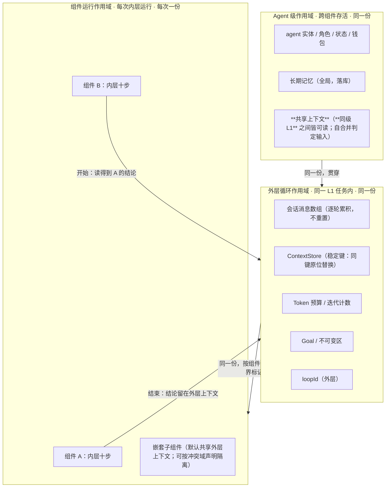
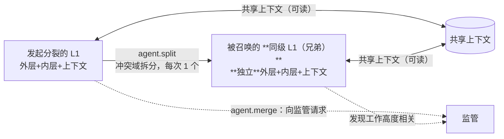

# 上下文作用域与生命周期（同一份 / 各自一份）

> **适用范围**：Agent 级 / 外层级 / 组件级三个作用域；边界标记；声明式隔离；分裂时的分叉。
> **相关模块**：[01-双层循环总览](01-双层循环总览.md) · [07-分裂与自合并](07-分裂与自合并.md)
> **上级索引**：[00-索引.md](00-索引.md)　|　**状态**：设计稿（未实现，未提交 git）

---
## 9. 生命周期与上下文作用域（三份，不是一份）

**结论先说**：**同一 L1 agent 内，外层与它的各个组件共用一份"外层上下文"；但 agent 级、外层级、组件级是三个不同的作用域**，
分裂出的新 L1 则**完全独立**（只通过"共享上下文"协同）。



#> **与「输入集」的关系（2026-10-15 修正）**：共享的是**同一个上下文容器**，但每个组件看到的是其
> **输入集**声明的那个子范围 —— 见 [10-组件的三集合](10-组件的三集合.md)。否则"共享"与"输入集"会互相抵消。

## 9.1 逐项裁定（同一份 / 各自一份）

| 上下文载体 | 作用域 | 是否同一份 | 理由 |
|---|---|---|---|
| 会话消息数组 | 外层 | **同一份**（累积） | 兄弟组件若各起一份，模型就丢前序组件的结论，只能重新决策；且**前缀缓存会整段失效** |
| `ContextStore` | 外层 | **同一份** | 它的设计就是"稳定键 + 同键原位替换"，天然支持跨组件累积 |
| Token 预算 / 迭代计数 | 外层 | **同一份** | 否则组件可绕过预算（每个组件一份 = 预算被乘上组件数） |
| Goal / 不可变区 | 外层 | **同一份** | 目标不能因为换组件而变——否则"换组件改目标"是最容易的规避路径 |
| `loopId` | 外层（组件为子循环） | 一份 + 子 ID | 既有机制是"中间件按归属 Loop 过滤（P0-2 防跨 Loop 污染）"，嵌套需 `外/子` 形式 |
| 组件局部工作集 / 迭代计数 | 组件 | **各自一份** | 组件的私有推进状态；结束即回收 |
| 长期记忆（落库） | Agent（全局） | **同一份** | 跨组件、跨轮次共享的知识 |
| **共享上下文** | **同级 L1 之间** | 一份（兄弟共读） | **自合并的判定输入**：拉取与自己相关的文件，发现高度相关 → 请求合并 |
| 分裂出的 L1 的全部上下文 | 独立 agent | **各自一份** | 它是同级别的新 agent，有自己完整的双层循环 |

### 9.2 组件切换用"边界标记"，不用"换上下文"

组件切换时**不重置**上下文，而是往 `ContextStore` 写一个**稳定键**段：

```
key     = ctx:outer:component-boundary
content = 「组件 A（plan）已结束；结论：…｜下一个组件：execute」
timestamp
```

这与我把检索结果注入上下文用的是同一手法：**稳定键 + 同键原位替换 ⇒ 不破坏前缀缓存**，同时让模型知道"阶段变了"。

### 9.3 隔离是**声明式**的，不是默认的

嵌套组件（Workflow 节点内的 ReAct）有两种语义，需显式声明：

| 声明 | 语义 | 用于 |
|---|---|---|
| `isolation: 'shared'`（**默认**） | 共享外层上下文，只把结论留在外层 | 常规节点——它是父任务的延续 |
| `isolation: 'isolated'` | 独立子上下文，结束后**只回写摘要**到外层 | **冲突域高度隔离**的场景——正是你裁定④里"确保工作内容高度隔离"的上下文层落地 |

**为什么默认共享**：默认隔离会让每个节点都重新建立上下文，模型看不到前序进展，外层编排的意义被削弱；
而隔离的价值只在"确实要互不干扰"（冲突域）时才成立——所以它应当是**被声明的例外**，不是默认。

### 9.4 分裂时的作用域分叉



**要点**：两个**同级 L1**（发起者与被召唤的兄弟）**不共享**会话上下文/预算（各自是完整 L1），但**共享**那块用于协同的"共享上下文"——
这既是自合并的判定输入，也是"同级别而非上下级"的体现（下级子代理才从属于父的任务树）。

### 9.5 需要你确认的两处

1. **组件切换是否真的不重置上下文**（我按"共享 + 边界标记"设计）。若你要求某些组件**必须**从干净上下文开始，
   那就把它归入 `isolation: 'isolated'`，而不是默认行为。
2. **`loopId` 的嵌套形式**：外层一个 `loopId`、组件用 `外/子` 派生？还是组件各自独立 `loopId`？
   现有中间件隔离机制（P0-2）按归属过滤，我倾向派生形式——但会改动既有过滤语义，需你定。

