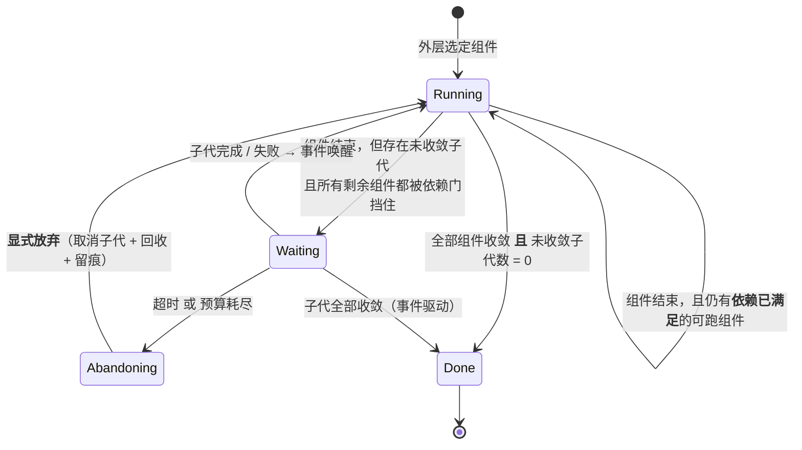
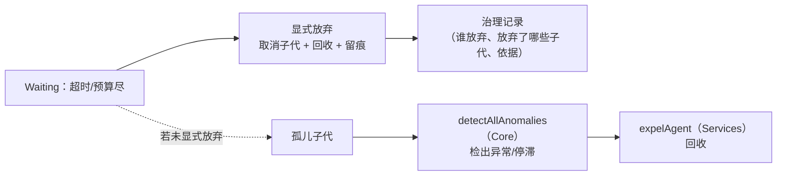
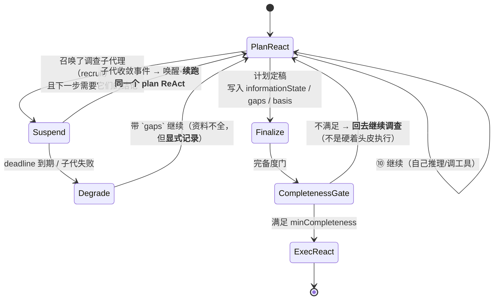

# 父与子：等待、join 门与计划完备度

> **适用范围**：父不得"空闲"；依赖门；suspend/handoff；唤醒路径；p→r 的完备度门。
> **术语消歧**：本模块的「子」指**招募的下级子代理**（`agent.recruit`，父子关系，计入父的任务成本）。
> **分裂**产生的是**同级（兄弟）L1**，不走本模块的 join 语义 —— 见 [07-分裂与自合并](07-分裂与自合并.md)。
> **相关模块**：[04-递归组合与P&E](04-递归组合与P&E.md) · [08-生命周期回调与动态性](08-生命周期回调与动态性.md)
> **上级索引**：[00-索引.md](00-索引.md)　|　**状态**：设计稿（未实现，未提交 git）

---
## 10. 父已空闲、子仍在工作 —— 这个状态该怎么定义

### 10.0 先分清两种"召唤"（答案完全不同）

| 机制 | 关系 | 父要不要等 | 原因 |
|---|---|---|---|
| **`agent.recruit`（招募）** | **下级**子代理，从属于父的任务树 | **必须 join** | 它是父那份任务的一部分；父走完自己的 ReAct 时，整体任务**并未完成** |
| **`agent.split`（自分裂）** | **同级** L1，按冲突域拆分 | **不等**（并行两域） | 父继续做自己那份；两者最终由**自合并**收敛 —— 这是你裁定④的闭环语义 |

**所以"父空闲而子仍在工作"这个问题，只在下级子代理（join 语义）下才是问题**；
在自分裂（同级并行）下它是**正常状态**，真正要防的是另一件事：**父把自己那一份做完就宣告整体完成**。

### 10.1 父的状态机：**"空闲"不该是一个状态**



| 状态 | 含义 | 允许的退出原因 | 需落盘 |
|---|---|---|---|
| `Running` | 有活可干（自己跑或已满足依赖的组件跑） | `continue` / 组件返回 | 是 |
| `Waiting` | **无活可干，但仍有未收敛子代** | **仅** `awaiting_children`（不得 success） | **是**（关键） |
| `Abandoning` | 主动放弃未收敛子代 | `abandoned`（须留痕） | 是 |
| `Done` | 全部收敛且无未收敛子代 | `success` | 是 |

**要点**：没有"空闲"这个中间态。**要么在跑、要么在等、要么在放弃、要么已完成**——
"空闲"会让系统误判"没事可干 = 干完了"，这正是 Benchmark 里 `false_success` 诊断要禁的东西。

### 10.2 依赖门（dependency gate）

外层选组件时，每个组件带**入口条件**：`子代(ids) 已收敛`。于是：

```
父内层 ReAct 退出 → 外层重选
  ├─ 存在依赖已满足的组件 → 继续 Running（**父并不空闲**，它去做别的）
  └─ 所有剩余组件都被依赖门挡住 → 进入 Waiting（挂起，不消耗 token）
```

这与仓内既有的 `dispatchGate`（子任务分发时的"blocked by failed dep"检查 + 并发上限）**是同一个概念**，
只是从"子任务层"提到"组件层"。可直接照抄其形态。

### 10.3 唤醒路径 —— 这里撞上我核实过的两个真缺陷

`Waiting` 靠**事件**唤醒，而事件要落地就必须有：

| 需要 | 现状（已核实） | 后果 |
|---|---|---|
| 挂起状态落盘 | **`afterAgent` 从未被派发**，`checkpointWriter` 是死代码 | 父一旦挂起，**没有地方存它挂在哪**，重启即丢 |
| 恢复入口 | `AG-BEN-RESUME` 登记为 gap（无 load/resume API） | 挂起的父**无法被唤醒后继续** |
| 子代完成事件 | 子代完成会走 ⑩ → 事件总线（`emit` 阶段） | 这条能用 |

**结论**：**"父等待子"这件事能不能成立，取决于挂起状态能不能落盘与恢复**——
它不是新设计问题，而是那两个既有缺陷的直接后果。这也说明：**自组装 + 等待语义**都必须先把
`afterAgent` 派发修好，否则"父在等待"只是一句结构上的话。

### 10.4 预算与计费（等待期不许自旋）

| 项 | 规则 |
|---|---|
| `Waiting` 期间的父 | **不消耗 token**（没有模型调用；靠事件唤醒，不许轮询自旋） |
| 下级子代理（recruit） | 消耗**计入父的任务成本**（它是父任务的一部分） |
| 同级 L1（split） | **各自预算**（见 §9.4：**同级之间**不共享预算） |
| `Abandoning` | 放弃动作本身要付费/留痕（取消、回收都算治理动作） |

### 10.5 孤儿与放弃（这条链路在仓里已有零件，但证据很弱）

父若在 `Waiting` 中被迫退出（超时、预算耗尽），必须走**显式放弃**：



回收链路**零件是齐的**（`detectAllAnomalies` 在 Core、`expelAgent` 在 Services），
但我这两天查过它的 cell `SUB-BEN-RECLAIM`：**它的证据只是"存在调用点"，证明不了"确实检出并回收"**
（且它锚在一条 `kind=gap` 的检查上，锚点与声明方向相反）。**所以这条兜底链目前不可信**，
在"父放弃/孤儿回收"成为设计的一部分之后，它必须升级为真实调用探针。

### 10.6 这给检查树加了一条闭环判据

> 组装体中**任何可能召唤子代的节点，必须声明 join 语义**：`wait`（等）/ `detach`（不等，仅同级分裂）/
> `abandon-on-timeout`（超时放弃）。**未声明 = 开环**：父走了，子悬着，无人负责。

这条要加进 §5 的检查树（作为"1. 闭环"的子条），并配反例：**造一个"召唤了子代却不声明 join 语义"的组装，必须被拒**。

### 10.7 需要你确认

1. **同级分裂是否真的"父不等"**？（我按你裁定④的"自合并闭环"理解为不等；若你要求父也必须等到
   子代某阶段完成，那 `split` 也要有 join 语义，模型会不同。）
2. **`Waiting` 是否允许父去做**不依赖该子代的其它组件？（我设计为允许——否则 `Waiting` 会变成
   纯阻塞，外层编排的并行价值没了。）
3. **放弃是否需要审批**？我倾向：**放弃下级子代理**属治理动作（要审批/留痕），
   **放弃同级分裂体**按你裁定④走"向监管请求"。

## 12. p agent 召唤完调查子代理后"闲下来"：真实的两难在哪

### 12.0 先把一个错误前提拆掉：这**不是**"退出还是等待"的二选一

若它召唤的调查子代理**尚未收敛**，那么按 §11.2 已经定死：

> 有未收敛子代 ⇒ **禁止** `terminate` 与 `success`。

所以它**不可能"退出"**——唯一合法判定是 `suspend`。用户感到的"两难"来自一个隐含误解：

> 把 `suspend` 当成了"卡住 / 空转"。

`suspend` 的真实语义（§10.4）：**不调用模型、不消耗 token、状态落盘、事件唤醒**。
它不占循环、不烧钱、可超时、可放弃。**"闲下来"≠"卡住"**。

**但你的第二个担心是真的，而且我上一轮没答：即使正确挂起，`r` 拿到的资料也可能不全。**
—— 这不是"退出/等待"的问题，而是"**计划什么时候算定稿**"的问题。

### 12.1 缺的那一环：计划要携带**完备性声明**

```
Plan {
  steps: [...],
  informationState: 'complete' | 'partial',
  gaps: [ { 缺什么, 由哪个子代负责, 截止时间 } ],   // partial 时必填
  basis: [ 依据了哪些子代的结论 ],
}
```

于是 `r`（execute）的**入口条件不再是"plan 返回了"**，而是：

> **`plan.informationState` 满足本轮 `minCompleteness`。**

这就是把"资料不全"从**隐性错误**变成**可检查、可拒绝的结构条件**。
否则 `r` 只能瞎猜，而"猜"在结果里看不出来——这正是本项目最怕的形态。

### 12.2 p 阶段的状态流（含完备度门）



**门的两个出口都要有**：满足 → 执行；不满足 → **回到调查**。
只在"满足"一侧有出口，就等于把"资料不全"偷偷放过去。

### 12.3 由此 §11.4 的 `Join` 要扩两个字段

```
Join {
  mode: 'wait' | 'detach',
  deps: [...],
  onMissing: 'block' | 'degrade',   // 资料不全时：挡住，还是降级并把缺口写进计划
  minCompleteness: 0..1,            // 后继（r）启动所需的最小完备度
  deadline?: ms,                    // 到期 → Degrade / Abandon（§10.5）
}
```

**没有 `minCompleteness` 的 plan→execute 转移 = 开环**：`r` 会在"不知道资料全不全"的情况下开跑。

### 12.4 一个现成的锚点：调查子代理的并发上限

你说"p agent **一直**召唤子代理调查"——那就必须有界。仓里已经有：

```
MAX_LIVE_SUBAGENTS_PER_TRACE = 8     （我核实过：强制在 Src/Tools/Custom/agentRecruiter.ts，工具层）
```

所以调查子代理可以并行，但**每 trace 存活上限 8**。这同时给出"调查轮次必须收敛"的结构约束：
`Join.deadline` + 8 上限 + 预算，三者共同保证 **p 不会无限调查下去**（这是"闭环"的又一条，不是靠"跑着看"）。

### 12.5 我上一轮的缺口（明确承认）

§11 只回答了"**能不能退出**"，没回答"**退出的前提是否成立**"。你这个问题把它补上了：

```
§11：有未收敛子代 ⇒ 只能 suspend（不能 terminate）
§12：即便正确 suspend，也要判"资料够不够"—— 完备度门 + gaps 显式传递
```

两者合起来才完整：**第一个防止"父走了不管子"；第二个防止"父等到资料不全就当齐了"**。

### 12.6 需要你确认

1. **`minCompleteness` 由谁定**：外层 LLM 在编排时声明？还是 `r` 自己的入口契约（"我需要观测数据才能执行"）？
   我倾向**由 `r` 的契约声明**（下游最清楚自己需要什么），外层只负责满足或降级。
2. **`degrade` 是否允许**（资料不全也执行，但把 `gaps` 写进结果）？还是**一律 block**、宁可超时？
   这决定"宁可慢"还是"宁可猜"——是产品语义判断，你定。
3. **并行调查的用满 8 个**是否允许？还是像分裂那样"**每次只召唤一个**"？（分裂你定了每次 1 个；
   招募调查是否也限 1，我拿不准——`MAX_LIVE_SUBAGENTS_PER_TRACE = 8` 只给了总量上限，没给速率。）

