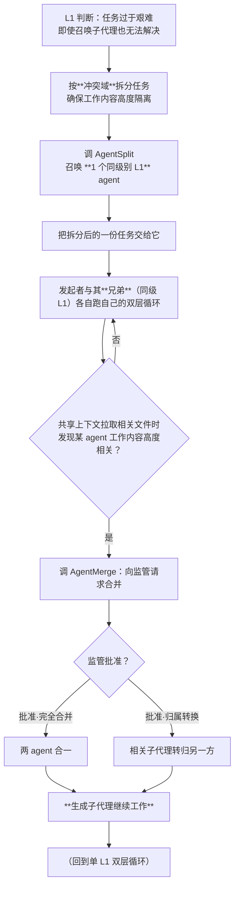

# 分裂与自合并

> **适用范围**：自分裂（同级召唤 + 冲突域 + 每次 1 个）与自合并闭环。
> **三集合**：[10-组件的三集合](10-组件的三集合.md)（输入=可见上下文 / 输出=交给谁 / 工具=有哪些）
> **相关模块**：[05-上下文作用域](05-上下文作用域.md) · [06-父子等待与join](06-父子等待与join.md)
> **上级索引**：[00-索引.md](00-索引.md)　|　**状态**：✅ 已实现（2026-10-15 · 组件级 + 集成级取证，见 [17](17-账本-子代与兄弟.md) §0.1 与 [28](28-设计实现覆盖清点.md) §3）
> ⚠️ **生产装配未接**（端口已改为按身份解析 `splitMergeFor(agentId)`，但 `main.ts` 未登记任何 L1 宿主 ⇒ 实调为 `NOT_ENABLED`，28 号 **G4**）；**真实 Agent 调用回归未做**（**G7**）。设计未规定兄弟数量上限（**D1**）· 端口容器的作用域口径未规定（**D4**）

---
## 3. 分裂：完整闭环（发起者与被召唤者都是 L1、**同级/兄弟**，各跑双层循环）

**关键**：`C` 这一步在内层可达（图 2），否则 `A` 这个判断发生在执行过程中时无处执行。

