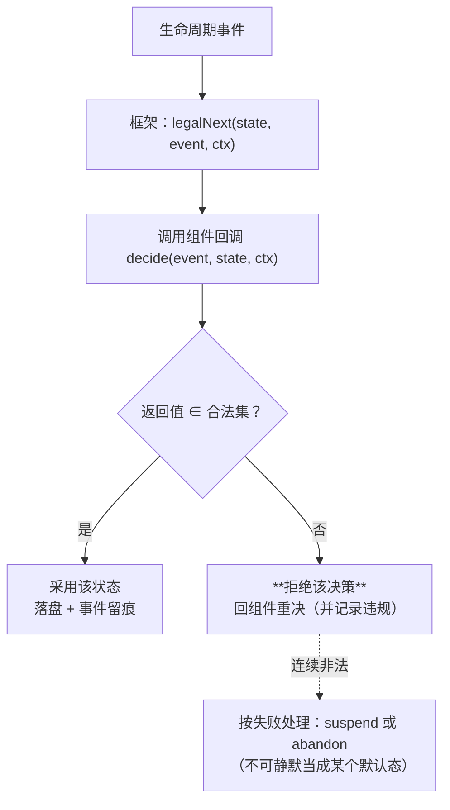
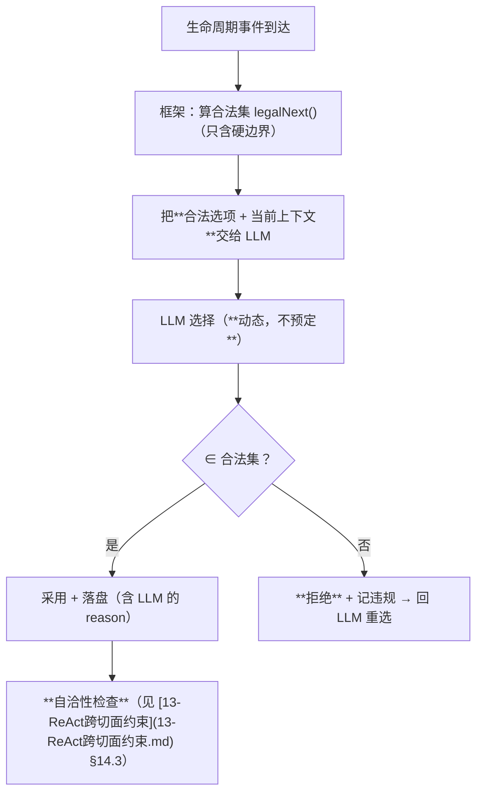
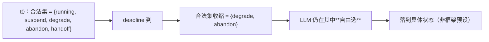

# 生命周期：回调、合法性与动态性

> **适用范围**：框架给合法性、组件给决策；判据从「选对」改为「自洽」；合法集收缩。
> **相关模块**：[06-父子等待与join](06-父子等待与join.md) · [01-双层循环总览](01-双层循环总览.md)
> **上级索引**：[00-索引.md](00-索引.md)　|　**状态**：文中「现状 / ❌ / 不存在」各列均为**设计期快照**，不作为当前事实 —— 落地情况一律以 [28-设计实现覆盖清点](28-设计实现覆盖清点.md) 为准（2026-10-15：14 号组件闭集 18 项均有 TS 落点；**生产链路未装配** G4 · **未提交 git**）

---
## 13. 生命周期以**回调**给定：框架给合法性，组件给决策

### 13.1 修正说明：§10–§12 的状态机不是"写死的流程"

前面我画的状态机（`Running/Waiting/Abandoning/Done`、`terminate/suspend/handoff` 判定）应当被理解为
**默认的「合法集」与「默认回调」**，而**不是框架里写死的分支**。

正确形态是：

```
框架负责「合法性」： 状态集合 + 在给定事件下允许的转移集合（不可协商的边界）
组件负责「决策」：   一条回调 —— 在该事件点返回它要的下一状态（必须 ∈ 合法集）
```

**合法性由框架/契约"给定"，决策由组件"给出"。** 这样不同组件可以有完全不同的生命周期，
但都跑在同一套合法性边界内——既"不写死"，又"不会乱来"。

### 13.2 回调接口

```python
LifecycleEvent = Literal[
    "component.entered", "iteration.exited", "child.spawned", "child.settled",
    "dependency.blocked", "budget.exhausted", "deadline.reached",
    "goal.satisfied", "goal.unmet",
]

# 决策用 dict 表示判别联合（伪代码约定）：
#   {"next": "running"}
#   {"next": "suspend", "until": "child" | "event", "refs": [...]}
#   {"next": "terminate"}
#   {"next": "handoff", "to": "parent" | "peer", "refs": [...]}
#   {"next": "degrade", "reason": str, "gaps": [Gap]}
#   {"next": "abandon", "reason": str}
Decision = dict

class ComponentLifecycle(Protocol):
    """组件自己的生命周期决策：每个组件一份，可各不相同。"""
    async def decide(self, event: LifecycleEvent, state: LifecycleState,
                     ctx: LifecycleCtx) -> Decision: ...
```

### 13.3 框架侧：合法性表（**由契约给定，组件不能改**）

```python
def legal_next(state: LifecycleState, event: LifecycleEvent,
               ctx: LifecycleCtx) -> set[LifecycleState]:
    """在事件发生、当前处于 state 时，允许转移到哪些状态。

    由契约给定、组件不能改（只能收紧）。
    默认表即 §10–§12 那几条规则的结构化形式。
    """
    if event == "iteration.exited":
        # 有未收敛子代 ⇒ 禁止 terminate / success（= false_success）
        return {"suspend", "handoff", "abandon"} if ctx.outstanding else {"terminate"}
    if event == "dependency.blocked": return {"suspend", "degrade", "abandon"}
    if event == "deadline.reached":   return {"degrade", "abandon"}
    if event == "goal.unmet":         return {"running", "suspend", "degrade"}
    # 任何情形都不含 "success"：success 只由"全部收敛且无未收敛子代"推出
    return {"running"}
```

**默认合法集（即 §10–§12 那几条规则的结构化形式）**：

| 事件 | 前置 | 合法集 | 非法（框架必须拒绝） |
|---|---|---|---|
| `iteration.exited` | 有未收敛子代 | `{suspend, handoff, abandon}` | **`terminate` / `success`**（= false_success） |
| `iteration.exited` | 无未收敛子代 | `{terminate}` | — |
| `dependency.blocked` | 依赖未满足 | `{suspend, degrade, abandon}` | `terminate` |
| `deadline.reached` | — | `{degrade, abandon}` | `running` / `terminate` |
| `goal.unmet` | — | `{running, suspend, degrade}` | `terminate` |
| 任意 | — | 一律不含 `success`（`success` 只由"全部收敛且无未收敛子代"推出） | 组件**无权**自行宣称成功 |

### 13.4 决策 → 合法性判定（不许静默兜底）



**第三条是关键**：回调返回非法值时，**绝不能"当成默认值继续跑"**——那就是把守卫变成装饰。
必须**拒绝并要求组件重决**；连续非法则按失败处理（挂起或放弃，且留痕）。

这与我这两天在工具侧做的事同形：`registerTool` 对 FORBIDDEN 返回 `ok=false`，而不是"忽略这个字段"。

### 13.5 各组件因此可以有**各自的**生命周期

| 组件 | 它的回调典型行为 |
|---|---|
| ReAct | 无子代 → `terminate`；召唤了子代 → `suspend`（§11） |
| Plan 半 | 资料不全 → `suspend` / `degrade`（带 `gaps`）；完备 → `terminate`（§12） |
| Execute 半 | 依赖 `plan.informationState` 不满足 → `suspend`（**不是**硬着头皮跑） |
| Workflow 节点 | 按节点自身契约决定；`Join` 决定后继能否开始 |
| **L2 组件** | 回调**由父给定**（父 L1 在编排时传入），L2 自己不改 |

最后一行是权限的落地方式：**"合法集由谁给"就是权限**——
L1 可以给自己/子组件指定回调与合法集；L2 的回调由父注入、自身不可改。

### 13.6 与检查树的关系

检查树（§5）不再检查"流程是否写死成某个形状"，而是检查**合法性表是否被尊重**：

1. 组装体里每个组件是否都**声明了** `decide` 回调？（缺 = 开环）
2. 组装体声明的合法集是否**覆盖**了它可能触发的所有事件？（缺事件 = 开到一半没人接）
3. 是否存在"回调可以返回 `success`"的路径？（**有 = 假绿后门**，直接拒绝）
4. `Join.minCompleteness`（§12.3）是否被下游组件的入口契约引用？

### 13.7 需要你确认

1. **合法性表的来源**：由**框架内置默认表** + 组件可**声明收紧**（不能放宽）？
   还是每个组件**自带完整合法表**（框架不设默认）？我倾向"默认表 + 只许收紧"——放宽合法集必须有治理审批。
2. **回调是同步纯函数还是有副作用的**？若允许副作用（写盘/发事件），就需要规定"回调内不许阻塞"，
   否则 suspend/唤醒的时序会被回调拖住。
3. **L2 的回调由父注入**这点确认否？这是"L2 不可编排"的上文落地方式（它拿到的是**定好的回调 + 合法集**，
   而不是"自己能改的东西"）。

## 14. 动态性由 LLM 驱动：合法性表只放**硬边界**，不放流程偏好

### 14.1 修正：§13.3 那张表**不是**转移矩阵

你的例子点破了它：**ReAct 可能该一直挂着，也可能该立即退出——我们预定不了**。
所以 §13.3 的用法必须收窄成：

```
合法性表 = 只放「不可协商的边界」（越界就是错的）
合法集内的选择 = 交给 LLM 现场决定（动态性所在）
```

**分界线很清楚**：

| 放 | 不放 |
|---|---|
| ✅ "有未收敛子代时不得宣称成功"（越界即错） | ❌ "这种情况应该挂起"（这是流程偏好，会夺走动态性） |
| ✅ "deadline 到了不能再 running" | ❌ "应该先挂起 3 轮再退出" |
| ✅ "terminate 必须过完备度门" | ❌ "资料不全时必须先再调查一轮" |

**判断标准**：一条规则如果**换一个任务就可能反过来**，它就不该进合法性表——它属于 LLM 的决策空间。

### 14.2 回调的实现方式：把**合法选项**交给 LLM



**所以 `decide` 回调的默认实现就是"问 LLM"**，而不是我写死的规则代码。
组件可以覆盖它（比如 L2 用父给的确定逻辑），但**默认是动态的**。

### 14.3 判据从「选对」改成「自洽」——这是保住动态性的关键

我们**不能**断言"某情形必须挂起"（那就不是动态 agent 了）。但可以断言**任何选择都必须自洽**：

| LLM 的选择 | 必须同时满足（否则非法） |
|---|---|
| `terminate` / 退出 | **过完备度门**：资料不全也可以退，但必须带 `gaps` 并以 `degrade` 走，不能声称 `success` |
| `suspend` / 一直挂着 | **必须有唤醒条件 + deadline**（否则是"挂着"而非"等待"） |
| `handoff` | 必须指明接收方，且接收方在组装体里可查 |
| `abandon` | 必须留痕 + 走治理 |

**这解决了你举的两个例子**：

- **"需要一直挂着"** → 合法，只要声明唤醒条件 + deadline；到 deadline 时**合法集收缩为 `{degrade, abandon}`**，
  框架**不替它选**，只是把选项收紧 ✅
- **"需要立即退出"** → 合法；但若还有未收敛子代，它只能走 `handoff` / `abandon`，
  **不能 `terminate`/`success`** ✅ —— "立即退出"仍然允许，只是不许**假装完成**

### 14.4 用"收缩合法集"代替"替 LLM 决策"

这是既能防死挂、又不夺走动态性的手法：



**框架的动作是"缩小可选范围"，不是"指定结果"。** 预算耗尽、deadline 到期、目标达成——都只是收缩条件。

### 14.5 动态性的代价必须显式化（不靠信任）

| 代价 | 必须有的机制 |
|---|---|
| LLM 可能反复摇摆（挂着↔退出来回切） | **每次决策都落盘**（事件 + 合法集 + 选择 + reason）；摇摆可被检索出来 |
| 摇摆消耗资源 | 决策本身计费（进 `emit` 记账），且 `contextStore` 里的决策记录可被复盘 |
| 无法预先证明"后果正确" | 基准判据改为**自洽性判据**（14.3 的四行），配反例：造一个"带未收敛子代却 terminate"的决策，必须被拒 |
| 挂起状态要能存活 | **撞上既有缺陷**：`afterAgent` 未派发 → 挂起状态无处落盘（§10.3）。动态性越强，这个缺陷越致命 |

### 14.6 需要你确认

1. **`decide` 的默认实现是否就是"问 LLM"**？（我按你说的"动态性由 LLM 驱动"设计为默认；
   组件仍可覆盖成确定逻辑——L2 由父注入的就是这一类）
2. **每次决策都调一次 LLM 成本不低**：是否允许"同类事件连续发生时沿用上次决策 + 只在状态/上下文变化时重决"？
   这是性能与动态性的折衷，我不替你定。
3. **`success` 是否永远由框架推出、LLM 完全无权宣称**？（我按 §13.3 末行设计为"无权"，
   这是防止假绿的最后一道，也是我唯一想坚持写死的一条。）

