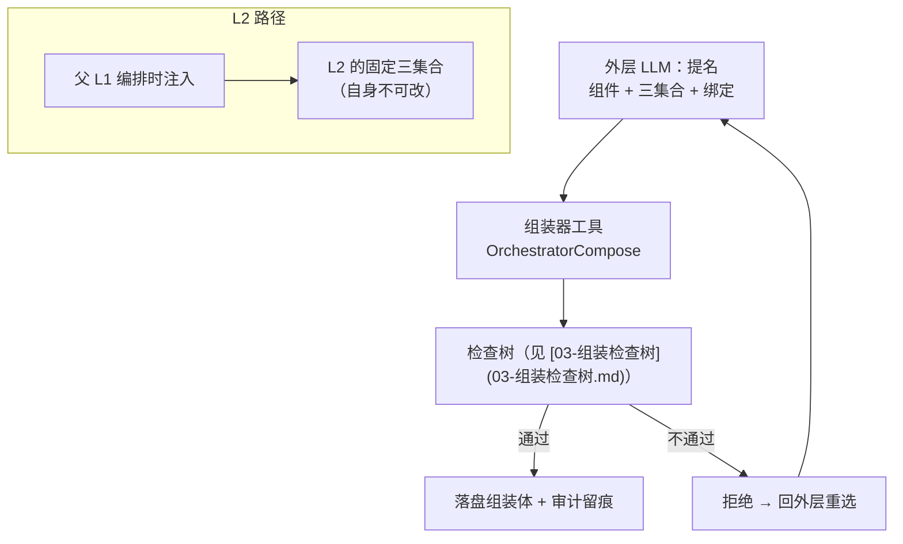

# 组件的三集合：输入集 / 输出集 / 工具集

> **适用范围**：每个执行件（ReAct、P&E 的两半、Workflow 节点、L1 外循环、L2 组件）都必须声明这三集合，
> 它们**都是编排对象**——由外层 LLM 提名、组装器校验、检查树拒绝开环。
> **相关模块**：[02-组装器与算子闭集](02-组装器与算子闭集.md) · [03-组装检查树](03-组装检查树.md) ·
> [05-上下文作用域](05-上下文作用域.md) · [07-分裂与自合并](07-分裂与自合并.md)
> **上级索引**：[00-索引.md](00-索引.md)　|　**状态**：文中「现状 / ❌ / 不存在」各列均为**设计期快照**，不作为当前事实 —— 落地情况一律以 [28-设计实现覆盖清点](28-设计实现覆盖清点.md) 为准（2026-10-15：14 号组件闭集 18 项均有 TS 落点；**生产链路未装配** G4 · **未提交 git**）

---

## 1. 三个集合各是什么（一句话各一）

| 集合 | 管什么 | 一句话 |
|---|---|---|
| **输入集** | **上下文** | 这个组件**看得见什么**（可见上下文的截取范围） |
| **输出集** | **内容交给谁** | 这个组件的产出**投递到哪里 / 给谁用** |
| **工具集** | **它有哪些工具** | 这个组件**被允许调用哪些工具** |

三者合起来就是组件的**接口契约**：看得见什么、能影响谁、能用什么手段。

## 2. 输入集 = 可见上下文范围

**不是**参数列表，而是**上下文截取**：哪些消息 / 上下文分区 / 记忆 / 工作集 / 上游结论对它可见。

**为什么必须编排（不能全给它看）**：

| 全给会怎样 | 后果 |
|---|---|
| 业务工具输出全量进外循环 | 外循环的决策被执行细节淹没；token 白烧 |
| 兄弟组件的中间态互相可见 | **冲突域隔离失效**（§7 分裂要求"工作内容高度隔离"） |
| 下级子代理看到父的全部上下文 | 层级失效、授权范围被隐式放大 |
| 任何组件都能读全量共享上下文 | 数据流无法检查（"输入"这个概念就没了） |

**与 §9「共享上下文」的关系（一处需要修正的表述）**：

> §9 说"组件共享同一份外层上下文"。准确说法应是：**共享的是同一个上下文容器，但每个组件看到的是其「输入集」声明的那个子范围。**
> 否则"输入集"与"共享"两句话会互相抵消。

## 3. 输出集 = 交付去向（谁收）

> `to: 'shared-ctx'` 的**准入、范围、频率、选址**见 [11-共享上下文](11-共享上下文.md)。

**不是** schema 声明，而是**一张去向表**：

```
Outputs = [
  { to: 'outer'        , content: '结论/摘要'  , required: true  },   // 交给外层，作为下一步编排依据
  { to: 'shared-ctx'   , content: '相关文件'    , required: true  },   // 投进共享上下文
  { to: 'peer:<id>'    , content: '协同数据'    , required: false },   // 交给兄弟（同级 L1）
  { to: 'sub:<id>'     , content: '任务下达'    , required: false },   // 交给下级子代理
  { to: 'long-term'    , content: '可沉淀结论'  , required: false },   // 长期记忆
  { to: 'governance'   , content: '审批/审计'   , required: false },   // 治理
]
```

**一条容易被忽略的因果链**：**自合并的判定输入是"在共享上下文里拉取与自己相关的文件"** ——
所以**组件的输出必须先把内容投递到共享上下文**，否则无论工作多相关，都永远发现不了相关性、永远不会触发合并。

## 4. 工具集 = 可见工具（按层与角色收缩）

**例（你给的，也是最典型的）**：**L1 外循环没必要看见 `read` / `write` / `execute` 等业务工具**——
它只做"选组件、改组装"，它的工具集就是编排类工具。

```
实际工具集 = 组件声明的需求 ∩ 角色/层的可见性 ∩ 授予（上层给的收缩集） ∩ 组装合法性
```

**任一环节吃不掉时，必须拒绝组装**，不能静默少给工具（少给会让组件跑不起来或走偏，且没人知道）。

## 5. 规范示例：三层组件的三集合

| 组件 | 输入集（看得见什么） | 输出集（交给谁） | 工具集 |
|---|---|---|---|
| **L1 外循环** | 组装体 · 各组件状态摘要 · Goal · 子代收敛事件 | `outer`（编排依据）· `governance`（变更留痕） | **仅编排类**：`OrchestratorCompose` · `OrchestratorSelect`。**不含** read/write/execute |
| **内层 ReAct（L1）** | 它声明的任务片段 · 上游结论 · 必要工作集 | `outer`（结论）· `shared-ctx`（相关文件）· `long-term` | 业务工具 + `AgentSplit` · `AgentMerge`（**不含** `compose`） |
| **Plan 半** | 任务描述 · 已知资料 · 子代回报 | `outer` · `shared-ctx` | 调查类工具 + `AgentRecruit` + `AgentSplit` |
| **Execute 半** | **`plan` 的 required 输出**（含 `informationState` / `gaps`） | `outer` · `long-term` | 执行类工具（写/改/跑） |
| **L2 组件** | **由父给定**（父不给就看不见） | **由父给定** | **由父给定**（父注入的回调 + 收缩后的工具集） |

## 6. 编排链路：谁定这三集合



**关键规则：提名 ≠ 生效。** 外层 LLM 提名的三集合必须过检查树；过不了就拒绝。

## 7. 三集合之间的相互约束（检查树要查的）

| 约束 | 违反的后果 | 检查 |
|---|---|---|
| 组件的**输出**目标必须存在，且目标的**输入集**包含该输出 | "交出去了但没人看得见" = 开环 | 是 |
| 下游的 **required 输入** 必须被某个上游输出的**输出**覆盖 | 组件启动时缺料 | 是 |
| **工具集** ⊆ 角色可见 ∩ 授予 | 越权 | 是 |
| 外循环的输入集**不得**包含业务上下文（最小必要） | 层规失效、成本失控 | 是 |
| `plan` 的 `informationState` / `gaps` 属 **required 输出** | 资料不全无法被下游读到（§6 完备度门失效） | 是 |

## 8. 需要你确认

1. **输出集的 "to" 目标集合**是否就是 §3 表里那六类（outer / shared-ctx / peer / sub / long-term / governance）？
   我按现有机制归纳（`AgentSplit` 的兄弟、`AgentRecruit` 的下级、`globalWorkspace`、`longTermMemory`、`governanceAudit`），
   若有遗漏（例如"交给时间/事件系统的定时上报"）请补。
2. **输入集的粒度**：是"按上下文分区（`ContextStore` 的 key）挑"还是"按消息类型挑（user/tool/system）"？
   前者更精确、能对齐 §5 的稳定键；后者更粗但简单。我倾向前者。
3. **外循环看不到业务工具**这条，是否也要**反过来**成立——即**内层看不到 `compose`**？
   我在 [02](02-组装器与算子闭集.md) 里判断"compose 仅外层可达"，与你的例子方向一致，请一并确认。
