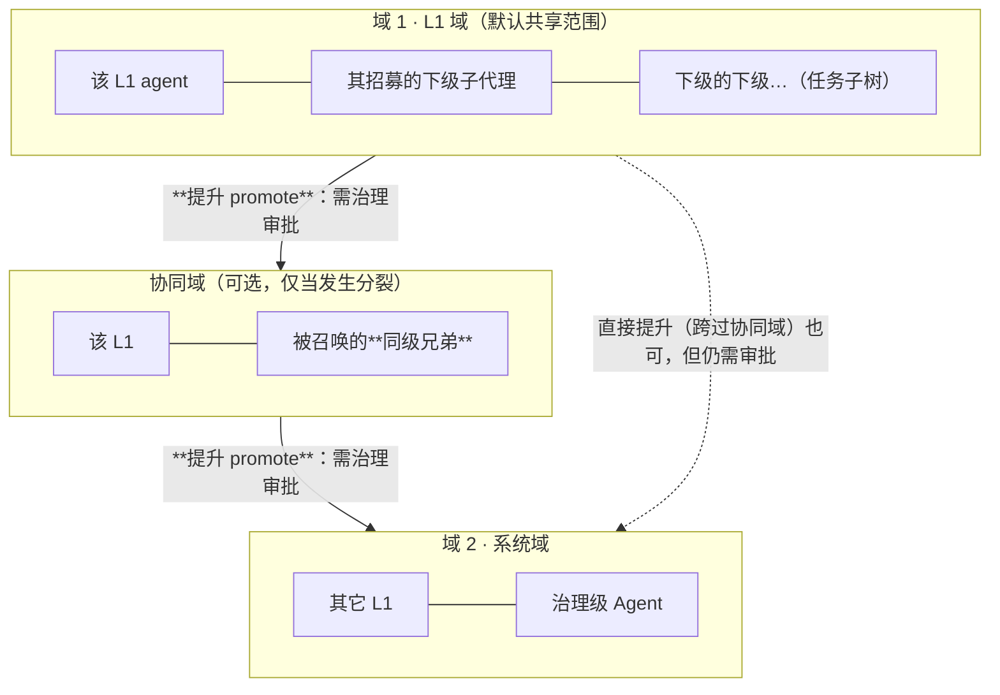

# 共享上下文：共享什么、共享给谁、多久拉、从哪拉

> **适用范围**：多 agent 之间的共享面 —— 两域范围、内容准入、拉取频率、选址与冲突类型。
> **相关模块**：[10-组件的三集合](10-组件的三集合.md)（输出集的 `shared-ctx` 去向落在这里）·
> [05-上下文作用域](05-上下文作用域.md) · [07-分裂与自合并](07-分裂与自合并.md) · [06-父子等待与join](06-父子等待与join.md)
> **上级索引**：[00-索引.md](00-索引.md)　|　**状态**：设计稿（未实现，未提交 git）

---

## 1. 先说结论：共享的是「**坐标**」，不是「**过程**」

冲突的根源只有两个：**可写资源的重叠** 与 **状态变化的不可见**。
所以共享面只装"让彼此不撞车"所需的**坐标信息**，不装"我是怎么想的"。

| 必须进共享（否则会冲突） | **不应**进共享（进了反而制造冲突/污染） |
|---|---|
| **占用声明**：谁正在改哪个文件 / 键 / 任务 | 中间推理与草稿（会被误当结论；体积大、污染决策） |
| **责任边界**：每个 agent 负责哪个**冲突域** | 工具调用原始输出（除必要的文件工作集） |
| **不可变约定**：Goal、红线键、治理规则 | 私域记忆与未验证推断（`inferred` 本就有既有红线禁止入长期记忆） |
| **结论摘要**：已完成部分（避免重复劳动 + 自合并判定输入） | 审批细节等治理内部状态（按层级隔离） |
| **版本/序号**：乐观锁 `expectedVersion` 的依据 | 全量会话消息数组 |

**判据**：一条内容若要进共享，必须能回答"**它防止了什么冲突**"。答不上来的，就不该进。

## 2. 共享范围：两域 + 一条"提升"通道



| 层级 | 谁能看 | 说明 |
|---|---|---|
| **域 1 · L1 域** | 该 L1 及其招募的下级子树 | **默认**。你问的"L1 域内所有 agent 共享"就是这一层 |
| **协同域** | 该 L1 + 它的分裂兄弟 | 只为"自合并判定"而存在；**这是让兄弟能互相发现的最小扩域**，不必一上来就全系统 |
| **域 2 · 系统域** | 跨 L1、跨任务、含治理级 | **必须显式提升** |

**回答你的问题**：**是的，先域内，再（必要时）扩到协同域，最后才是系统域**——而且是**逐级提升**，
不是"要么域内、要么全局"。每次提升都**扩大可见面**，因此**必须走治理并留痕**（谁把什么提升了、依据是什么）。

**分裂兄弟默认不在同一域**（它们是同级、各自独立上下文，见 [05-上下文作用域](05-上下文作用域.md)）——所以它们靠**协同域**协同，而不是天然互见。

## 3. 拉取频率：事件驱动为主，主动拉取只在三个时刻

**先看一条已核实的事实**：检索**有写副作用**——`searchMemories` 会写 `accessCount` / `lastAccessedAt`，
且命中 ≥5 次会触发**自增强**（越常被拉的内容越容易被再拉）。所以"多久拉一次"不是性能问题，**它会改变数据本身**。

| 时机 | 动作 | 理由 |
|---|---|---|
| **默认** | **不轮询**——由"内容被提升 / 占用声明发布"**推**给相关 agent | 与 [06](06-父子等待与join.md) 的"Waiting 靠事件唤醒"一致 |
| 组件启动 | 主动拉**一次**，对齐当前状态 | 入口一次性对齐，避免全程零散拉取 |
| 依赖门放行后 | 主动拉**那次产出** | 只拉刚到达的上游产物（增量） |
| 自合并判定前 | 主动拉**与自己相关**的文件 | 这是裁定④规定的动作，天然是过滤后的 |

**节流**：同一 agent 对同一区域有最小拉取间隔（由预算/配额决定），防止自增强与抖动。
**禁止**：把拉取放进内层 ReAct 的**每一轮**——那是 `O(迭代数 × agent 数)` 的读放大，并且会持续污染 `accessCount`。

## 4. 从哪拉最"高效且最少冲突"

**选址顺序（就近原则）**：

```
① 域内（L1 域）    → 最小、最相关、无跨域授权、冲突面最小
② 协同域（若有）    → 只拉"与我相关"的文件（自合并判定的动作）
③ 系统域           → 优先**只读 + 带版本**；写操作必须版本校验
```

**分区键：按「冲突域」分区，而不是按 agent 或时间**。这一条是效率与冲突面的关键：

| 分区方式 | 拉取命中率 | 冲突面 | 评价 |
|---|---|---|---|
| 按 agent 分区 | 低（要拉所有别的 agent） | 大 | ✗ |
| 按时间分区 | 中 | 大 | ✗ |
| **按冲突域分区** | **高**（"与我相关的" = 我所属的冲突域） | **小**（跨域天然隔离） | ✅ |

因为你裁定④已经把"冲突域"定为分裂的拆分依据，**同一个键**复用到共享分区，天然对齐：
分工边界 = 冲突域边界 = 共享分区边界。于是"拉取与自己相关的"变成一次**分区内查询**，而不是全库过滤。

**增量**：拉取按**版本**取增量（只拉 version 变化的），不重拉全量。

## 5. 三类冲突与对应机制（"不冲突"要可检查）

| 冲突类型 | 例子 | 机制 |
|---|---|---|
| **写写冲突** | 两个 agent 同时改同一键/文件 | **占用声明（租约）** + 乐观锁 `expectedVersion` |
| **读旧写新** | 读了过期版本再写 | 版本随读返回；写时校验版本 |
| **语义冲突** | 两者结论互斥，但无直接写冲突 | 自合并请求 / 仲裁（裁定④） |

## 6. ⚠️ 两个已核实的缺陷：它们会让"最少冲突"落空

| 缺陷 | 事实（我在本会话核实） | 影响 |
|---|---|---|
| **乐观锁检出但未拒写** | 版本冲突时 `memory:version_conflict` 事件**会发**，但 `write()` **仍返回 ok**；而 `globalWorkspace.ts:34` 的注释写的是"拒写" | **写写冲突与读旧写新两类冲突的防线实际不生效** ⇒ 共享上下文的安全性建立在一条没生效的锁上 |
| **`afterAgent` 从未被派发** | 挂在它上面的 `checkpointWriter` 是死代码 | 共享上下文里"挂起态/占用声明"**无处落盘** ⇒ 重启后租约消失，两个 agent 可能同时认为同一资源空闲 |

**结论**：共享上下文的设计可以现在定，但**"最少冲突"要成立，必须先修这两条**——
否则我们只是把并发安全写在了文档里。

## 7. 进检查树的判据

1. 组件的输出若声明 `to: 'shared-ctx'`，其内容必须能回答"**防止了什么冲突**"（准入判据，§1）
2. 组件的输入若来自协同域/系统域，必须声明**提升来源**（谁批的）
3. 任何**跨域写**必须带 `expectedVersion`
4. 拉取不得出现在内层每轮（静态可查：拉取调用的位置）

## 8. 需要你确认

1. **"协同域"是否作为一个正式层级**？还是按你说的两级（域内 / 系统域），兄弟直接走系统域？
   我加协同域的理由是：**避免为了兄弟协同而把内容提升到全系统**（最小扩域）。
2. **提升是否需要审批**？（我认为要——它扩大可见面；但你可能认为同任务内的协同不需要审批，只是要留痕。）
3. **占用声明（租约）的粒度**：按"文件/键"还是按"冲突域"？
   按冲突域更省、更稳（域内不细分），但一个域内两人要改同一文件时仍需先内部协调——这取决于你希望协调发生在**跨域**还是**域内**。
