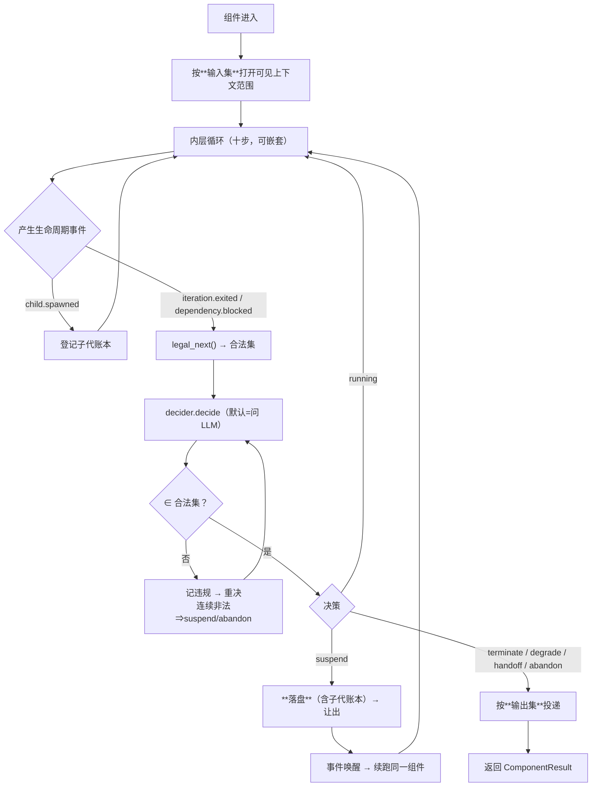

# ReAct 类设计（最小执行件）

> **代码约定**：本文档用 **Python 伪代码**（可读性优先，不追求可执行）；**实现用 TypeScript**。
> **适用范围**：`ReActCore` 的**核心**（§0–§9）—— 数据总表 · 定位 · 三集合 · 生命周期归属 · 依赖 · 内部执行细节 · 状态流 · 默认合法性表 · 可组合性 · 接缝。
> **跨切面约束**（§10–§17：判定/插件/监管可见/双向插入/前缀稳定/会话对话/外部控制/归属表）见 [13-ReAct跨切面约束](13-ReAct跨切面约束.md)。
> **相关模块**：[10-组件的三集合](10-组件的三集合.md) · [08-生命周期回调与动态性](08-生命周期回调与动态性.md) ·
> [02-组装器与算子闭集](02-组装器与算子闭集.md) · [04-递归组合与P&E](04-递归组合与P&E.md) · [06-父子等待与join](06-父子等待与join.md)
> **上级索引**：[00-索引.md](00-索引.md)　|　**状态**：文中「现状 / ❌ / 不存在」各列均为**设计期快照**，不作为当前事实 —— 落地情况一律以 [28-设计实现覆盖清点](28-设计实现覆盖清点.md) 为准（2026-10-15：14 号组件闭集 18 项均有 TS 落点；**生产链路未装配** G4 · **未提交 git**）

---

## 0. 数据总表（**受控清单**：所有可能出现的数据）

> **"所有可能数据"是一个受控清单，不是描述。** 新增一类数据必须同时声明：**方向 · 可见级 · 是否落盘 · 处理规则**，
> 否则检查树拒绝组装 —— 与算子闭集（见 [02-组装器与算子闭集](02-组装器与算子闭集.md) §6）同一原则。当前共 **38 类**。

### 0.1 外部输入（in）—— 14 类

| # | 数据 | 来源 | 可见级 | 落盘 | 处理规则 |
|---|---|---|---|---|---|
| I-01 | 任务片段 / 目标引用 | 外层 / 上级 | 组件 | 是 | 入口绑定；缺失 ⇒ 拒绝进入（不许"自己猜任务"） |
| I-02 | 可见上下文分区内容 | `ContextStore`（按输入集解析） | 组件 | 是 | **只给声明的子范围**；未声明者构造上不可见 |
| I-03 | 历史消息（最近 N 轮） | 外层会话 | 组件 | 是 | 按 `ContextSelector.history` 截取；不重拉 |
| I-04 | 上游产出（Join deps） | 上游组件 / Join 门 | 组件 | 是 | 门放行才可见；不完备 ⇒ 依 `Join.onMissing` block/degrade |
| I-05 | 共享上下文条目 | 域内 / 协同域 / 系统域 | 按域 | 是 | 准入见 [11-共享上下文](11-共享上下文.md) §1；**先域内再外扩**；跨域读带版本 |
| I-06 | 长期记忆召回片段 | 检索 | 组件 | 否 | **检索有写副作用**（accessCount，≥5 自增强）⇒ 受 §10 拉取频率约束 |
| I-07 | 工具目录 / schema | 工具注册表（按工具集收缩） | 组件 | 否 | 只给 `ToolSelector` 声明 ∩ 可见 ∩ 授予 |
| I-08 | 工具执行结果 | 内层 ⑧ | 组件 | 是 | 经 `wrapToolCall` 可被插件改写；改写须留痕 |
| I-09 | 子代回报 | recruit/split 的后代 | 组件 | 是 | 登记进 `outstanding`/`peers`；**不得绕过合法集** |
| I-10 | 监管指令（拦截/降级/冻结） | 前置/后置/懒监管 | 组件 | 是 | **不可协商**：命中即按指定状态收束 |
| I-11 | 治理决议（审批/配额） | 治理层 | 组件 | 是 | 拒绝 ⇒ 不得继续；批准 ⇒ 记录依据 |
| I-12 | 策略与配置（合法集/插件集/预算/deadline） | 组装器 | 组件 | 是 | 组件**只能收紧**，不能放宽 |
| I-13 | 事件（唤醒/超时/预算） | 事件总线 | 组件 | 是 | suspend 靠它唤醒；**不许轮询自旋** |
| I-14 | 环境信号（时钟漂移/DB 不可用/模型错误） | Infra | 组件 | 是（故障必须留痕） | 不得静默吞；按 Diagnosis 上报 |

### 0.2 自己产生（self）—— 14 类

| # | 数据 | 去向 | 可见级 | 落盘 | 处理规则 |
|---|---|---|---|---|---|
| S-01 | 中间推理 / 草稿 | 不投递 | **私有** | 否（仅诊断摘要） | **禁止进共享上下文**（会被误当结论） |
| S-02 | 工具调用请求（名 + 参数） | 内层 ⑧ | 组件 → 监管只读 | 是 | 危险工具触发治理门 |
| S-03 | 工具调用结果（改写后） | 输出集 / 诊断 | 组件 | 是 | 改写留痕 |
| S-04 | 子代召唤请求（split/recruit 参数） | 子代 | 组件 → 监管只读 | 是 | split 每次 1 个；recruit 受 8 上限 |
| S-05 | 子代账本（outstanding / peers） | 内部 | 组件 → **监管只读** | 是 | 决定 exit 合法集（见 [08-生命周期回调与动态性](08-生命周期回调与动态性.md) §7） |
| S-06 | 上下文分区写入（稳定键） | `ContextStore` | 按域 | 是 | 同键原位替换；**不破坏前缀缓存** |
| S-07 | 生命周期决策（状态 + reason） | 内部 / 事件 | 组件 → **监管只读** | 是 | ⚠️ **归属外部控制器**（§16）：ReAct 只**上报**，不决策 |
| S-08 | 违规记录 | 事件 / 审计 | 组件 → 监管 | 是 | **必须留痕**，不得静默 |
| S-09 | 挂起快照 | **交外部控制器落盘** | 组件 → 监管只读 | **是（强制）** | ⚠️ **落在外部**（§16）：ReAct 只封装内容；落盘失败 ⇒ 不许假装已挂起 |
| S-10 | 用量计数（tokens/迭代/工具） | 记账（emit） | 全局 | 是 | 进入成本；**等待期不计** |
| S-11 | 诊断信号（no_progress / context_drift / …） | 监管 | 组件 → 监管 | 是 | 自查结果，供监管取证 |
| S-12 | 计划（steps / informationState / gaps / basis） | 输出集 | 按去向 | 是 | `gaps` 为 **required 输出**（见 [04-递归组合与P&E](04-递归组合与P&E.md) §12） |
| S-13 | 产出物（artifacts / files） | 输出集 | 按去向 | 是 | 文件需租约（见 [11-共享上下文](11-共享上下文.md) §5） |
| S-14 | 致命错误 | 事件 / 监管 | 组件 → 监管 | 是 | 进 `fatalError`；不得伪装成正常退出 |

### 0.3 给别人（out）—— 10 类

| # | 数据 | 去向 | 约束 |
|---|---|---|---|
| O-01 | 结论摘要 | `outer` | 必填（required 输出） |
| O-02 | 相关文件 / 结论摘要 | `shared-ctx` | **准入门槛：能说明"防止了什么冲突"**（[11-共享上下文](11-共享上下文.md) §1）；也是**自合并判定的输入** |
| O-03 | 租约 / 占用声明 | `shared-ctx` | 防止写写冲突；随挂起快照落盘 |
| O-04 | 协同数据 | `peer:<id>` | 仅同级；跨 L1 需提升（[11-共享上下文](11-共享上下文.md) §2） |
| O-05 | 任务下达 | `sub:<id>` | 下级；计入父任务成本 |
| O-06 | 可沉淀结论 | `long-term` | 受断言级别红线（仅 `observed` 可入） |
| O-07 | 审计 / 审批请求 | `governance` | 危险动作必须走 |
| O-08 | **上下文快照 + 工作状态** | **`supervision`** | **监管只读可见**（§12）；组件**无权拒绝** |
| O-09 | 生命周期 / 决策事件 | 事件总线 | 供归因与复盘 |
| O-10 | 计量记录 | 记账 | 与 S-10 对齐 |

### 0.4 处理数据的总纲（8 条，适用于上表每一类）

1. **准入**：外部数据进来先过**输入集**过滤；未声明的构造上不可见
2. **分级**：治理内部数据不向普通组件暴露（L2 尤其）
3. **写侧守卫**：任何对外写入走红线 + 乐观锁 —— ⚠️ **本条当前不成立**：乐观锁**检出未拒写**（[11-共享上下文](11-共享上下文.md) §6）
4. **投递必须声明**：输出集之外的投递**一律禁止**（否则是隐蔽信道）
5. **监管可见**：上下文与工作状态对监管**只读**可见；监管可**拦截/降级**，但**不改组件内部数据**（只留痕）
6. **落盘分级**：挂起快照**强制**落盘；中间推理不落盘（只留诊断摘要）；用量必记账
7. **插件边界**：插件读到的数据受**同一输入集**约束；插件写出的数据**必须走输出集**（否则插件成为绕过检查的后门）
8. **不静默**：任何丢弃 / 降级 / 缺失都要留痕（`gaps` / Diagnosis）

### 0.5 哪些数据**到达 LLM 上下文**（分类见 §14 的前缀稳定性约束）

**"到达 LLM 上下文"是 38 类里**少数**——多数是结构性/元数据，不进消息数组。**
下表**逐条覆盖全部 38 类**（可机检：I-01…I-14 / S-01…S-14 / O-01…O-10）：

| 数据 | 进上下文 | 落在哪个区 | 稳定性等级 |
|---|---|---|---|
| I-01 任务片段 / 目标 | ✅ | 回合段（稳定键） | 原位替换 |
| I-02 可见上下文分区 | ✅ | 回合段（**每个分区一个稳定键**） | 原位替换 |
| I-03 历史消息 | ✅ | 历史区 | **只追加**（压缩是唯一例外） |
| I-04 上游产出 | ⚠️ **部分** | 仅"被引用为输入"的部分 | 原位替换 |
| I-05 共享上下文条目 | ✅ | 回合段（按冲突域分区键） | 原位替换 |
| I-06 长期记忆召回 | ✅ | 回合段（`ctx:memory:retrieval`） | 原位替换 |
| I-07 工具目录 | ✅ | **工具区（在全部 messages 之前）** | **会话内恒定** |
| I-08 / S-03 工具结果 | ✅ | 历史区（tool 消息） | 只追加 |
| I-09 子代回报 | ✅ | 回合段 | 原位替换 |
| I-10 监管指令 | ✅（**必须**） | 回合段 | 原位替换 |
| I-11 治理决议 | ✅ | 回合段 | 原位替换 |
| I-12 策略与配置 | ❌（默认） | — | — |
| I-13 事件 | ❌ 正文；仅**触发**回合段更新 | — | — |
| I-14 环境信号 | ✅ | 回合段 | 原位替换 |
| S-01 中间推理 | ❌ | — | — |
| S-02 工具请求 | ✅ | 历史区（assistant + tool_calls） | 只追加 |
| S-04 召唤请求 | ✅ | 历史区（同上） | 只追加 |
| S-05 子代账本 | ❌ 正文；如需影响决策则写**一条摘要**进回合段 | — | — |
| S-06 上下文分区写入 | ✅（**写入的内容就是回合段**） | 回合段（写入方定稳定键） | 原位替换 |
| S-07 生命周期决策 | ❌（框架用）；**决策理由**在续跑时进回合段 | — | — |
| S-08 违规记录 | ❌ | — | — |
| S-09 挂起快照 | ❌ | — | — |
| S-10 用量 | ⚠️ 仅**预算水位**作为回合段提示 | 回合段 | 原位替换 |
| S-11 诊断信号 | ⚠️ 部分（自查结论） | 回合段 | 原位替换 |
| S-12 计划（含 gaps） | ✅ | 回合段（当前计划 + 当前步） | 原位替换 |
| S-13 产出物 | ⚠️ 部分（摘要/引用） | 回合段 | 原位替换 |
| S-14 致命错误 | ✅ | 回合段 | 原位替换 |
| 组件边界标记 | ✅ | 回合段（`ctx:outer:component-boundary`） | 原位替换 |
| O-01 结论摘要 | ❌（投给 outer，不再回灌） | — | — |
| O-02 相关文件 | ❌ | — | — |
| O-03 租约/占用声明 | ❌ | — | — |
| O-04 协同数据 | ❌ | — | — |
| O-05 任务下达 | ❌ | — | — |
| O-06 可沉淀结论 | ❌ | — | — |
| O-07 审计/审批请求 | ❌ | — | — |
| O-08 上下文快照+工作状态 | ❌（监管只读，不进模型上下文） | — | — |
| O-09 生命周期/决策事件 | ❌ | — | — |
| O-10 计量记录 | ❌ | — | — |

> **O-* 全部不进模型上下文**：它们是**投递/记账/审计**通道，进上下文只会污染决策并随每次变化破坏前缀。

**判定规则**：一类数据进上下文，**iff** 它能改变模型的下一步决策。
进不去的（投递、记账、审计、框架状态）一律留在**结构化通道**，不许塞进消息数组——否则既污染决策，又随每次变化破坏前缀。

## 1. 定位：**ReAct 不实现十步，它包住十步**

```
内层十步（既有 runIteration）  ← ReAct 复用，不重写
ReActCore               ← 本类：三集合 + 生命周期 + 子代账本
```

两个前提（当前**都不满足**，见 §9 接缝）：

1. `runIteration` 必须**可实例化、可嵌套、可重入**（现在是"全局唯一循环"）
2. 必须存在 `CheckpointPort`（现在 `checkpointWriter` 挂在**未派发**的 `afterAgent` 上，是死代码）

## 2. 三集合（见 [10-组件的三集合](10-组件的三集合.md)）

```python
@dataclass
class SharedScope:
    domains: list[Literal["l1", "coop", "system"]]     # 可见哪些共享域（见 [11-共享上下文](11-共享上下文.md)）

@dataclass
class ContextSelector:              # 输入集：**看得见什么**
    sections: list[str]             # 可见的上下文分区键（对齐 ContextStore 稳定键）
    history: int | Literal["all"]   # 可见历史：最近 N 轮 / 全部
    shared: SharedScope | None = None

@dataclass
class OutputChannel:                # 输出集：**内容交给谁**
    to: Literal["outer", "shared-ctx", "peer", "sub", "long-term", "governance"]
    content: Literal["summary", "artifacts", "files", "plan", "gaps", "lease"]
    ref: str | None = None          # to ∈ {peer, sub} 时必填目标 id
    required: bool = True

@dataclass
class ToolSelector:                 # 工具集：**它有哪些工具**
    names: list[str]                # 显式声明；默认实现=外层提名
    expand_role_visible: bool = False   # 默认不展开角色全量（最小必要）

@dataclass
class ComponentContract:
    id: str
    kind: Literal["react", "plan&execute", "workflow", "outer-loop"]
    input_set: ContextSelector
    output_set: list[OutputChannel]
    tool_set: ToolSelector
    plugins: list[PluginGrant] = field(default_factory=list)   # 允许哪些插件插进来（见 §11）
```

## 3. 生命周期：**外部控制器**持有合法性与决策（见 [08-生命周期回调与动态性](08-生命周期回调与动态性.md)、16）

> **归属（见 §16）**：合法集与决策**都不属于 ReAct**。合法集分两层——**框架定默认硬边界**、
> **外部控制器收紧为子集**；决策由**外部控制器**做出（默认=问 LLM）；
> 二者的产物作为 ReactInput 的一部分**输入** ReAct。本节描述的是那个控制器的内部语义。

```python
LifecycleState = Literal["running", "suspend", "terminate", "handoff", "degrade", "abandon"]

LifecycleEvent = Literal[
    "component.entered", "iteration.exited", "child.spawned", "child.settled",
    "dependency.blocked", "budget.exhausted", "deadline.reached",
    "goal.satisfied", "goal.unmet",
]

# 决策用 dict 表示判别联合（伪代码约定；实现时用 TS 的判别联合类型）
#   {"next": "running"}
#   {"next": "suspend", "until": "child" | "event", "refs": [...]}
#   {"next": "terminate"}
#   {"next": "handoff", "to": "parent" | "peer", "refs": [...]}
#   {"next": "degrade", "reason": str, "gaps": [Gap]}
#   {"next": "abandon", "reason": str}
Decision = dict

@dataclass
class LifecycleCtx:
    component_id: str
    outstanding: list[str]              # **未收敛子代**（下级 recruit；兄弟是否计入见 §8.3）
    peers: list[str]                    # 同级兄弟（默认不影响 terminate 判定）
    produced: dict[str, Any]            # 已产出（按 output_set 对齐）
    dependency_satisfied: bool
    budget_remaining: int
    deadline_at: float | None = None

class LifecycleLegality(Protocol):      # 框架定默认硬边界；外部控制器收紧后传入
    def legal_next(self, state, event, ctx: LifecycleCtx) -> set[LifecycleState]: ...

class LifecycleDecider(Protocol):       # 组件给：**决策**（默认实现=把合法集交给 LLM 选）
    async def decide(self, event, state, ctx: LifecycleCtx) -> Decision: ...
```

## 4. 依赖（组装器注入；缺能力必须显式失败，不许静默降级）

```python
@dataclass
class ReActDeps:
    inner_loop: Callable[[InnerLoopInput], Awaitable[InnerLoopOutput]]  # 内层十步，可重入
    context_store: ContextStorePort
    build_tool_header: Callable[[str, ToolSelector], list[ToolSpec]]    # 可收缩
    spawn: SpawnPort                     # split（同级）/ recruit（下级）
    checkpoint: CheckpointPort           # **当前缺失**（见 §9）；落盘归属外部控制器（§16）
    deliver: Callable[[OutputChannel, Any], Awaitable[Result[None]]]
    plugin_host: "PluginHost"            # 插件注册/派发（见 §11）

@dataclass
class ComponentResult:
    component_id: str
    state: LifecycleState
    delivered: list[OutputChannel]       # 已投递（上层据此判"输出是否齐"）
    gaps: list[Gap] | None = None
    reason: str | None = None
    usage: Usage = field(default_factory=Usage)   # tokens / iterations
```

## 5. 内部执行细节（**状态归属见 §16**）

> 本节只列 ReAct **自己**要保证的事项；类骨架见 **§16.4**。
> 旧版此处放了一个"自己判生命周期"的骨架，与"状态与控制由外部输入"冲突，**已删除**。

| # | ReAct 内部要保证 | 说明 |
|---|---|---|
| 1 | **O-R-A 次序** | 观察→推理→执行 不可被外部改写（否则不是 ReAct） |
| 2 | **局部一致性** | 一次 step 内，三段之间的数据不被并发破坏 |
| 3 | **记账如实** | tokens / 迭代 / 工具调用如实上报，不自行"省"或"补" |
| 4 | **快照内容封装** | 需要挂起时把"恢复所需数据"打包**交出去**；**落盘由外部控制器做** |
| 5 | **投递顺序** | 产出按 outputSet 顺序投递；**是否投、投给谁**由外部授予 |
| 6 | **上报待决事项** | 把"需要外部拍板的事项"完整回流，不得丢弃、不得自行拍板 |
## 6. 一次运行的状态流



## 7. 默认合法性表（**两层归属**：框架定默认，外部控制器收紧）

> **归属（修正 P0-1，2026-10-15）**：合法集**不是单一 owner**，分两层：
> 1. **框架**定义默认合法表（**硬边界，不可协商**）—— 见下
> 2. **外部控制器**在默认表之上**收紧**出本次运行的合法集（**只能是子集**）
> 3. **组件（ReAct）无权**参与，只接收最终合法集
>
> 此前本节写「框架内置；组件只能收紧」，与 §3/§17 写「外部控制器持有」冲突 —— 现统一为上面三层。

```python
def default_legality(state, event, ctx: LifecycleCtx) -> set[LifecycleState]:
    # 硬边界：任何情形都不含 "success" —— success 只由外层从"全部收敛"推出
    if event == "iteration.exited":
        return {"suspend", "handoff", "abandon"} if ctx.outstanding else {"terminate"}
    if event == "dependency.blocked": return {"suspend", "degrade", "abandon"}
    if event == "deadline.reached":   return {"degrade", "abandon"}
    if event == "budget.exhausted":   return {"suspend", "abandon"}
    if event == "goal.unmet":         return {"running", "suspend", "degrade"}
    if event == "child.settled":      return {"running", "terminate", "degrade"}
    return {"running"}
```

## 8. 可组合性（本类即"最小执行件"）

```python
Executable = Protocol(lambda self, scope: Awaitable[Result[ComponentResult]])

def seq(*stages: Executable) -> Executable: ...            # 顺序
def join_gate(spec: JoinSpec, nxt: Executable) -> Executable: ...  # join 门（见 [04-递归组合与P&E](04-递归组合与P&E.md) §11.4）

def plan_and_execute(plan: Executable, execute: Executable, join: JoinSpec) -> Executable:
    return seq(plan, join_gate(join, execute))              # P&E = 两个 ReAct + 一个门

def workflow_node(body: Executable) -> Executable:
    return body                                            # 节点体=任意执行件（递归）
```

**`ReActCore` 不特判自己是否嵌套** —— 嵌套由组装器用 `Executable` 组合出来。
这正是"节点体内可插 ReAct / P&E / Goal"能成立的原因。

## 9. 与既有零件的接缝

| 本类需要 | 既有零件 | 现状 |
|---|---|---|
| 内层十步、可重入 | `Src/Core/Loop/runIteration.ts` | ⚠️ 存在但**视作全局唯一循环** |
| 可见上下文范围 | `Services/Context/contextStore.ts` | ✅ 稳定键机制可用 |
| 工具头部可收缩 | `buildToolHeader(role)` | ⚠️ 现在按角色全量 |
| 子代：分裂 / 招募 | `AgentSplit`（**未实现**）/ `AgentRecruit`（在） | ⚠️ 分裂不存在 |
| 挂起落盘 | `checkpointWriter`（挂 `afterAgent`） | ❌ **死代码** |
| 输出投递 | `globalWorkspace` / `longTermMemory` / 事件总线 | ⚠️ 有，但**乐观锁检出未拒写**（见 [11-共享上下文](11-共享上下文.md) §6） |
| 合法性 | 无 | ❌ 需新建 |

