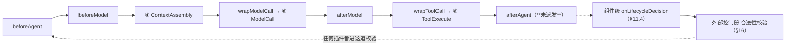
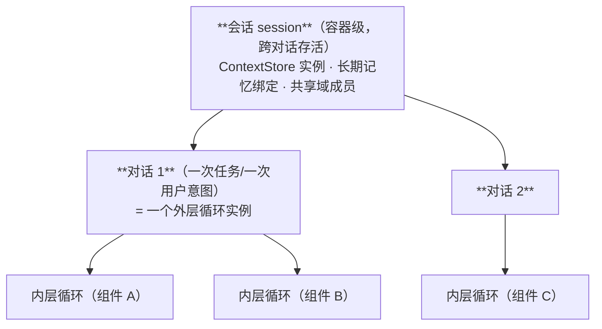

# ReAct 跨切面约束（§10–§17）

> **适用范围**：从 [12-ReAct类设计](12-ReAct类设计.md) 拆出的跨切面部分 —— 三条判定 · 插件插入 · 监管可见性 · 双向可插入 · 前缀稳定 · 会话/对话继承 · 状态与控制由外部输入 · 归属对照表。
> **节号说明**：为**不打断** 12 里已建立的全部 §N 交叉引用，本文件**保留原节号**（从 §10 起）。
> **相关模块**：[12-ReAct类设计](12-ReAct类设计.md) · [03-组装检查树](03-组装检查树.md) · [11-共享上下文](11-共享上下文.md)
> **上级索引**：[00-索引.md](00-索引.md)　|　**状态**：设计稿（未实现，未提交 git）

---
## 10. 三条判定：**已定**（统一解法见 §17.1）

1. **decider 默认 = 问 LLM，但只在「需判断类」事件上问**：
   机械事件（如 child.spawned）由外部按规则处理，**不问 LLM**；
   需判断事件（iteration.exited / dependency.blocked / goal.* …）才问，且：
   · 只把**合法集内**的选项给模型（不给非法选项 ⇒ 无效输出大幅减少）；
   · 缓存键 = (event, state, ctx 指纹)，相同则复用上次决策；
   · 传给模型的是**渲染后的状态说明**，不是状态机枚举。
   ⇒ 需要一个 PromptPort（渲染 + 询问）与一个决策缓存。
2. **既有 ⑩ 与组件级判定：不是二选一，而是分两层**：
   · 内层「是否继续迭代」→ **留在 ReAct**（它是 O-R-A 的终止条件；交出去 = 每轮一次跨边界往返，成本爆炸）；
   · **每轮干预** → 走**插件链**（Grants.plugins，同进程同步生效，无需跨边界）；
   · **状态转移**（suspend/terminate/…）→ **组件边界**交外部控制器。
3. **兄弟不计入组件账本，但进「域账本」**：
   · **组件级**（能否 terminate）只看**下级**（join 语义）；兄弟不影响 —— 父做完自己那份就走；
   · **域级**（这个 L1 的任务算不算完成）由**外层**持有，必须等所有兄弟（含自己）收敛；
   · 兄弟还须**上报到共享上下文**，供自合并判定。

## 11. 插件插入（中间件）—— 补上一版漏掉的维度

**插入点就是既有的 6 个中间件钩子**（经 `registerMiddleware` / `registerMiddlewares` 注册）：

```
beforeAgent · beforeModel · wrapModelCall · wrapToolCall · afterModel · afterAgent
```

ReAct 类**不发明新机制**，只做三件事：

1. **驱动它们** —— 尤其 `afterAgent`：内层循环**从未派发**它，挂在它上面的插件是死代码（本仓既有缺陷）
2. **按组件契约收缩** —— 哪些插件允许插进这个组件
3. **与生命周期合法性对齐** —— 插件不得绕过合法集

### 11.1 契约与依赖都要带插件

```python
HookName = Literal["beforeAgent", "beforeModel", "wrapModelCall",
                   "wrapToolCall", "afterModel", "afterAgent"]

@dataclass
class PluginGrant:                    # 与工具集同构：声明 ∩ 授权 ∩ 合法性
    id: str
    hooks: list[HookName]             # 只允许插在这些钩子上
    conflict_domain: str              # 互斥域：同域插件不得同时生效
    order: int = 100                  # 前置/后置链的次序；wrap 类为洋葱层序

@dataclass
class ComponentContract:
    # …（三集合见 §2）
    plugins: list[PluginGrant] = field(default_factory=list)

@dataclass
class ReActDeps:
    # …（见 §4）
    plugin_host: PluginHost           # 注册/卸载 + 按层派发
```

### 11.2 三种钩子语义不同，"插入"的含义也不同

| 钩子 | 语义 | 能否改变控制 |
|---|---|---|
| `beforeAgent` / `beforeModel` | **前置链**（按序） | ✅ 可**短路**（既有能力：`shortCircuited` → 退出） |
| `wrapModelCall` / `wrapToolCall` | **洋葱包裹** | ✅ 可改输入 / 输出 |
| `afterModel` / `afterAgent` | **后置链** | ❌ 只观察与记录（**`afterAgent` 目前从未派发**） |

### 11.3 插件**不得绕过合法性**（最要紧的一条）

插件短路退出时，它请求的下一状态**必须走同一个合法性校验**：

```
插件短路 → 请求 {"next": X}
        → **外部控制器**的同一套合法性校验（§16）
        → X ∉ legal_next(state, event, ctx) ⇒ 拒绝 + 记违规
```

尤其是：**任何插件都不得让组件在"有未收敛子代"时 `terminate` / `success`。**
否则"插一个插件就能假成功"，§7 的合法性表立刻形同虚设。

### 11.4 组件级需要补一个观察点

既有 6 个钩子都在**内层十步内部**，看不到**组件级生命周期决策**。因此补：

```python
# 决策前后各调用一次
onLifecycleDecision(event, state, legal_set, ctx) -> None | Preference
#   允许：观察、记录、对**合法集内**的选项给出偏好
#   禁止：**扩大合法集**、直接写状态
```

### 11.5 插入与"模式互相插入"的关系（你最初的那句）

插件的价值正是让**模式之间可互相插入**：
ReAct 内层装"计划推进"插件就是 P&E 的一半；装"节点门禁"插件就是 Workflow 的一个节点；
装"目标校验"插件就是 Goal 约束。**模式 = 组件 + 插件组合**，而不是新的硬编码分支。

### 11.6 L2：插件集由父给定

L2 组件拿到的是**定好的插件集 + 定好的合法集**，自身不可改 —— 与"L2 不可编排"一致。

### 11.7 检查树新增判据

> 判据与反例的**归口处**：[03-组装检查树](03-组装检查树.md)（每条判据都配"造出来必须被拒"的反例）。

1. 组件声明的插件必须在册，且钩子 ∈ `PluginGrant.hooks`
2. **同 `conflict_domain` 的插件不得同时启用**
3. 不允许注册"**能返回 success**"的钩子处理器（静态可查）
4. 若有插件使用 `afterAgent`，则**内层循环必须真的派发它**——否则插件是死代码（本仓已有此缺陷）

### 11.8 插件围绕十步的插入位置



## 12. 监管可见性：上下文与工作状态对监管**只读可见**

### 12.1 为什么必须（不是可选）

监管层要在**不打断**组件的前提下判断"这个组件是不是在跑偏"，它需要看到两样东西：

| 监管要看 | 数据（对应 §0） | 读取方式 |
|---|---|---|
| **上下文** | I-02/I-03/I-05 的**当前可见范围**（不是全量） | 只读快照，经输出通道 O-08 |
| **工作状态** | S-05 子代账本 · S-07 生命周期决策 · S-11 诊断信号 · S-02/S-04 工具与召唤请求 | 事件流 + 只读状态查询 |

**关键**：监管看到的是**组件当前输入集范围内的上下文**，而**不是**它的私有推理（S-01）。
监管需要能**复现判断**，不需要**窥探草稿**——后者会让监管变成另一种污染源。

### 12.2 三类监管动作与权限边界

| 动作 | 允许 | 说明 |
|---|---|---|
| **观察** | ✅ 读上下文快照 + 工作状态 | 只读；不产生副作用 |
| **干预** | ✅ 拦截（前置）/ 降级（后置）/ 冻结 | 结果**经合法集收束**（见 [08-生命周期回调与动态性](08-生命周期回调与动态性.md) §7） |
| **改写** | ❌ 修改组件内部数据 / 私有推理 | 只能**留痕并要求组件重决**，不能替它写 |

既有接缝：前置 / 后置 / 懒监管三处（内层十步的 ②⑤⑨），加**冻结**机制。
新增的是 **O-08 通道**：把"上下文快照 + 工作状态"作为**常态化只读输出**，而不是只在异常时导出。

### 12.3 与既有两个缺陷的关系

| 需要 | 现状 |
|---|---|
| 工作状态可被读取 | ⚠️ 有诊断快照（`agentRegistry`），但**组件级状态（子代账本/决策历史）无落点** |
| 快照可跨重启复查 | ❌ `afterAgent` 未派发 ⇒ 快照无处落盘 |
| 监管判断可归因 | ⚠️ 事件总线在，但**生命周期决策事件**是本设计新增的 |

## 13. 双向可插入：ReAct **插入别人** 与 **被别人插入**

你要的两向都要成立，且约束不同：

```
方向 A（ReAct 作为子件被插入别的范式）  —— 它是"内容"
方向 B（ReAct 作为插件插入别的 agent）  —— 它是"修饰"
```

| 方向 | 形态 | 约束 |
|---|---|---|
| **A · 被插入** | 作为 `Executable` 出现在 P&E / Workflow 的节点体里（见 [04-递归组合与P&E](04-递归组合与P&E.md)/§8） | 三集合由**外层编排时给定**；它**不感知自己在嵌套里**；输入集**不得**默认继承父的全量上下文 |
| **B · 插入** | 作为 `PluginGrant` 挂到别的组件/agent 的钩子上（见 §11） | 只能挂 `hooks` 声明的钩子；**同 `conflict_domain` 互斥**；**不得绕过合法集**；读到的数据受该组件输入集约束 |

### 13.1 两向共用的三条铁律

1. **不越合法集**：无论作为内容还是修饰，都不能使宿主做出非法状态转移
2. **不越可见面**：插入别的 agent 时，**不能借宿主看到宿主自己看不到的东西**
   （否则"插入"成了提权路径）
3. **可归因**：插入关系必须可查（谁在谁的哪个钩子上；谁嵌套在谁的哪个节点里）

### 13.2 这一条给检查树加的判据

> 判据与反例的**归口处**：[03-组装检查树](03-组装检查树.md)（每条判据都配"造出来必须被拒"的反例）。

| 判据 | 违反的后果 |
|---|---|
| 方向 A：子件的**输入集不得等于宿主的全集**（必须显式声明子范围） | 嵌套退化为"看全部"，冲突域隔离失效 |
| 方向 B：插件的可见面 ⊆ 宿主输入集 | 借宿主提权 |
| 双向：插入图**无环**（A 插 B、B 又插 A） | 递归死锁 / 无限修饰 |
| 双向：插入关系必须记入组装体（可查） | 无法归因 |

### 13.3 一个必须承认的复杂度

**方向 B 一旦允许，组的就不是"组件图"，而是"组件 × 插件 × 嵌套"的三维结构。**
这会显著抬高检查树的成本（要判环、判可见面包含、判互斥域）。
**我的建议**：先只支持**方向 A**（被插入），方向 B 限制在**同一 L1 域内、且插件集静态声明**——
即"动态编排的是组件图，插件集在组装时定死"。这样既满足"模式可互插"，又不会让检查树在三维上爆炸。

## 14. 前缀稳定性：进上下文的数据必须**位置稳定**

### 14.1 消息数组的三区布局（既有机制：三区分离 + 头部冻结）

```
[系统提示 · 静态段]        会话内**字节恒定**        角色段 / 系统资产段
[工具区 tools 数组]        会话内**字节恒定**        ← I-07：只放热工具 + 元工具（约 10 个）
── 以下为 messages ──
[system · 回合段]          稳定键 → **原位替换**     ← I-01/02/05/06/09/10/11/14 · S-12 · 边界标记 · 诊断
[历史区]                   **只追加**（压缩例外）    ← I-03 · S-02/S-03/S-04
[尾部 appended 段]         追加末尾                  ← ContextStore.toAppendMessages()
```

### 14.2 一条容易说错的精确关系

**原位替换保护的是"该键之前"的前缀，不是它之后。**

因此有一条**排序原则**：

> **回合段按「变更频率升序」排列** —— 越稳定的键越靠前，越易变的越靠后。
> 这样每次变化只让"它之后"的部分失效，命中前缀长度最大化。

（把最易变的分区放最前面，等于每次改动都让整个回合段失效。）

### 14.3 四条硬规则

| # | 规则 | 违反的后果 |
|---|---|---|
| 1 | 进上下文的每条数据**必须有稳定键**（同键原位替换 / 只追加） | 中间插入或删除 ⇒ 从该点起前缀全失效 |
| 2 | **工具区会话内恒定**（只放热工具 + 元工具，其余靠 `tool.search`/`tool.execute`） | 工具在 messages **之前**，一变则**全部**前缀失效 |
| 3 | **压缩**是唯一允许"重写前缀"的操作，且必须：超阈值才触发 → 一次性重写 → 立刻重新稳定 → **压缩后重锚目标**（既有机制） | 频繁压缩 = 前缀永远不命中 |
| 4 | **组件切换不得重置上下文**（见 [05-上下文作用域](05-上下文作用域.md) §9.2），只写边界标记（稳定键） | 每换一个组件重建上下文 ⇒ 前缀归零 + 模型丢失前序结论 |

### 14.4 "react 内" 与 "单个 agent 内" 是两个不同的稳定域

| 稳定域 | 含义 | 谁在破坏它 |
|---|---|---|
| **react 内** | 一次组件运行内部，逐轮之间前缀稳定 | 每轮重拉检索/共享内容（会改内容）、每轮改工具集 |
| **单个 agent 内** | 同一 L1 的**所有组件之间**前缀链保持 | 组件切换时重置上下文、组件各自一套工具目录、外层擅自改静态段 |

**由此推出两条组件级约束**：

1. **同一 agent 内所有组件的工具区必须一致**（否则组件切换即前缀归零）——
   若某组件确实要不同工具，只能放进**回合段**（作为"可用工具提示"），不能动工具区
2. **外层不得改静态段**；外层能改的只有回合段里的稳定键

### 14.5 检查树新增判据

> 判据与反例的**归口处**：[03-组装检查树](03-组装检查树.md)（每条判据都配"造出来必须被拒"的反例）。

| 判据 | 违反的后果 |
|---|---|
| 进上下文的每条数据都声明了稳定键（或"只追加"） | 随机破坏前缀 |
| 同一 agent 内各组件声明的**工具区一致** | 组件切换使前缀失效 |
| 易变分区排在稳定分区**之后**（按变更频率升序） | 命中前缀被最小化 |
| 拉取类（I-05/I-06）**不在每轮**发生 | 内容每轮变 → 回合段每轮失效 |

### 14.6 与既有实现的对齐情况（已核实）

| 机制 | 现状 |
|---|---|
| 三区分离（静态段/工具目录/回合段） | ✅ 既有（`buildStableSystemPrompt`） |
| 头部冻结（工具放所有 messages 之前，只放热工具） | ✅ 既有（2026-10-03 的头部冻结） |
| 稳定键原位替换（`ContextStore.put`） | ✅ 既有（同键同内容跳过 / 不同则原位替换） |
| 组件级边界标记 | ❌ 本设计新增（`ctx:outer:component-boundary`） |
| 组件切换不重置上下文 | ⚠️ 需实现（取决于`runIteration`可重入化） |

## 15. 会话 / 对话 / 内层循环：三层时间尺度下的上下文继承

前面 §0.5/§14 只覆盖了"一次组件运行内"的前缀稳定。**跨对话**是另一回事——**尺度不同，继承规则不同**。

### 15.1 三层尺度（必须先分清，否则"继承"无从谈起）



| 尺度 | 生命周期 | 承载什么 |
|---|---|---|
| **会话** | 跨对话 | `ContextStore` 实例 · 长期记忆绑定 · 共享域成员 · 会话级偏好 |
| **对话** | 一次任务/意图 | **一个外层循环** · 它的 Goal · 计划 · 子代账本 |
| **内层循环** | 一次组件运行 | 局部工作集 · 迭代计数（组件私有） |

### 15.2 继承规则：**复用恒定前缀 + 恢复结构化状态 + 只带结论摘要**

**关键判断：不要把上一对话的消息数组带进新对话。** 那会同时造成三件事：

1. 前缀**必然**与上一对话不同 ⇒ 缓存归零
2. 旧任务内容**污染**新任务
3. token 无谓膨胀

正确的继承分三类：

| 类别 | 是否继承 | 方式 | 为什么 |
|---|---|---|---|
| **恒定区**（系统提示静态段 + 工具区） | ✅ **必须，字节不变** | 会话级复用 | 它是**契约**；不变则新对话第 1 次调用**即命中缓存** |
| **会话级回合段**（偏好 / 工作目录 / 账号设置） | ✅ | 稳定键**原位替换** | 跨对话保留，但内容变化只影响"该键之后" |
| **对话级回合段**（Goal / 计划 / 子代账本） | ❌ | **新对话重新建立** | 它们是**对话私有**的 |
| **历史消息** | ❌（同任务续轮除外，见 §15.4） | — | 带过来 = 前缀全变 |
| **长期记忆** | ✅ 按需 | **pull**（检索，受 §10 频率约束） | 全局知识，不属于任何单次对话 |
| **共享上下文域成员** | ✅ | 会话/域级绑定 | 成员关系跨对话 |

**结论一句话**：**继承 = 恒定前缀复用 + 结构化状态从持久层恢复 + 只带一条结论摘要（稳定键），绝不复制消息数组。**

### 15.3 谁编排：**恒定与契约用 push，易变与任务用 pull**

| 数据 | 方式 | 谁 | 理由 |
|---|---|---|---|
| 恒定区（静态段 / 工具区） | **push** | 组合根 / 外层 | 必须**所有组件、所有对话一致**；若各自 pull，前缀必然不一致 |
| 会话级回合段 | **push** | 外层 | 同上，属于会话契约 |
| 上游产出（Join deps） | **push**（门放行时） | 外层 / Join 门 | 有明确的到达事件 |
| 共享上下文条目 | **pull** | 组件（按输入集） | 按需、按冲突域分区 |
| 长期记忆召回 | **pull** | 组件 | 按需；且**有写副作用**，必须限频 |
| 计划 / Goal / 账本 | **push**（对话级建立） | 外层 | 对话私有，随对话重建 |

> **分工原则**：**恒定与契约用 push（保证一致），易变与任务相关用 pull（保证按需）。**
> 二者混用的典型错误：让组件自己 pull 恒定区 —— 于是不同组件的系统前缀不同，**同一 agent 内的前缀稳定直接失效**。

### 15.4 "对话"的划分本身就是设计决策

这是全篇最容易被忽略的一点：**用户追问 ≠ 新对话**。

| 情形 | 判定 | 上下文行为 |
|---|---|---|
| 用户**追问**（同一任务） | **同一个外层循环的延续** | 接续历史（**不重建**），只在历史区追加 |
| 用户**新任务** | **新对话** | §15.2 的继承规则：复用恒定前缀、隔离历史、带结论摘要 |
| 系统**自分裂**出的同级 | 独立对话（各自外层循环） | 各自独立；经协同域协同（见 [07-分裂与自合并](07-分裂与自合并.md)/11） |

若把"追问"也当成新对话，**每次追问都会让前缀归零** —— 这正是"怎么保证前缀稳定"这个问题的真正来源。

### 15.5 跨对话的前缀稳定：四条

| # | 规则 | 违反的后果 |
|---|---|---|
| 1 | **恒定区在会话内字节不变**（可哈希比对） | 新对话第一次调用就 miss |
| 2 | **跨对话继承的稳定键保持同名同序** | 对话框切换变成"重建"而非"原位替换" |
| 3 | **禁止拼接上一对话的 messages** | 前缀必然不同 |
| 4 | 对话边界写**边界键**（`ctx:dialogue:boundary`），**不清空 ContextStore** | 清空 = 恒定区也被丢 ⇒ 下一对话完全冷启动 |

**那么对话切换时命中前缀是多少？**

```
命中前缀 = 系统提示静态段 + 工具区 + （会话级稳定键之前的回合段）
失效范围 = 仅"对话级键"及其之后
```

—— 这就是"共享恒定区、隔离历史区"的效果：**缓存只损失对话私有的那一小段**。

### 15.6 检查树新增判据

> 判据与反例的**归口处**：[03-组装检查树](03-组装检查树.md)（每条判据都配"造出来必须被拒"的反例）。

| 判据 | 违反的后果 |
|---|---|
| 新对话不携带上一对话的历史消息（同任务续轮除外，须显式标记） | 前缀归零 + 旧任务污染 |
| 恒定区跨对话**哈希一致** | 冷启动 |
| 对话边界写边界键，未清空 ContextStore | 恒定区被丢 |
| 继承的结构化状态来自**持久层**，而非"把上次消息塞回来" | 伪装成继承的污染 |

### 15.7 需要你确认

1. **"同任务续轮"如何识别**？由外层判定（用户意图分类）还是由用户显式选择？
   这决定"接续历史 vs 新对话"，**是前缀能否命中的分水岭**。
2. **会话级回合段放哪些键**？我按"偏好 / 工作目录 / 账号设置"举例，但需要一份**受控清单**
   （否则"谁想放什么就放什么"，跨对话前缀稳定性反而不可控）。
3. **push / pull 的分工是否按 §15.3**？特别是"恒定区必须 push"——若你认为组件也可自取，
   那"同一 agent 内前缀一致"就需要另一套机制来保证。

## 16. 铁律：**状态与控制由外部输入**（ReAct 保留自己的机制，但值来自外部）

### 16.1 一句话

```
ReAct 自己的固定逻辑  = 观察 → 推理 → 执行（O-R-A）
其余一切             = 由外部**输入**：状态 · 控制信息 · 观察 · 授予（工具/插件/可见面/合法集）
```

**注意区分两件事**（我上一版理解偏了）：

- ❌ "ReAct 只有那个循环" —— 不对。它**有**状态、控制、上下文、工具等机制
- ✅ "ReAct 的**状态与控制值来自外部输入**" —— 对。它**不自行决定**，而是**接收并执行**

### 16.2 输入契约（外部 → ReAct）

```python
@dataclass
class ControlInfo:                      # **控制信息**：外部决定
    should_continue: bool               # 是否还要继续下一轮（外部说了算）
    desired_state: LifecycleState       # 期望处于哪个状态（外部给）
    budget_remaining: int
    deadline_at: float | None
    priority: int
    throttle: ThrottleInfo | None       # 限流/退避（外部给）
    mode: str | None                    # 外部指定的子模式（如 "plan" / "execute"）

@dataclass
class Grants:                           # **授予**：外部给的可用范围
    tools: ToolSelector
    plugins: list[PluginGrant]
    visible: ContextSelector
    legality: LifecycleLegality         # 外部在【框架默认表】之上收紧后的合法集（ReAct 不设边界）

@dataclass
class Observation:                      # **观察**：外部组装好再输入
    context_sections: dict[str, str]
    history: list[ChatMessage]
    upstream: dict[str, Any]            # 上游产出（Join 放行的）
    events: list[Event]                 # 到达的事件
    env: EnvSignals | None              # 环境信号

@dataclass
class ReactInput:                       # 一次输入的完整形状
    state: LifecycleState               # ← **当前状态（外部给）**
    control: ControlInfo                # ← **控制信息（外部给）**
    observation: Observation            # ← **观察（外部组装）**
    grants: Grants                      # ← **授予（外部给）**

@dataclass
class ReactOutput:                      # ReAct → 外部
    produced: dict[str, Any]            # 产生的数据（§0 的 S-*）
    events: list[Event]                 # 事件（供外部 / 监管）
    needs_decision: list[str]           # **需要外部决定的事项**（不由自己拍板）
    usage: Usage
    next_observation_hint: list[str] | None
```

### 16.3 什么仍然是 ReAct 自己的

| 属于 ReAct | 说明 |
|---|---|
| **O-R-A 固定顺序** | 观察→推理→执行 的次序与语义不可被外部改写（否则它就不是 ReAct） |
| 内部执行 | 真正去调模型、去执行工具、去记账 |
| **上报** | 把它看到/做了什么、以及"需要外部决定什么"如实上报 |
| 局部一致性 | 一次 step 内的数据不被并发破坏 |

**不属于 ReAct**：状态取值 · 控制决策 · 工具集 · 可见范围 · 合法集 · 是否 suspend/terminate。

### 16.4 修正后的类骨架

```python
class ReActCore:
    """只持有固定的 O-R-A 逻辑；状态与控制从外部输入。"""

    async def step(self, inp: ReactInput) -> Result[ReactOutput]:
        state = inp.state                  # ← 外部给的
        ctrl  = inp.control                # ← 外部给的
        obs   = inp.observation            # ← 外部组装好的
        g     = inp.grants                 # ← 外部授予的

        # ① 观察：直接采用外部组装好的观察（不自行扩大可见面）
        view = obs

        # ② 推理：经**外部给的插件链**调用模型
        #    若插件短路，短路结果当作**外部控制**处理 —— 由外部决定其状态含义
        reason = await self.call_model(view, g.plugins, ctrl, state)

        # ③ 执行：只用 **g.tools** 里的工具；危险动作走外部门禁
        acts = await self.execute(reason.tool_calls, g.tools, ctrl)

        # ④ 上报：把"需要外部决定的事项"交回去，**自己不改状态**
        return Ok(ReactOutput(
            produced=acts.produced,
            events=acts.events,
            needs_decision=acts.needs_decision,   # 例如 ["iteration_exit", "child_spawned"]
            usage=acts.usage,
        ))
```

**循环本身也由外部驱动**（外部持 while；ReAct 一次一个 step）——
这是"控制由外部决定"的最直接体现：**ReAct 没有"我该不该再来一轮"的权力**。

### 16.5 与前面各节的关系（谁归属谁）

| 前文 | 归属修正 |
|---|---|
| §3 `LifecycleLegality` / `LifecycleDecider` | **属于外部控制器**；其**产物作为 `ReactInput` 的一部分进入** ReAct |
| §5 类主体 | 状态归属以 §16 为准；其内部细节（记账/快照/投递顺序）仍适用 |
| §7 `default_legality` | **框架**定默认硬边界；**外部控制器**收紧为子集；ReAct 无权 |
| §11 插件 | 插件链由外部授予（`Grants.plugins`） |
| §12 监管可见 | 监管读的就是 `ReactOutput.events` + 外部持有的状态（不是窥探 ReAct 内部） |
| §14/§15 前缀稳定 | 由**组装观察的那一方（外部）**负责，ReAct 只按给定的 view 推理 |

**这条修正让 §12 的监管可见性变得自然**：监管不需要"看进 ReAct 内部"——
它读的是 ReAct **上报的**事件与外部自己持有的状态。

### 16.6 检查树新增判据

> 判据与反例的**归口处**：[03-组装检查树](03-组装检查树.md)（每条判据都配"造出来必须被拒"的反例）。

| 判据 | 违反的后果 |
|---|---|
| 组件的控制信息必须**由外部注入**（组件代码里不得自造 state/control） | "外部决定"退化为口号 |
| 工具/插件/可见面只能来自 `Grants`；不得在运行中自增 | 绕过授权 |
| L2 的 `ReactInput` 必须由**父**构造（父不给则 L2 无输入） | L2 隐式自编排 |
| `needs_decision` 的每一项都必须在外部得到处理（不可丢弃） | 组件"自己拍板"或事项被静默吞掉 |

## 17. 归属对照表（自洽性收口：每一项只有一个主人）

> 本文档经过多轮修正，出现过"同一项被两处拥有"。**此表是唯一裁决处**：
> 若某节与下表冲突，**以本表为准**，并应修订该节。

| 项目 | 归属 | 依据 | 一致 |
|---|---|---|---|
| **O-R-A 次序** | **ReAct** | §5 · §16.3 | ✅ |
| 状态取值（当前处于哪个 LifecycleState） | **外部控制器** | §16.2 | ✅ |
| 控制信息（继续/预算/deadline/限流/子模式） | **外部控制器** | §16.2 | ✅ |
| 合法集（哪些转移允许） | **框架定默认硬边界 + 外部控制器收紧为子集**（组件无权） | §3 · §7 · §16.5 | ✅ |
| 状态决策（在合法集内选哪个） | **外部控制器**（默认=问 LLM） | §3 · §16.5 | ✅ |
| 挂起落盘（persist） | **外部控制器** | §5 · §16.5 | ✅ |
| 工具集 | **外部授予**（Grants.tools） | §2 · §16.2 | ✅ |
| 插件集（授予） | **外部授予**（Grants.plugins） | §11 · §16.2 | ✅ |
| 插件派发（真正调用钩子） | **ReAct** | §11 | ✅ |
| 可见上下文组装（Observation） | **外部** | §16.2 | ✅ |
| 前缀稳定 | **外部**（组装观察的那一方） | §14 · §15 · §16.5 | ✅ |
| 监管可见 | 读 ReAct 上报的事件 + **外部持有的状态** | §12 · §16.5 | ✅ |
| 投递**目标**（投给谁） | **外部授予**（outputSet） | §2 · §10 | ✅ |
| 投递**执行**（真的投出去） | **ReAct** | §5 | ✅ |
| 用量**记账** | **ReAct** 记账，**外部**累计与配额 | §0 S-10 · §16.2 | ✅ |
| **子代账本**（下级 join） | **外部独占**（ReAct 既不持有也不查询） | §17.1 | ✅ |
| **域账本**（同级兄弟收敛） | **外层**（组件级不看兄弟） | §17.1 | ✅ |
| **待决事项**（needs_decision） | **引用【事件闭集】− 纯通知类**（不新建枚举） | §17.2 | ✅ |

### 17.1 五个待定项的统一解法（已定，2026-10-15）

**根因**：这几项的纠结都来自同一个错误 —— 把「**产生数据的一方**」当成了「**需要这个判断的一方**」。

**归属判据**：**若没有它就做不出那个判断 → 归做判断的一方**（而不是"谁先碰到它"）。

**三招**：

| 招 | 内容 | 治什么 |
|---|---|---|
| ① **唯一真源** | 谁需要这个判断，谁持有 | 判断依据与判断执行分家 |
| ② **不新增闭集** | 新枚举尽量**引用已有闭集** | 两个清单必然漂移 |
| ③ **分层** | 组件级 / 域级 / 会话级各持各的账本 | 一个账本硬扛三个尺度 |

**逐条结论**：

| 待定项 | 结论 | 依据 |
|---|---|---|
| 子代账本 | **外部独占** —— ReAct 既不持有也不查询 | 合法集由外部算 ⇒ 外部本就有这个输入；ReAct 知道了也不决策 |
| 待决事项 | **引用【事件闭集】− 纯通知类**，不新建枚举 | 招②：避免与 §3 的事件集合漂移 |
| decider 默认 | **问 LLM**，但只在「需判断类」事件上（机械事件按规则） | 成本与动态性的结构性折衷 |
| ⑩ 接缝 | **⑩ 留内层**；每轮干预走**插件链**；状态转移在**组件边界** | 避免每轮跨边界往返 |
| 兄弟 | **不计入组件账本**；进**域账本**（外层持有），并上报共享上下文 | 组件级(join)与域级(收敛)是两个判据 |

### 17.2 为什么"引用事件闭集"能彻底消除漂移

```
需要裁决 ≡ 会改变状态或控制的事件
needs_decision = LifecycleEvent − { component.entered }
```

| 事件 | 需裁决 | 处理方式 |
|---|---|---|
| child.spawned | ✅ 机械 | 外部按规则更新账本（**不问 LLM**） |
| iteration.exited · dependency.blocked · child.settled · budget.exhausted · deadline.reached · goal.satisfied · goal.unmet | ✅ 需判断 | 外部控制器（问 LLM 或按规则） |
| component.entered | ❌ | 纯通知 |

**一个枚举换成一个引用** ⇒ 单一真源，不可能漂移。

### 17.3 本次收尾实际改了什么

| 改动 | 原因 |
|---|---|
| 命名统一 ReActExecutable → ReActCore | 曾两个类名并存 |
| §3 标题与引言改为"外部控制器持有" | 原写"框架给合法性，组件给决策"，与 §16 冲突 |
| **删除 §5 旧骨架**，改写为"内部执行细节"6 条 | 旧骨架把状态与控制写在 ReAct 内部 |
| §0 的 S-07 / S-09 标注"归属外部" | 决策与落盘已不在 ReAct 内部 |
| 新增本表 + 两处待定 | 让"每项只有一个主人"可核对 |

### 17.4 收口状态：**已无待你裁定项**

§10 三条与 §17 两处待定**已全部定下**（统一解法见 §17.1，结论见 §17 表）。
本文档现在**没有悬空的开放问题**；后续若出现新的待定，应加回本小节并标注依据。

