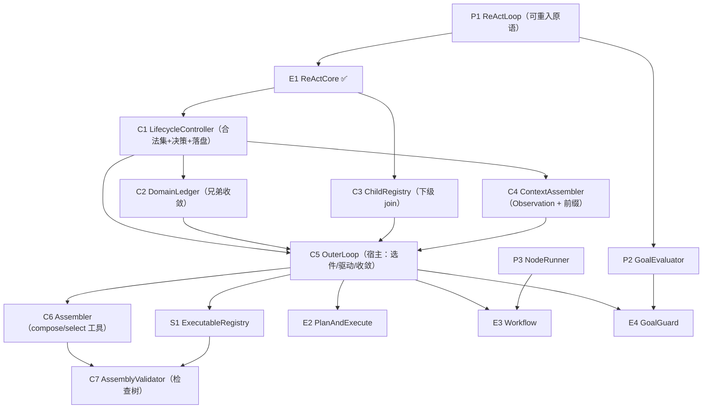

# 核心层组件总表（在执行件之外，还需要什么）

> **记号约定**：本文档中 `§N`（N ≥ 10）指 [13-ReAct跨切面约束](13-ReAct跨切面约束.md) 的节；裸 `§N`（N ≤ 9）指本文档内的节；`03 §6` 指 [03-组装检查树](03-组装检查树.md) 的「判据与反例集」。

> **适用范围**：除 [`ReActCore`](12-ReAct类设计.md) 之外，核心层与基础设施层还需要的组件清单 —— 职责 · 三集合要点 · 归属 · 依赖顺序 · 设计优先级。
> **相关模块**：[12-ReAct类设计](12-ReAct类设计.md) · [13-ReAct跨切面约束](13-ReAct跨切面约束.md) · [03-组装检查树](03-组装检查树.md) · [09-与现状差距](09-与现状差距.md)
> **上级索引**：[00-索引.md](00-索引.md)　|　**状态**：文中「现状 / ❌ / 不存在」各列均为**设计期快照**，不作为当前事实 —— 落地情况一律以 [28-设计实现覆盖清点](28-设计实现覆盖清点.md) 为准（2026-10-15：14 号组件闭集 18 项均有 TS 落点；**生产链路未装配** G4 · **未提交 git**）

---

## 0. 全景：四类组件

按"它是什么"分四类，**不是按文件分**：

```
① 原语（Infra）       —— 不含策略的最小循环/判定：ReActLoop · GoalEvaluator · NodeRunner
② 执行件（Core）      —— 可被组装的执行单元：ReActCore ✅ · PlanAndExecute · Workflow · GoalGuard
③ 控制件（Core）      —— 决定状态与控制的那一方（§16 的"外部控制器"）：OuterLoop · Assembler · LifecycleController · AssemblyValidator
④ 状态件（Core）      —— 各自尺度的账本与上下文：DomainLedger · ChildRegistry · ContextAssembler · ExecutableRegistry
```

**关键**：② 只做固定逻辑（O-R-A / 图推进），③ 持有全部状态与控制（§16 铁律），④ 是 ③ 的判断依据。

## 1. 组件清单

### ① 原语层（Infra）—— 目前住在 Core，需下沉

| # | 组件 | 职责 | 现状 | 优先级 |
|---|---|---|---|---|
| P1 | **`ReActLoop`** | 十步循环（①Input…⑩Decision），**必须可实例化、可嵌套、可重入** | ⚠️ 存在但视作**全局唯一循环**（`Src/Core/Loop/runIteration.ts`） | **P0** |
| P2 | **`GoalEvaluator`** | 目标是否达成 / 重锚判定（纯判定，无策略） | ⚠️ 有 `goalReanchor` 相关件，未抽成原语 | P2 |
| P3 | **`NodeRunner`** | 运行一个节点体（= 任意执行件） | ❌ 不存在 | P4 |

### ② 执行件（Core）

| # | 组件 | 职责 | 三集合要点 | 状态 | 优先级 |
|---|---|---|---|---|---|
| E1 | **`ReActCore`** | O-R-A 固定逻辑；状态与控制全部外部输入 | 见 §2 | ✅ **已设计**（12/13） | — |
| E2 | **`PlanAndExecute`** | 两个 ReAct + 一个 join 门；plan 的完备度门 | 工具集=调查类+执行类；输出集须含 `plan`(`informationState`/`gaps`) | ❌ 待设计 | P5 |
| E3 | **`Workflow`** | 图 + 节点门禁 + `Join`；节点体=任意执行件 | 工具集=节点内所需；输出集=各节点产出 | ❌ 待设计 | P5 |
| E4 | **`GoalGuard`** | **可插任意层**的约束件（终止判据 + 目标函数） | 工具集=空；输入集=Goal+出口判定所需；输出集=`gaps`/终止建议 | ❌ 待设计 | P5 |

### ③ 控制件（Core）—— 状态与控制的真正持有者

| # | 组件 | 职责 | 归属（§16） | 状态 | 优先级 |
|---|---|---|---|---|---|
| C1 | **`LifecycleController`** | 合法集（框架默认 + 收紧）· 决策（默认问 LLM）· **落盘** | 持有状态取值、控制信息、合法集、决策、快照 | ❌ 待设计 | **P1** |
| C2 | **`DomainLedger`** | **域账本**：同级兄弟的收敛情况 | 持有（组件级不看兄弟） | ❌ 待设计 | **P1** |
| C3 | **`ChildRegistry`** | **子代账本**：下级 `recruit` 的未收敛集合（`Join` 依据） | 持有（ReAct 既不持有也不查询） | ❌ 待设计 | **P1** |
| C4 | **`ContextAssembler`** | 组装 `Observation`（可见范围）+ **前缀稳定** | 持有"谁看得见什么"与稳定键布局 | ❌ 待设计 | **P2** |
| C5 | **`OuterLoop`** | L1 外层循环：选执行件 → 构造 `ReactInput` → 收 `needs_decision` → 更新 → 收敛 | **宿主**：持有组装体、对话级状态、域账本、合法集 | ❌ 待设计 | **P3** |
| C6 | **`Assembler`** | `OrchestratorCompose` / `select`（**工具**），变更组装体 | 工具集=改写组装体；输出集→`governance` 留痕 | ❌ 待设计 | P4 |
| C7 | **`AssemblyValidator`** | 执行**检查树**（判据与反例见 03 §6） | 纯判定，无状态 | ❌ 待设计（判据已有） | P4 |

### ④ 状态件 / 注册表（Core）

| # | 组件 | 职责 | 状态 | 优先级 |
|---|---|---|---|---|
| S1 | **`ExecutableRegistry`** | 执行件目录（名字 → 构造器），供 `Assembler` 解析与 `Validator` 判"悬挂引用" | ❌ 待设计 | P4 |
| S2 | **组件级状态快照** | 按 §12 供**监管只读**（上下文快照 + 工作状态） | ⚠️ 有 `agentRegistry` 诊断快照，组件级无落点 | P2 |

## 2. `ReActCore` 的三集合（作为其它执行件的模板）

| 集合 | ReActCore | PlanAndExecute | Workflow | GoalGuard |
|---|---|---|---|---|
| **输入集**（看得见什么） | 声明的任务片段 + 上游产出 + 必要工作集 | plan 半：任务描述+已知资料；execute 半：**plan 的 required 输出** | 当前节点所需 + 前驱产出 | Goal + 出口判定所需（**最小**） |
| **输出集**（交给谁） | `outer` · `shared-ctx` · `long-term` | 同 + `plan`(含 `gaps`) 必须 | 各节点产出按声明 | `gaps` · 终止建议 |
| **工具集**（有哪些工具） | 业务工具 + `AgentSplit`/`AgentMerge`（**不含** `compose`） | 调查类 + 执行类 + `recruit`/`split` | 节点内所需 | **空**（约束件不执行动作） |

**共性**：三集合都**由外层授予**（`Grants`），执行件只声明需求（§16）。

## 3. 依赖顺序（**不能跳序**）



**为什么是这个顺序**：

- **P1 先** —— `ReActCore` 要"包住十步循环"，而循环现在不可重入；不改它，后面全部是空中楼阁
- **C1/C2/C3 次之** —— 它们是 ReAct 的**外部依赖**（合法集、账本）；§16 说"状态与控制外部输入"，没有它们 ReAct 收不到输入
- **C4 再之** —— `Observation` 由外部组装，且**前缀稳定由它负责**（§14/§15）
- **C5 是宿主** —— 把上面串起来，并能驱动 `ReActCore.step`
- **C6/C7 是组装闭环** —— 组装器是工具，检查树负责拒绝（判据见 03 §6）
- **E2/E3/E4 最后** —— 它们是"模式"，由 C5 + C6 组装出来，不是新引擎

## 4. 每个组件都要带的东西（模板）

为保持一致，后续每个组件设计都按同一模板写（与 12/13 相同）：

| 小节 | 内容 |
|---|---|
| 0 | **数据总表**：进/出/内部，含可见级与落盘 |
| 1 | 定位与职责（**一句话 + 不是什么**） |
| 2 | 三集合（输入/输出/工具） |
| 3 | **归属**（状态与控制归谁；本组件是持有者还是执行者） |
| 4 | 依赖端口（缺能力必须显式失败） |
| 5 | **Python 伪代码类骨架** |
| 6 | 一次运行/调度的状态流（mermaid） |
| 7 | 插件插入点（若有） |
| 8 | 对前缀稳定与上下文的影响 |
| 9 | 检查树判据（**指回** 03 §6，不重复列） |
| 10 | **反例**：造什么必须被拒绝 |
| 11 | 与现状差距（核实的） |

## 5. 已核实的现状对账（决定"哪些是新建、哪些是改造"）

| 组件 | 现状 | 结论 |
|---|---|---|
| `ReActLoop` | 存在但在 Core，视作全局唯一循环 | **改造 + 下沉** |
| `AgentRecruit` | ✅ 在（`Src/Tools/Custom/agentRecruiter.ts`，上限 `MAX_LIVE_SUBAGENTS_PER_TRACE = 8`） | 复用 |
| `AgentSplit` | ❌ 不存在（现只有"招募下级"） | **新建** |
| `AgentMerge` | ❌ 不存在 | **新建** |
| `MemoryWrite` | ✅ 本轮新增（工具 + 端口） | 复用 |
| 检索 Core 入口 | ✅ 本轮新增（`memoryRetrievalEntry.ts`） | 复用 |
| `checkpointWriter` | ❌ 挂在**未派发**的 `afterAgent` 上，死代码 | **必须先修**（C1 的落盘依赖它） |
| 乐观锁 | ⚠️ 版本冲突**检出但未拒写** | **必须先修**（C2/C3 与共享上下文的安全性依赖它） |
| `RoutingMode`（6 个固定模式） | ✅ 存在 | 将来降级为**策略预设**（不是新引擎） |
| 组件级状态快照 | ❌ 无落点 | 新建（S2） |

## 6. 建议的推进顺序（我会按这个往下写）

```
第 1 批（地基，必须先做）
  P1 ReActLoop 可重入化          ← 不改它，ReActCore 无法成立
  C1 LifecycleController         ← ReAct 的外部依赖（合法集/决策/落盘）

第 2 批（账本与上下文）
  C3 ChildRegistry · C2 DomainLedger · C4 ContextAssembler

第 3 批（宿主）
  C5 OuterLoop                   ← 把前面串起来

第 4 批（组装闭环）
  C6 Assembler · C7 AssemblyValidator · S1 ExecutableRegistry

第 5 批（模式）
  E2 PlanAndExecute · E3 Workflow · E4 GoalGuard
```

## 7. 需要你确认的两点

1. **顺序是否认可**？我按"依赖不能跳序"排的：**P1（可重入）→ C1（外部控制器）→ 账本/上下文 → C5 宿主 → 组装闭环 → 模式**。
   若你希望先看到某个具体的（比如 Workflow），我可以插队——但**C5 未定之前，E2/E3 只能画个空壳**。
2. **`RoutingMode` 是否按"降级为策略预设"处理**？（我一直在提这条：6 个固定模式是现成的行为基线，迁移时是回归对照，不建议一步删掉。）
