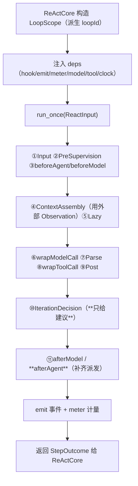

# P1 · `ReActLoop` 原语（可重入化）

> **记号约定**：本文档中 `§N`（N ≥ 10）指 [13-ReAct跨切面约束](13-ReAct跨切面约束.md) 的节；裸 `§N`（N ≤ 9）指本文档内的节；`03 §6` 指 [03-组装检查树](03-组装检查树.md) 的「判据与反例集」。

> **适用范围**：内层十步循环从"**全局唯一循环**"改造为**可实例化、可嵌套、可重入的原语**。
> 这是 [`ReActCore`](12-ReAct类设计.md) 成立的**前提**——不解决它，后面所有组件都是空中楼阁。
> **相关模块**：[14-核心层组件总表](14-核心层组件总表.md) · [12-ReAct类设计](12-ReAct类设计.md) · [13-ReAct跨切面约束](13-ReAct跨切面约束.md) · [09-与现状差距](09-与现状差距.md)
> **上级索引**：[00-索引.md](00-索引.md)　|　**状态**：文中「现状 / ❌ / 不存在」各列均为**设计期快照**，不作为当前事实 —— 落地情况一律以 [28-设计实现覆盖清点](28-设计实现覆盖清点.md) 为准（2026-10-15：14 号组件闭集 18 项均有 TS 落点；**生产链路未装配** G4 · **未提交 git**）

---

## 0.1 ReActLoop 外壳已落地（2026-10-15，已实现）

✅ 已实现于 `Src/Core/Loop/reactLoop.ts`：`createReActLoop(scope, deps)` → `runOnce(state, ctx)` /
`dispose()` / `registerDisposable` / `metrics()` / `scope`。

**默认调用真实 `runIteration`**（不重写十步）；R1–R6 六条契约全部落地并有对应负向测试；
**R3 的派生权在上层**（本原语只校验嵌套 `loopId` 前缀）—— 与 §7 的判据一致。

验收：`Tests/Core/reactLoop.spec.ts` **14 条**（含真实十步集成）+ 3 次变异检验。
清单见 [25-实现顺序与最小落地切分](25-实现顺序与最小落地切分.md) §7.21–§7.22。
## 1. 定位：**原语，不是执行件**

| 是 | 不是 |
|---|---|
| 十步循环的**机制**（①Input…⑩Decision） | 执行件（**不声明三集合**——它不被组装，只被实例化） |
| 被 `ReActCore` **包住** | 被组装器编排 |
| **无策略**：不含目标判定、不含合法性、不含插件选择 | 生命周期决策者（那些在 `LifecycleController`） |

**为什么放到 Infra**：它是"不含策略的最小机制"。你早前说"主循环不该在 Core"，指的就是这一层定位。

## 2. 可重入契约（**六条**，逐条可验）

| # | 契约 | 违反的表现 |
|---|---|---|
| R1 | **零模块级可变状态**：循环运行所需的一切都在实例状态里 | 两个实例互相串状态（并行组件会串味） |
| R2 | **可嵌套**：内层循环可在外层循环的调用栈内运行 | 递归/Workflow 节点无法实现 |
| R3 | **`loopId` 派生**：外层 `L`，其组件 `L/C1`。**派生权只在 `NodeRunner`（外层侧，唯一派生点）**；本原语**只接收** `LoopScope`（不派生、不改） | 两处派生 ⇒ 同一节点两个 loopId ⇒ 中间件归属过滤（P0-2 防跨 Loop 污染）失效 |
| R4 | **事件与 trace 带自身 scope**：每层的 span/事件不串到别层 | 归因错乱（无法回答"这步是哪个组件做的"） |
| R5 | **计量隔离但可汇总**：组件计量归组件，**外层不重复计** | 成本翻倍或漏计（两者都出现过） |
| R6 | **并发安全**：同 agent 内并行组件不共享可变状态（**外部账本除外**） | 数据竞争；账本由外部持有则天然安全 |

## 3. 归属：它是**执行者**，不是持有者

| 项 | 归属 |
|---|---|
| 十步次序 | **本原语**（固定逻辑） |
| 状态取值 / 控制信息 | **外部**（`LifecycleController`，§16） |
| 预算 / deadline | **外部**（随 `ReactInput.control` 传入） |
| 中间件/插件 | **外部授予**；本原语只**派发**（含补齐 `afterAgent`） |
| 事件与计量 | 本原语**产生并上报** |

## 4. 依赖端口（注入；缺能力必须显式失败）

```python
@dataclass
class ReActLoopDeps:
    dispatch_hook: Callable[[HookName, HookCtx, Any], Awaitable[Any]]   # 6 钩子派发（含 afterAgent）
    emit_event:    Callable[[Event], Awaitable[None]]
    meter:         Callable[[UsageDelta], None]                        # 计量上报（外部累计）
    model_port:    ModelPort                                          # 模型调用
    tool_exec:     Callable[[ToolCall], Awaitable[ToolResult]]         # 工具执行（经门禁）
    clock:         Callable[[], float]
```

## 5. 实例形态（Python 伪代码）

```python
@dataclass(frozen=True)
class LoopScope:
    loop_id: str            # 派生：外层 'L'，组件 'L/C1'
    parent_loop_id: str | None
    agent_id: str
    trace_id: str

class ReActLoop:
    """十步循环原语。可实例化、可嵌套、可重入；不含任何策略。"""

    def __init__(self, scope: LoopScope, deps: ReActLoopDeps):
        self.scope = scope
        self.deps = deps
        self._state = LoopState(...)      # **实例私有**（R1：无模块级可变状态）

    async def run_once(self, inp: ReactInput) -> Result[StepOutcome]:
        """跑**一次**完整十步；不自己决定"要不要下一轮"（那是 ReActCore 的事）。"""
        s = self._state
        # ① InputReceived
        # ② PreSupervision      —— 命中即按外部给定状态收束
        # ③ Middleware(beforeAgent / beforeModel)   ← 含短路 → 上报，不自决
        # ④ ContextAssembly     —— 用**外部组装好的** Observation
        # ⑤ LazySupervision
        # ⑥ ModelCall(wrapModelCall)
        # ⑦ OutputParse
        # ⑧ ToolExecute(wrapToolCall)  —— 危险动作经外部门禁
        # ⑨ PostSupervision
        # ⑩ IterationDecision   —— **原语给建议**，最终去留由 ReActCore/外部定
        # ⑪ afterModel / afterAgent   ← afterAgent 必须在此真的派发（本仓既有缺陷）
        return Ok(StepOutcome(...))
```

**关键**：`run_once` 是**一次**十步。循环节奏（要不要再来一轮）在 `ReActCore`，状态转移在 `LifecycleController`——**三层职责不混**。

## 6. 一次调用的状态流



## 7. 实现前必须先做的一件事（**盘点，不是设计**）

> **盘点是 S2 的前置。** ✅ **已于 2026-10-15 完成** —— 结论见 [26-S1模块级可变状态盘点](26-S1模块级可变状态盘点.md)：
> **`runIteration.ts` 的模块级可变状态 = 0**（唯一容器是"值由输入决定 + 有界 + 有 reset"的纯缓存），
> 真正的地雷在 `contextCompression.ts` 的 `_lowGain` / `_metrics`（模块级运行态）⇒ **S2 范围据此收窄**。
>
> 原始任务描述（保留）：**逐行盘点** `Src/Core/Loop/runIteration.ts` 的模块级可变状态（R1 的前置）。

我**没有**逐行审计过这个文件，所以不能声称"它现在就是可重入的"。盘点要输出一张表：

| 形态 | 例子 | 处置 |
|---|---|---|
| 模块级 `let/const` 可变对象 | 计数器、缓存、单例 | 移入实例 |
| 模块级 `Map/Set` | 注册表、待处理表 | 判断是否为**全局注册表**（允许）vs **运行态**（必须移入） |
| 闭包捕获的共享 | 上层 `createLoopState` 返回的对象是否被多处持有 | 每个实例独立 |
| 订阅/定时器 | 订阅在实例结束时要解绑 | 加 `dispose()` |

**判据**：**全局"目录"可以共享**（如工具注册表、中间件注册表）；**运行态一律实例私有**。

## 8. 反例（造什么必须被拒绝/必须暴露）

| # | 反例 | 期望 |
|---|---|---|
| 1 | 两个 `ReActLoop` 实例并行运行，任一实例的状态被对方读到 | 必须**不出现**（R1/R6） |
| 2 | 内层循环的事件被记到外层 scope 上 | 必须**不出现**（R4） |
| 3 | 组件计量被外层重复累计一次 | 必须**不出现**（R5） |
| 4 | 中间件按 `loopId` 过滤时把子循环的事件也吃掉 | 必须**不出现**（R3 派生形式） |
| 5 | 挂 `afterAgent` 的插件在 `run_once` 后**没有**被调用 | 必须**不出现**（本仓当前正是这个缺陷） |
| 6 | 实例结束后订阅/定时器仍存活（泄漏） | 必须**不出现**（需 `dispose`） |

## 9. 检查树判据

判据与反例**归口处**：[03-组装检查树](03-组装检查树.md) §6。与本原语相关的两条：

- 「扫描新增算子/组件必须补规则 + 反例」→ 本原语新增 `run_once` 契约，必须补上面 6 条反例
- 「组件级状态快照」→ 本原语的实例状态**不对外暴露**，只经 `StepOutcome` 上报（监管读上报数据，不窥探内部）

## 10. 与现状差距（核实的）

| 项 | 现状 | 需做 |
|---|---|---|
| 十步循环位置 | `Src/Core/Loop/runIteration.ts` | **下沉到 Infra**（先不动文件位置，先把"可实例化"做出来） |
| `createLoopState({loopId, agentId, traceId, config})` | ✅ 已是显式状态对象 | 复用，但需保证**每实例一份** |
| `recordStep(loopState, '④ ContextAssembly')` | ✅ 已是显式记账 | 复用；需带 scope |
| 中间件派发 | 派发 5 个钩子；**`afterAgent` 从未派发** | **补齐 `afterAgent`** |
| 循环节奏 | 由 `executeLoop` 内部驱动 | 拆出：节奏归 `ReActCore` |
| 模块级可变状态 | **未盘点**（本设计的前置任务） | 盘点是第一步 |
