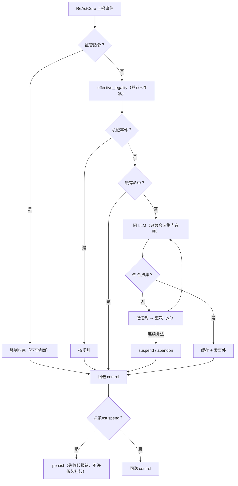

# C1 · `LifecycleController`（外部控制器的落点）

> **记号约定**：本文档中 `§N`（N ≥ 10）指 [13-ReAct跨切面约束](13-ReAct跨切面约束.md) 的节；裸 `§N`（N ≤ 9）指本文档内的节；`03 §6` 指 [03-组装检查树](03-组装检查树.md) 的「判据与反例集」。

> **适用范围**：**单个组件实例**的生命周期责任方 —— 算合法集（框架默认 + 收紧）· 做决策（默认问 LLM）· **落盘** · 发事件 · 强制收束监管指令。
> **它是 [`ReActCore`](12-ReAct类设计.md) 的"外部"**：ReAct 只上报事件，控制器回送 `ReactInput.control`。
> **相关模块**：[14-核心层组件总表](14-核心层组件总表.md) · [12-ReAct类设计](12-ReAct类设计.md) · [13-ReAct跨切面约束](13-ReAct跨切面约束.md) · [08-生命周期回调与动态性](08-生命周期回调与动态性.md)
> **上级索引**：[00-索引.md](00-索引.md)　|　**状态**：设计稿（未实现，未提交 git）

---

## 0. 数据总表（进 / 内部 / 出）

| 方向 | 数据 | 来源/去向 | 落盘 |
|---|---|---|---|
| 进 | 生命周期事件（`iteration.exited` / `child.spawned` / …） | ReActCore 上报 | 是 |
| 进 | 当前状态取值 + 上下文指纹 | 自身维护 | 是 |
| 进 | 预算剩余 / 截止时间 | `OuterLoop` | 是 |
| 进 | **监管指令**（拦截/降级/冻结） | 监管（前置/后置/懒） | 是 |
| 内部 | **框架默认合法表** | 框架（不可改） | 随代码 |
| 内部 | **本次运行的收紧合法集** | 本控制器（**只能是默认集的子集**） | 是 |
| 内部 | 决策缓存 | `(event,state,ctx指纹) → 决策` | 是 |
| 内部 | 违规记录 | 非法决策留痕 | 是 |
| 出 | `ReactInput.control`（`desired_state` / `should_continue` / 预算 / deadline / 限流） | ReActCore | 否（随输入） |
| 出 | 挂起快照 | `CheckpointPort` | **是（强制）** |
| 出 | 决策事件 + 依据 | 事件总线 / 监管 | 是 |
| 出 | 审计留痕（谁/何时/为何） | `governance` | 是 |

## 1. 定位：**持有者，不是执行者**

| 是 | 不是 |
|---|---|
| 状态取值、控制信息、合法集、决策、快照的**唯一持有者** | 执行件（**不声明三集合**） |
| ReAct 的"外部" | 编排者（选执行件是 `OuterLoop` 的事） |
| 会**问 LLM**，但只在"需判断类"事件上 | 每步都问（成本） |

## 2. 合法集的两层归属（P0-1 修完的结论）

```python
def effective_legality(event, state, ctx, grants) -> set[LifecycleState]:
    default_set = DEFAULT_LEGALITY(event, state, ctx)        # 框架定：硬边界
    tightened   = grants.legality(event, state, ctx)          # 外部控制器收紧
    if not tightened.issubset(default_set):
        raise ConfigError('合法集只能收紧，不能放宽')          # 放宽 = 拒绝启动
    return tightened if tightened else default_set
```

**组件无权参与**；控制器**只能收紧**；放宽直接**拒绝启动**（不是警告）。

## 3. 决策算法（机械 / 需判断 分流）

```python
MECHANICAL = {'child.spawned', 'child.settled'}      # 按规则，不问 LLM
NEEDS_JUDGEMENT = {'iteration.exited', 'dependency.blocked',
                   'budget.exhausted', 'deadline.reached',
                   'goal.satisfied', 'goal.unmet'}

async def on_event(event, state, ctx, grants):
    # ① 监管指令优先：命中即强制收束（不可协商）
    if ctx.supervision_verdict:
        return forced(ctx.supervision_verdict)

    legal = effective_legality(event, state, ctx, grants)

    # ② 机械事件：按规则，不问 LLM
    if event in MECHANICAL:
        return rule_based(event, state, ctx)

    # ③ 需判断：缓存 → 问 LLM（只给合法集内选项）
    key = fingerprint(event, state, ctx)
    if key in self._cache:
        return self._cache[key]

    for _ in range(self.MAX_RETRY + 1):                  # 默认 2
        d = await self.ask_llm(render(event, state, ctx, legal))   # 渲染说明，不给枚举
        if d['next'] in legal:
            self._cache[key] = d
            self.emit('lifecycle.decided', {event, state, legal, d})
            return d
        self.record_violation(event, d, legal)           # 非法必须留痕

    # ④ 连续非法：按失败处理，**绝不静默兜底**
    return {'next': 'suspend', 'until': 'child', 'refs': ctx.outstanding} \
        if ctx.outstanding else {'next': 'abandon', 'reason': '生命周期决策连续非法'}
```

**三条硬规则**：① 监管指令优先于一切；② 机械事件不问 LLM；③ 非法决策**记违规 + 重决**，连续非法按失败处理。

## 4. 落盘：**不许假装已挂起**

```python
async def persist_if_suspend(self, decision, snapshot) -> Result[None]:
    if decision['next'] != 'suspend':
        return Ok(None)
    saved = await self.deps.checkpoint.save(snapshot)     # 含：状态/子代账本/决策缓存/违规记录
    if not saved.ok:
        return Err('suspend 需要落盘但 checkpoint 失败: ' + str(saved.error))
    return Ok(None)
```

**判据**：**落盘失败 ⇒ 不允许返回"已挂起"**。否则重启后"挂在哪"无人知道（本仓 `afterAgent` 未派发就是这个后果）。

## 5. 一次事件的流转



## 6. 反例（造什么必须被拒绝 / 必须暴露）

| # | 反例 | 期望 |
|---|---|---|
| 1 | 组件代码里自造 `state` / `control` | 拒绝（§16 铁律） |
| 2 | 收紧后的合法集**超出**框架默认集（放宽） | **拒绝启动**（ConfigError） |
| 3 | LLM 返回非法状态后**未记违规**、或未重决 | 拒绝（必须留痕 + 重决） |
| 4 | 机械事件（`child.spawned`）也去问 LLM | 拒绝（应走规则；否则成本失控） |
| 5 | 落盘失败仍返回"已挂起" | 拒绝（必须报错） |
| 6 | 监管指令被"协商"（未强制收束） | 拒绝（监管优先） |
| 7 | `needs_decision` 中某项被丢弃 | 拒绝（§16.6 判据 4） |
| 8 | 决策缓存键遗漏 `ctx` 指纹（用陈旧决策） | 拒绝（应命中不同键） |

## 7. 检查树判据

归口处：[03-组装检查树](03-组装检查树.md) §6。相关两条：

- 「在"有未收敛子代"时把状态置为 terminate/success」→ 本控制器的 `effective_legality` 负责拒绝
- 「组件自行宣称 success」→ 本控制器**从不产生 success**（success 只由外层"全部收敛"推导）

## 8. 与现状差距（核实的）

| 需要 | 现状 | 需做 |
|---|---|---|
| 合法集（两层） | ❌ 无 | **新建** |
| 决策（机械/需判断分流 + 缓存） | ⚠️ 停止判定是固定的 `StopRuleEvaluator`（非本控制器） | 新建；`StopRuleEvaluator` 可作为**规则来源**之一 |
| 落盘 | ❌ `checkpointWriter` 挂在**未派发**的 `afterAgent` 上（死代码） | **先修派发**，再接本控制器 |
| 违规留痕 | ❌ 无 | 新建（事件 + 审计） |
| 监管指令优先 | ⚠️ 有前置/后置/懒监管，但无"强制收束到指定状态"的通道 | 需补通道 |
| 决策缓存 | ❌ 无 | 新建（否则每步一问，成本失控） |

## 9. 快照分区与账本可见范围（归属复核补，见 [20-归属复核](20-归属复核.md)）

**规则 1 · 快照按 key 空间分区，一个空间一个写者**

| 写者 | key 前缀 | 内容 |
|---|---|---|
| 本控制器（C1） | `ckpt:component:<componentId>` | 状态 / 决策缓存 / 违规记录 |
| `OuterLoop`（C5） | `ckpt:conversation:<dialogueId>` | 组装体 / 域账本 / 对话级状态 |

账本（C2/C3）**不单独落盘**，随 C5 的 conversation 空间 —— 避免三方竞争同一 key。
**判据**：一个 key 空间只有一个写者；跨空间读取允许。

**规则 2 · 本控制器只注入 `ChildRegistry`，不注入 `DomainLedger`**

理由：兄弟（split）**不影响**组件级 `terminate`；若 C1 能读到域账本，
"父不等兄弟"立刻失效 —— 这是"两本账合并"的翻版。
**实现要求**：靠**构造上不可见**（依赖里不给），不靠自觉。
