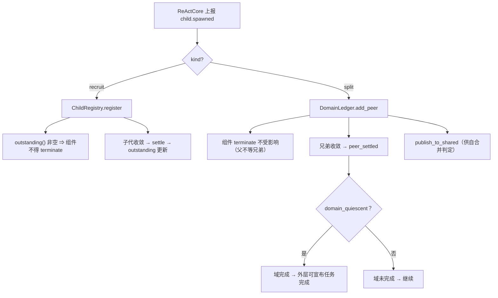
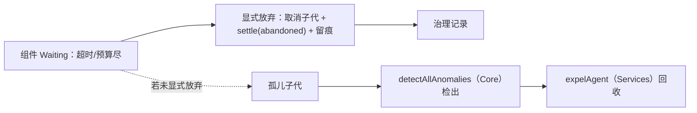

# C2/C3 · 账本：`ChildRegistry`（下级）与 `DomainLedger`（兄弟）

> **记号约定**：本文档中 `§N`（N ≥ 10）指 [13-ReAct跨切面约束](13-ReAct跨切面约束.md) 的节；裸 `§N`（N ≤ 9）指本文档内的节；`03 §6` 指 [03-组装检查树](03-组装检查树.md) 的「判据与反例集」。

> **适用范围**：两个尺度上的收敛账本。**它们是两个不同判据的输入**，不能合成一本。
> **相关模块**：[14-核心层组件总表](14-核心层组件总表.md) · [16-LifecycleController](16-LifecycleController.md) · [06-父子等待与join](06-父子等待与join.md) · [07-分裂与自合并](07-分裂与自合并.md)
> **上级索引**：[00-索引.md](00-索引.md)　|　**状态**：文中「现状 / ❌ / 不存在」各列均为**设计期快照**，不作为当前事实 —— 落地情况一律以 [28-设计实现覆盖清点](28-设计实现覆盖清点.md) 为准（2026-10-15：14 号组件闭集 18 项均有 TS 落点；**生产链路未装配** G4 · **未提交 git**）

---

## 0. 为什么是**两本**（这是本模块存在的理由）

| 账本 | 记什么 | 回答哪个问题 | 影响 |
|---|---|---|---|
| **`ChildRegistry`** | **下级**（`recruit`，从属父的任务树） | 这个**组件**能否 `terminate`？ | `default_legality` 的**输入** |
| **`DomainLedger`** | **同级兄弟**（`split`，同级 L1） | 这个 **L1 域**的任务算不算完成？ | **外层**的收敛判据 |

**合成一本的后果**：父会因为"兄弟还在跑"而不敢结束自己的组件 → 与裁定④的"自合并闭环"（**父不等兄弟**）冲突。

```
下级 recruit → 组件账本（join，父必须等）
同级兄弟 split → 域账本（不等，由自合并闭环收敛）
```

## 0.1 S5 落地状态（2026-10-15，已实现）

✅ 已实现于 `Src/Core/Ledger/ledgers.ts`：`createChildRegistry()` · `createDomainLedger(rootId)` ·
`snapshotLedgers` / `restoreLedgers`。下级上限直接引用 Tools 层的 `MAX_LIVE_SUBAGENTS_PER_TRACE`（**同一常量**）。

**同日补齐兄弟账本链路（本文件的 `merge_requests` 从字段清单变成实物）**：
`requestMerge`（只登记请求，**不改结构**）· `mergeRequests()`（含已裁决的历史）· `withdrawMerge`（提交监管失败时的补偿）·
`resolveMerge`（**唯一**能改动域结构的动作，只能由监管裁决侧调用，必须署名）· `dissolved()`（本域根被 `full` 并入 ⇒ 账本作废、拒绝一切写入）·
`transferChildren`（**归属转换**：先转入后转出，任一步失败都不留半转移，转出侧以 `abandoned` 结算）。
实现口径：**已裁决的历史不能用活体不变量复审** —— 恢复期走 `validateDomainSnapshot` 的**完整性**校验（成员自洽、裁决署名齐备），不自洽即**整体拒绝**，不做半恢复。

**同日补齐"账本属于哪个实例"（2026-10-16 · 28 号 §6 G4 档 1 第 1+2 步）**：两本账是**每个 L1 实例私有**的，而 Tools 层的端口容器是**进程级单例**，所以注入形态改成按身份解析 —— `toolServicePorts.splitMergeFor(agentId)`，解析件在 `Src/Core/Orchestration/l1HostRegistry.ts`（`createL1HostRegistry()` + `createSplitMergePortForHosts()`）。登记期两条硬判据：
**同一身份不得双宿主**（否则写进哪一本取决于装配顺序）、**`rootId` 必须等于 agentId**（工具把 `context.agentId` 当发起端，不相等会让 `requestMerge` 恒被拒 ⇒ 自合并链路静默失效）。恢复沿用 `snapshotLedgers` / `restoreLedgers`，`reopen` 整批校验后整批落位。

验收：`Tests/Core/ledgers.spec.ts` **32 条**（含"兄弟不得计入 outstanding"的集成反例、快照往返与三类不自洽快照）
+ `Tests/Tools/agentSplitMerge.spec.ts` **31 条**（真实账本 + 统一派发入口 + **双宿主各写各域**）
+ `Tests/Core/l1HostRegistry.spec.ts` **12 条**（双宿主拒、rootId 不一致拒、恢复不做半套、close 后解析不到、reopen 后不交陈旧账本）
+ 变异检验 **15 项 + 10 项全杀**。
实现与反例清单见 [25-实现顺序与最小落地切分](25-实现顺序与最小落地切分.md) §7.15；
工具身份与装配缺口见 [28-设计实现覆盖清点](28-设计实现覆盖清点.md) §3（`AgentSplit` / `AgentMerge` 两行）与 §6.1 **D1**（设计未规定兄弟数量上限）· **D4**（端口容器的作用域：`orchestration` 端口仍是共享单例）。

## 1. 归属：**外部独占**（§17 已定）

```
ReAct 既不持有、也不查询账本 —— 合法集本就在外部算，它知道了也不决策
ReAct 只做一件事：上报事件（child.spawned / child.settled）
```

**为什么不让 ReAct 持有**：若它持有，"是否有未收敛子代"就分散在两处，而它正是合法集的输入 —— **判断依据与判断执行分家 = 迟早不一致**。

## 2. `ChildRegistry`：下级（join 语义）

```python
@dataclass
class ChildRecord:
    child_id: str
    kind: Literal['recruit', 'split']     # 只登记 recruit；split 走 DomainLedger
    joined_at: float
    settled_at: float | None = None
    outcome: Literal['success', 'failed', 'timeout', 'abandoned'] | None = None
    deadline_at: float | None = None
    produced_refs: list[str] = field(default_factory=list)

class ChildRegistry:
    """每个组件实例一份；由 LifecycleController / OuterLoop 持有与查询。"""

    def register(self, rec: ChildRecord) -> None: ...
    def settle(self, child_id: str, outcome: str) -> None: ...
    def outstanding(self) -> list[str]:
        """未收敛子代 id —— 直接喂给 default_legality 的判定。"""
        return [c.child_id for c in self._m.values() if c.settled_at is None]
    def quiescent(self) -> bool:
        return not self.outstanding()
    def snapshot(self) -> dict: ...        # 随挂起快照落盘（**强制**）
    def restore(self, snap: dict) -> None: ...
```

**数量约束（复用既有锚点）**：总量上限 `MAX_LIVE_SUBAGENTS_PER_TRACE = 8`
（已核实：强制在 `Src/Tools/Custom/agentRecruiter.ts`，**工具层**）。账本据此拒绝登记第 9 个。

## 3. `DomainLedger`：同级兄弟（合并语义）

```python
@dataclass
class DomainRecord:
    l1_id: str                 # 本域根 L1
    self_state: Literal['running', 'waiting', 'done']
    peers: dict[str, str]      # peer_id → state
    merge_requests: list[str]  # 已向监管发起的合并请求（裁定④）
    conflict_domains: dict[str, str]   # peer_id → 它负责的冲突域

class DomainLedger:
    """**外层**持有（不是组件）。ReAct 级的 terminate 判定不看它。"""

    def add_peer(self, peer_id: str, conflict_domain: str) -> None: ...
    def peer_settled(self, peer_id: str) -> None: ...
    def domain_quiescent(self) -> bool:
        """域完成判据：**所有**兄弟（含自己）都收敛。"""
        return self.self_state == 'done' and all(s == 'done' for s in self.peers.values())
    def publish_to_shared(self) -> None:
        """把域内进展投递到共享上下文 —— 供**自合并**判定（裁定④）。"""
    def snapshot(self) -> dict: ...
```

**两条关键**：
1. **兄弟不参与组件级 `terminate`** —— 父做完自己那份就走
2. 但兄弟的进展**必须投递到共享上下文** —— 否则无论工作多相关，都**永远发现不了相关性、永远不会触发合并**（[11-共享上下文](11-共享上下文.md) §3 的因果链）

## 4. 一次收敛



## 5. 反例（造什么必须被拒绝 / 必须暴露）

| # | 反例 | 期望 |
|---|---|---|
| 1 | ReAct 内部自建账本（自己判断"我还有子代在跑"） | 拒绝（§17 归属：外部独占） |
| 2 | **兄弟被计入 `outstanding`**，导致父因兄弟未收敛而不敢结束 | 拒绝（与裁定④冲突） |
| 3 | 登记第 9 个下级（超出 `MAX_LIVE_SUBAGENTS_PER_TRACE = 8`） | 拒绝登记 |
| 4 | 挂起时账本**未随快照落盘** | 拒绝（重启后"挂在哪"无人知道） |
| 5 | 子代超时/失败后仍留在 `outstanding`（永不收敛） | 拒绝（必须有 `deadline_at` → `settled(outcome='timeout')`） |
| 6 | **域在兄弟未收敛时宣布完成** | 拒绝（`domain_quiescent()` 必须为真） |
| 7 | 兄弟进展**未投递共享上下文**（自合并永远触发不了） | 拒绝（必须 `publish_to_shared`） |
| 8 | 两个组件并发写同一账本且无版本号 | 拒绝（账本写入需版本/串行化） |

## 6. 孤儿与放弃（与既有零件对账）



**⚠️ 必须如实说明**：回收链路的零件是齐的（`detectAllAnomalies` 在 Core、`expelAgent` 在 Services），
但我核实过它对应的 cell `SUB-BEN-RECLAIM`：**证据只有"存在生产调用点"，证明不了"确实检出并回收"**，
且它锚在一条 `kind=gap` 的检查上。**所以在账本依赖这条兜底链之前，它必须先升级为真实调用探针。**

## 7. 检查树判据

归口处：[03-组装检查树](03-组装检查树.md) §6。相关两条：

- 「召唤了子代却未声明 join 语义」→ 拒绝（`Join` 语义与账本登记必须同时声明）
- 「Join.deps 引用不存在的子代」→ 拒绝（账本可解析性）

## 8. 与现状差距（核实的）

| 需要 | 现状 | 需做 |
|---|---|---|
| 子代账本 | ❌ 无（`AgentRecruit` 存在但不登记收敛状态） | 新建 |
| 域账本 | ❌ 无 | 新建 |
| 下级总量上限 | ✅ `MAX_LIVE_SUBAGENTS_PER_TRACE = 8`（工具层强制） | 复用（账本侧也要拦，不能只靠工具） |
| 孤儿回收 | ⚠️ 零件齐（`detectAllAnomalies` + `expelAgent`），**证据弱** | **先补真实调用探针**再用 |
| 账本落盘 | ❌ 依赖 `CheckpointPort`（当前 `afterAgent` 未派发 ⇒ 死代码） | **先修派发** |
| 兄弟协同通道 | ⚠️ 有 `globalWorkspace` / A2A，但无"域"概念 | 新建（域边界） |
