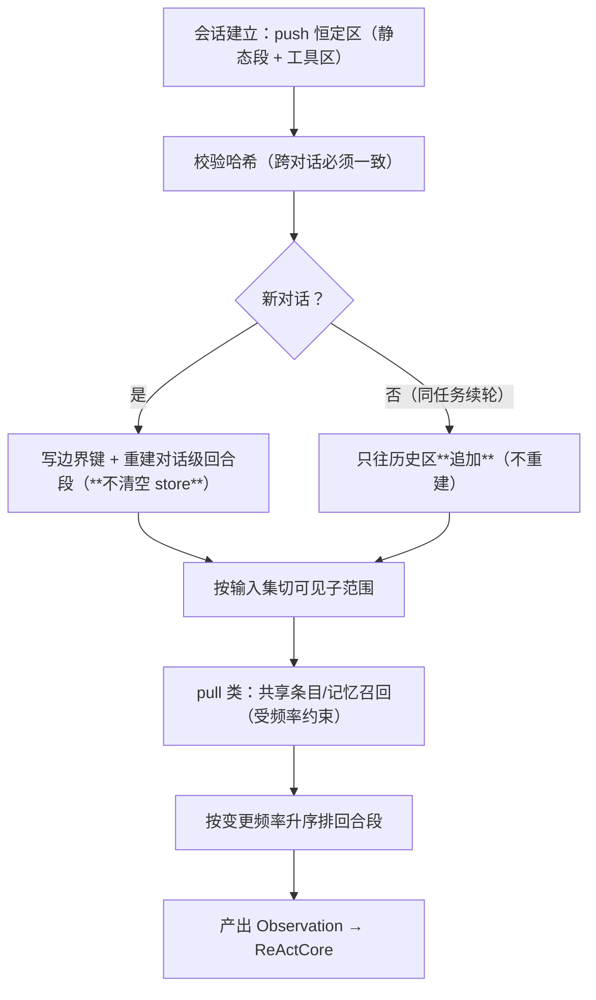

# C4 · `ContextAssembler`（Observation 组装 + 前缀稳定）

> **记号约定**：本文档中 `§N`（N ≥ 10）指 [13-ReAct跨切面约束](13-ReAct跨切面约束.md) 的节；裸 `§N`（N ≤ 9）指本文档内的节；`03 §6` 指 [03-组装检查树](03-组装检查树.md) 的「判据与反例集」。

> **适用范围**：为每个组件实例组装 `Observation`（**看得见什么**），并**保证前缀稳定**（三区布局 · 稳定键 · 变更频率升序）。
> 它是 §17 归属表里"可见上下文组装"与"前缀稳定"两行的**唯一主人**。
> **相关模块**：[14-核心层组件总表](14-核心层组件总表.md) · [13-ReAct跨切面约束](13-ReAct跨切面约束.md) · [05-上下文作用域](05-上下文作用域.md) · [11-共享上下文](11-共享上下文.md)
> **上级索引**：[00-索引.md](00-索引.md)　|　**状态**：设计稿（未实现，未提交 git）

---

## 0. 数据总表（进 / 内部 / 出）

| 方向 | 数据 | 来源 | 处理规则 |
|---|---|---|---|
| 进 | **会话级恒定区**（系统提示静态段 + 工具区） | 组合根 / 外层 | **字节不变**；哈希比对；**禁止**由组件自取 |
| 进 | **会话级回合段**（偏好 / 工作目录 / 账号） | 外层 | 稳定键**原位替换** |
| 进 | **对话级回合段**（Goal / 计划 / 子代账本摘要） | 外层 | 新对话重建 |
| 进 | 历史消息 | 会话 | **只追加**；压缩是唯一例外 |
| 进 | 上游产出（Join 放行） | Join 门 | 只取**被引用为输入**的部分 |
| 进 | 共享上下文条目 | 域内/协同/系统 | **pull**，按冲突域分区，带版本 |
| 进 | 长期记忆召回 | 检索 | **pull**；**有写副作用**（`accessCount`，≥5 自增强）⇒ 受频率约束 |
| 进 | 事件 / 环境信号 | 总线 / Infra | 触发回合段更新，不直接进正文 |
| 内部 | 分区表（键 → 内容 → 变更频率） | 自身 | 按**变更频率升序**排列 |
| 内部 | 恒定区哈希 | 自身 | 用于跨对话一致性校验 |
| 出 | `Observation`（`context_sections` / `history` / `upstream` / `events` / `env`） | ReActCore | 只给**声明的子范围** |
| 出 | 前缀命中/失效统计 | 计量 | 供观测（回答"缓存为什么没命中"） |

## 1. 定位

| 是 | 不是 |
|---|---|
| **唯一**组装 `Observation` 的地方，也是**前缀稳定的责任人** | 模型调用方（ReActLoop 调模型） |
| 按 `ContextSelector` 切"可见子范围" | 决策者（不知道也不该知道状态机） |
| push/pull 的**执行者**（分工由外层定） | 组装体**内容**的决定者（那是外层/Assembler） |

## 2. push / pull 分工（§15.3 落地）

| 数据 | 方式 | 为什么 |
|---|---|---|
| 恒定区（静态段 / 工具区） | **push** | 必须**所有组件、所有对话一致**；各自 pull ⇒ 前缀必然不一致 |
| 会话级回合段 | **push** | 属于会话契约 |
| 上游产出 | **push**（门放行时） | 有明确到达事件 |
| 共享上下文条目 | **pull** | 按需、按冲突域分区 |
| 长期记忆召回 | **pull** | 按需；**有写副作用**，必须限频 |
| 计划 / Goal / 账本摘要 | **push**（对话级建立） | 对话私有 |

**典型错误**：让组件自己 pull 恒定区 → 不同组件的系统前缀不同 → **同一 agent 内前缀稳定直接失效**。

## 3. 三区布局与排序原则

```
[系统提示 · 静态段]   会话内字节恒定     ← 会话级
[工具区 tools 数组]   会话内字节恒定     ← 会话级（必须在所有 messages 之前）
── messages ──
[system · 回合段]     稳定键 → 原位替换   ← 按【变更频率升序】排列
[历史区]              只追加（压缩例外）
[尾部 appended]       追加末尾
```

**排序原则（易被忽略）**：**原位替换保护的是"该键之前"的前缀，不是它之后** ——
故**越稳定越靠前、越易变越靠后**，才能让每次变化只影响"它之后"的部分。

## 4. 类骨架

```python
@dataclass
class SectionSpec:
    key: str                  # 稳定键（同键原位替换）
    content: str
    change_freq: int          # 变更频率（用于升序排列）
    scope: Literal['session', 'dialogue', 'component']

class ContextAssembler:
    def __init__(self, deps: ContextAssemblerDeps):
        self.deps = deps
        self._constant_hash: str | None = None

    def apply_constant_zone(self, static_prompt: str, tool_header: list[ToolSpec]) -> None:
        """会话级恒定区：写入并校验字节不变（跨对话必须哈希一致）。"""
        h = sha256(snapshot(static_prompt, tool_header))
        if self._constant_hash is None:
            self._constant_hash = h
        elif h != self._constant_hash:
            raise InvariantError('恒定区发生漂移（跨对话哈希不一致）')   # 拒绝，不静默

    def put_section(self, spec: SectionSpec) -> None:
        """稳定键写入：同键同内容跳过、不同则原位替换。"""
        return self.deps.context_store.put(spec.key, spec.content)

    def open_dialogue(self, goal, plan_summary, ledger_digest) -> None:
        """新对话：重建对话级回合段，写【边界键】，**不清空** store。"""
        self.put_section(SectionSpec('ctx:dialogue:boundary', render_boundary(), 0, 'dialogue'))
        self.put_section(SectionSpec('ctx:dialogue:goal', goal, 1, 'dialogue'))
        ...

    async def assemble(self, sel: ContextSelector, sid: str, did: str) -> Observation:
        """按【输入集】切出可见子范围；pull 类受频率约束。"""
        sections = {k: self.deps.context_store.get(k).content
                    for k in sel.sections if self.deps.context_store.has(k)}
        history = self.deps.history.tail(sel.history)          # 只追加
        shared = await self.pull_shared(sel.shared, sid, did)   # 受频率约束
        return Observation(context_sections=dict(sorted(sections.items(), key=by_change_freq)),
                           history=history, upstream=self.deps.upstream, events=self.deps.events,
                           env=self.deps.env)
```

## 5. 一次组装（含跨对话）



## 6. 反例（造什么必须被拒绝 / 必须暴露）

| # | 反例 | 期望 |
|---|---|---|
| 1 | 新对话直接**拼接上一对话的 messages** | 拒绝（前缀必然不同） |
| 2 | 恒定区跨对话**哈希不一致**（每对话重建系统提示） | 拒绝（`InvariantError`） |
| 3 | 切换对话时**清空 `ContextStore`** | 拒绝（应只写边界键） |
| 4 | 同 agent 内两个组件声明**不同的工具区** | 拒绝（组件切换即前缀归零） |
| 5 | 把最**易变**的分区排在稳定分区**之前** | 拒绝（违反变更频率升序） |
| 6 | 在**每轮**重拉检索/共享内容 | 拒绝（内容每轮变 ⇒ 回合段每轮失效） |
| 7 | 组件自取恒定区（而非 push） | 拒绝（前缀不一致） |
| 8 | 子件声明的可见面 = 宿主全集 | 拒绝（嵌套退化，冲突域隔离失效） |
| 9 | 投递**未声明稳定键**的数据进 messages | 拒绝（随机破坏前缀） |
| 10 | 共享条目 pull 越过自己的域（未提升） | 拒绝（越权可见） |

## 7. 检查树判据

归口处：[03-组装检查树](03-组装检查树.md) §6 —— 前缀 4 条 + 会话 3 条均属本组件责任（共 7 条）。

## 8. 与现状差距（核实的）

| 需要 | 现状 | 需做 |
|---|---|---|
| 三区分离（静态段/工具目录/回合段） | ✅ 既有（`buildStableSystemPrompt`） | 复用 |
| 头部冻结（工具在所有 messages 之前，只放热工具+元工具） | ✅ 既有（2026-10-03 头部冻结） | 复用 |
| 稳定键原位替换（`ContextStore.put`） | ✅ 既有（同键同内容跳过 / 不同则原位替换） | 复用 |
| 工具区按 `ToolSelector` 收缩 | ⚠️ 现按**角色全量**（`buildToolHeader(role)`） | **改造**（否则组件切换即前缀失效） |
| 组件边界键 | ❌ 无 | 新建（`ctx:outer:component-boundary`） |
| 对话边界键 + 跨对话继承规则 | ❌ 无 | 新建 |
| 恒定区哈希校验 | ❌ 无 | 新建 |
| 按变更频率升序排列 | ❌ 无（当前顺序由写入先后决定） | 新建（顺序即命中率） |
| 拉取频率约束 | ⚠️ 检索有写副作用（`accessCount`，≥5 自增强），无频率约束 | 新建 |
