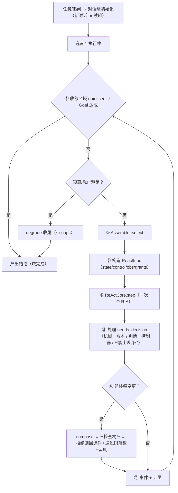

# C5 · `OuterLoop`（L1 外层循环 / 宿主）

> **记号约定**：本文档中 `§N`（N ≥ 10）指 [13-ReAct跨切面约束](13-ReAct跨切面约束.md) 的节；裸 `§N`（N ≤ 9）指本文档内的节；`03 §6` 指 [03-组装检查树](03-组装检查树.md) 的「判据与反例集」。

> **适用范围**：**单个 L1 agent** 的外层循环 —— 持有组装体与对话级状态 · 每个外层周期选执行件 · 构造 `ReactInput` · 收 `needs_decision` · 判收敛 · 驱动组装变更。
> 它是"外部控制器"的**宿主**：C1–C4 都由它持有，`ReActCore` 由它驱动。
> **相关模块**：[14-核心层组件总表](14-核心层组件总表.md) · [01-双层循环总览](01-双层循环总览.md) · [16-LifecycleController](16-LifecycleController.md) · [17-账本-子代与兄弟](17-账本-子代与兄弟.md) · [18-ContextAssembler](18-ContextAssembler.md) · [04-递归组合与P&E](04-递归组合与P&E.md)
> **上级索引**：[00-索引.md](00-索引.md)　|　**状态**：文中「现状 / ❌ / 不存在」各列均为**设计期快照**，不作为当前事实 —— 落地情况一律以 [28-设计实现覆盖清点](28-设计实现覆盖清点.md) 为准（2026-10-15：14 号组件闭集 18 项均有 TS 落点；**生产链路未装配** G4 · **未提交 git**）

---

## 0. 数据总表（进 / 内部 / 出）

| 方向 | 数据 | 来源/去向 | 落盘 |
|---|---|---|---|
| 进 | 任务与 Goal（**对话级**建立） | Interface / 上级 | 是 |
| 进 | 用户追问（**同任务续轮**的信号） | Interface | 是 |
| 进 | 子代回报（`child.settled`） | 账本 | 是 |
| 进 | 预算剩余 / 截止 | 会话配额 | 是 |
| 进 | 监管指令 / 治理决议 | 监管 / 治理 | 是 |
| 进 | 执行件目录 | `ExecutableRegistry` | 否（随代码） |
| 内部 | **组装体**（当前执行件图 + 声明） | 自身（经 `Assembler` 变更） | **是** |
| 内部 | 当前执行件与它的 `LifecycleController` | 自身 | 是 |
| 内部 | 对话级状态（Goal / 计划 / 分组） | 自身 | 是 |
| 内部 | `DomainLedger` / `ChildRegistry` | 自身持有 | 是（随快照） |
| 内部 | 组装变更历史（谁/何时/换成什么） | 自身 → `governance` | 是 |
| 出 | 结论摘要 | **上级 / 用户** | 是 |
| 出 | 组装变更 + 审计 | `governance` | 是 |
| 出 | 上下文快照 + 工作状态 | `supervision`（**只读可见**） | 是 |
| 出 | 域进展 | `shared-ctx`（供自合并判定） | 是 |
| 出 | 生命周期/决策事件 + 计量 | 事件总线 / 记账 | 是 |

## 0.1 S7 落地状态（2026-10-15，已实现）

✅ 已实现于 `Src/Core/Orchestration/outerLoop.ts`：`createOuterLoop(deps)`。
宿主循环把 **S3–S6 的真实组件**串起来：`ChildRegistry` / `DomainLedger` / `ContextAssembler` /
`LifecycleController`（工厂）与 S4 的落盘端口；**未用桩件替代**。

**构造期纪律**：`selfTools` 必须 ⊆ `ORCHESTRATION_TOOLS`（`OrchestratorCompose` / `OrchestratorSelect`）——
含 `read`/`write`/`execute` 等业务工具**直接拒绝创建**。

验收：`Tests/Core/outerLoop.spec.ts` **16 条**（含 11 条负向）+ 3 次变异检验。
清单见 [25-实现顺序与最小落地切分](25-实现顺序与最小落地切分.md) §7.17–§7.18。

**仍待接线（S8）**：`AssemblerPort` / `ValidatorPort` / `RegistryPort` 目前由测试注入功能性实现；
S8 将给出产品实现（含 `criteriaVersion` / `registryVersion` 版本记录）。
## 1. 定位

| 是 | 不是 |
|---|---|
| L1 的**宿主**：持有组装体、账本、控制器 | 执行件（**它不执行任务**） |
| **唯一**能驱动 `ReActCore.step` 的一方 | 内层循环（十步在 `ReActLoop`） |
| 域收敛的**判定者**（`DomainLedger`） | 组件级 `terminate` 的判定者（那是 C1） |

## 2. 三集合（**工具集是重点**）

| 集合 | 内容 |
|---|---|
| **输入集** | 组装体 · 各组件状态摘要 · Goal · **子代收敛事件** · 域账本摘要 · 预算/截止 |
| **输出集** | `outer`（结论，交上级/用户）· `governance`（组装变更留痕）· `supervision`（状态可见）· `shared-ctx`（域进展） |
| **工具集** | **仅编排类**：`OrchestratorCompose` · `OrchestratorSelect`。**不含** `read` / `write` / `execute` 等业务工具 |

> 你早前的原话就是这条：**"L1 外循环没必要看见写、读、执行等等工具"**。
> 判据：**外层的输入集也不该包含业务上下文**（最小必要）——否则决策被执行细节淹没、成本失控。

## 3. 归属

| 项 | 归属 |
|---|---|
| 组装体 / 对话级状态 / 域账本 / 域收敛 | **本组件** |
| 合法集 / 决策 / 落盘 | 本组件**只实例化并持有控制器对象**；合法集与决策的**逻辑和数据都在 C1**，C5 **不参与** |
| 单组件状态取值 | C1（本组件只**驱动**） |
| 可见上下文组装 | C4 |
| 组装变更的**合法性** | C7（本组件**不得跳过**校验） |
| 组件级 `terminate` | C1（本组件**不干预**） |

**注意**：外层也有"外部"——它的控制信息来自**会话 / Interface / 治理**（预算、截止、监管指令）。**外层不是最高的**。

## 4. 依赖端口

```python
@dataclass
class OuterLoopDeps:
    registry:      ExecutableRegistry          # 执行件目录
    assembler:     Assembler                   # compose / select（工具）
    validator:     AssemblyValidator           # 检查树（判据见 03 §6）
    lifecycle:     LifecycleControllerFactory   # 每个组件一个实例
    children:      ChildRegistry
    domain:        DomainLedger
    contexts:      ContextAssembler
    checkpoint:    CheckpointPort
    emit_event:    Callable[[Event], Awaitable[None]]
    meter:         Callable[[UsageDelta], None]
    clock:         Callable[[], float]
```

## 5. 类骨架

```python
class OuterLoop:
    """L1 外层循环：选件 → 驱动 → 收事项 → 判收敛。每周期 = 一次组件步进。"""

    async def run(self, task: TaskInput) -> Result[TaskOutcome]:
        # ⓪ 对话级初始化：新对话（隔离历史）或同任务续轮（接续历史）
        ctx = self.contexts.open_dialogue(task.goal) if task.new_dialogue else self.contexts.continue_dialogue()
        assembly = await self.assembler.select(ctx.assembly, ctx.state)     # 选首个执行件

        while True:
            # ① 收敛判定（**先于选件**，否则会多跑一轮）
            if self.domain.domain_quiescent() and goal_satisfied(ctx):
                return Ok(self.finish(ctx))
            if ctx.budget <= 0 or self.clock() >= ctx.deadline_at:
                return Ok(self.finish(ctx, forced='degrade'))               # 带 gaps

            # ② 选下一个执行件（外部决定；L2 的组装体由父注入）
            exe = await self.assembler.select(assembly, ctx.state)
            ctrl = self.lifecycle.for_(exe.id)                              # C1 实例

            # ③ 构造 ReactInput（state/control/observation/grants 全部由外部给）
            inp = ReactInput(state=ctrl.state,
                             control=ctrl.control(),                        # 含 should_continue
                             observation=await self.contexts.assemble(exe.grants.visible, ...),
                             grants=exe.grants)

            # ④ 驱动一次组件步进（ReActCore 只做 O-R-A）
            out = await exe.step(inp)
            if out.ok is False: return Err(out.error)

            # ⑤ 处理 needs_decision（**机械→账本；判断→控制器；禁止丢弃**）
            for item in out.value.needs_decision:
                if item == 'child.spawned': self.children.register(...)
                elif item == 'child.settled': self.children.settle(...)
                else: await ctrl.on_event(item, ctrl.state, ctx)            # 判断类
                self.children.assert_all_handled(item)                      # 不得丢弃

            # ⑥ 若组装需变更：compose → **必须过检查树** → 落盘 + 留痕
            if out.value.requests_assembly_change:
                candidate = await self.assembler.propose(out.value.change)
                verdict = self.validator.validate(candidate)                # 03 §6
                if not verdict.ok:
                    await self.emit_event(AssemblyRejected(verdict.reasons)) # 拒绝 → 回选件
                    continue
                assembly = candidate
                await self.governance.audit(candidate.change_digest())

            # ⑦ 事件与计量（含前缀命中统计，便于回答"缓存为何没命中"）
            await self.emit_event(OuterCycle(exe.id, ctrl.state))
            self.meter(out.value.usage)
```

## 6. 一次外层周期



## 7. 与外层的边界（三层职责不混）

| 判断 | 在哪层 | 归属 |
|---|---|---|
| 内层「是否继续迭代」 | `ReActLoop` 内部 | **原语**（固定逻辑） |
| 每轮干预 | **插件链** | 外部授予（不跨边界） |
| 组件状态转移 | **组件边界** | C1 |
| **域是否完成** | **本组件** | C5 |

## 8. 反例（造什么必须被拒绝 / 必须暴露）

| # | 反例 | 期望 |
|---|---|---|
| 1 | 外层调用 `read`/`write`/`execute` 等**业务工具** | 拒绝（工具集仅编排类） |
| 2 | 外层输入集包含**业务上下文** | 拒绝（最小必要；成本失控） |
| 3 | 外层**自造** `state`/`control`（不经 C1） | 拒绝（§16 铁律） |
| 4 | 组装变更**跳过检查树**直接落盘 | 拒绝（必须过 C7） |
| 5 | **兄弟未收敛**就宣布域完成 | 拒绝（`domain_quiescent()` 必须为真） |
| 6 | 外层修改**恒定区**（静态段/工具区） | 拒绝（前缀归零） |
| 7 | 每周期**重建**组装体（而非增量变更） | 拒绝（前缀与组装历史都会乱） |
| 8 | 丢弃 `needs_decision` 中某项 | 拒绝（§16.6 判据 4） |
| 9 | L2 自造 `ReactInput` / 自改组装体 | 拒绝（L2 由父注入） |
| 10 | 收敛判定放在**选件之后** | 拒绝（会多跑一轮、产生无谓副作用） |
| 11 | 组装变更未留痕（无法归因"谁把什么换成了什么"） | 拒绝 |

## 9. 检查树判据

归口处：[03-组装检查树](03-组装检查树.md) §6。与本组件直接相关的：
「组装变更必须过检查树」「召唤子代必须声明 join 语义」「插入关系记入组装体」「L2 的 ReactInput 必须父构造」。

## 10. 与现状差距（核实的）

| 需要 | 现状 | 需做 |
|---|---|---|
| 外层循环 | ❌ **不存在**（现在只有内层十步循环，被当成全局唯一循环） | **新建** |
| 执行件目录 | ❌ 无 | 新建（S1） |
| 组装器工具 | ❌ 无 | 新建（C6） |
| 检查树执行者 | ⚠️ 判据已在 03 §6，**无执行者** | 新建（C7） |
| 复杂度评估 / 模式选择 | ⚠️ 有 Director 复杂度评估路径 + 6 个固定 `RoutingMode` | 6 模式**降级为策略预设**，作回归对照 |
| 组装变更审计 | ⚠️ 有 `governanceAudit` | 复用；补"组装变更"这一事件类型 |
| 域概念 | ❌ 无 | 新建（17） |
| 对话级状态 | ⚠️ 会话级 `ContextStore` 在，**对话边界无概念** | 新建（18） |

## 11. 快照分区与 needs_decision 覆盖校验（归属复核补，见 [20-归属复核](20-归属复核.md)）

**规则 1 · 快照按 key 空间分区**

| 写者 | key 前缀 | 内容 |
|---|---|---|
| 本组件（C5） | `ckpt:conversation:<dialogueId>` | 组装体 / 域账本 / 对话级状态 |
| `LifecycleController`（C1） | `ckpt:component:<componentId>` | 各组件自己的状态 / 决策缓存 / 违规记录 |

**恢复时**：读 conversation 空间（自己）+ component 空间（各组件）；**写时各写各的**。

**规则 2 · `needs_decision` 用集合覆盖校验证明"没丢"**

```
needs_decision ≡ LifecycleEvent − { component.entered }     # 引用式闭集（§17.2）
校验：收到的每一项都必须被处理，且事件集合是闭集 ⇒ 可机检（而非靠自觉）
```
