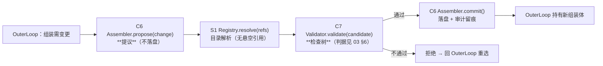
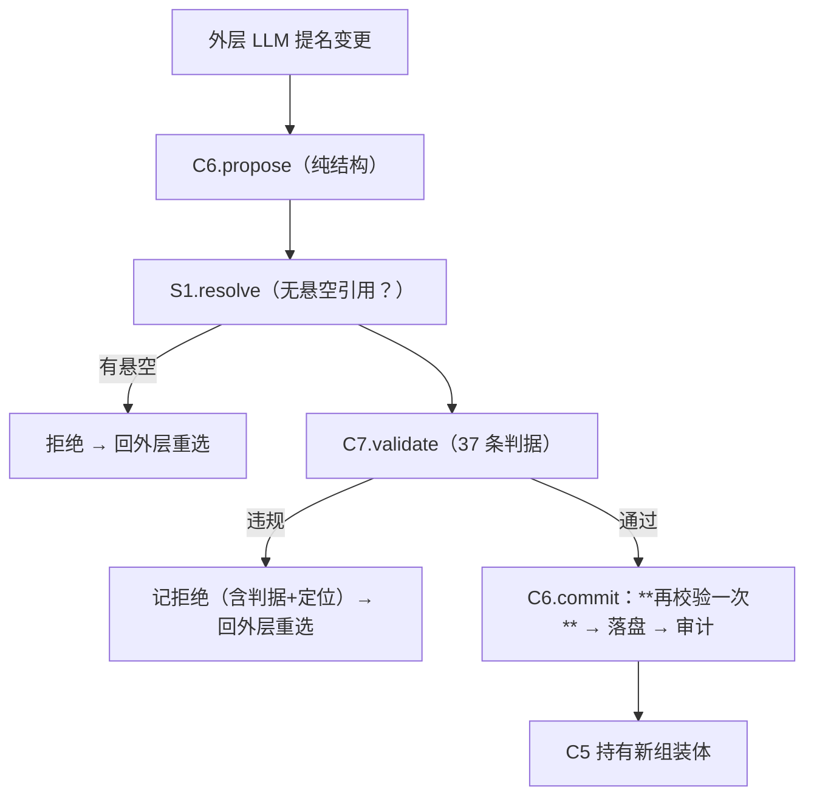

# C6/C7/S1 · 组装闭环（`Assembler` · `AssemblyValidator` · `ExecutableRegistry`）

> **记号约定**：本文档中 `§N`（N ≥ 10）指 [13-ReAct跨切面约束](13-ReAct跨切面约束.md) 的节；裸 `§N`（N ≤ 9）指本文档内的节；`03 §6` 指 [03-组装检查树](03-组装检查树.md) 的「判据与反例集」。

> **适用范围**：组装变更的**提议 → 校验 → 提交**链路，以及执行件目录。
> **为什么三件写在一起**：它们只作为一个**闭环**才有意义 —— 单独任何一件都无法回答"这次组装能不能上"。
> **相关模块**：[14-核心层组件总表](14-核心层组件总表.md) · [19-OuterLoop](19-OuterLoop.md) · [03-组装检查树](03-组装检查树.md) · [02-组装器与算子闭集](02-组装器与算子闭集.md) · [20-归属复核](20-归属复核.md)
> **上级索引**：[00-索引.md](00-索引.md)　|　**状态**：文中「现状 / ❌ / 不存在」各列均为**设计期快照**，不作为当前事实 —— 落地情况一律以 [28-设计实现覆盖清点](28-设计实现覆盖清点.md) 为准（2026-10-15：14 号组件闭集 18 项均有 TS 落点；**生产链路未装配** G4 · **未提交 git**）

---

## 0. 三者关系（闭环）



**职责切分（防止"谁都能改组装体"）**：

| 组件 | 是 | 不是 |
|---|---|---|
| **C6 `Assembler`** | **工具**（`OrchestratorCompose` / `select`）：提议与提交 | 判定者（不校验合法性）· 持有者（组装体归 C5） |
| **C7 `AssemblyValidator`** | **纯判定**（无状态）：出裁决与理由 | 修改者（只读候选） |
| **S1 `ExecutableRegistry`** | **目录**（名字 → 构造器） | 运行态（不被运行中修改） |

## 0.1 S8 落地状态（2026-10-15，已实现）

✅ 已实现：`Src/Core/Assembly/executableRegistry.ts`（目录，冻结后只读）·
`Src/Core/Assembly/assemblyPipeline.ts`（**9 条判据（带 id）** + 校验器 + 装配器）·
`Src/Core/Assembly/criteriaExtended.ts`（补齐 03 §6 其余条目）·
**C6 的工具身份**：`Src/Tools/Custom/orchestratorCompose.ts` / `orchestratorSelect.ts`
经 `Src/Core/Orchestration/orchestrationToolPort.ts` 接进闭环（组合根 `configureToolServicePorts({ orchestration })` 注入）。

已落地的纪律：提交前**再校验**（快照由装配器自己取，调用方无法绕过）· **TOCTOU 摘要匹配** ·
**落盘与审计双必需** · **`restore` 版本不匹配即拒绝**（`criteriaVersion` / `registryVersion`）。

**本轮由负向用例暴露并修掉的缺陷（2026-10-15）**：`commit` 先落盘后审计，而审计失败时**落盘不回滚**
——磁盘上留下一份"没人知道是谁改的"组装体，正是 §5 反例 11 所禁止的状态。
修法：`AssemblerPorts` 增加**必需**端口 `retract(assemblyId)`，审计失败即撤销本次落盘；
`retract` 自身失败则如实上报"存储与审计已分叉，需人工介入"，绝不谎称无事发生。
（落盘与审计本就是两个独立端口，做不成一个事务 ⇒ 补偿动作是可达的最低承诺。）

另一条落地方式：**判定不复制**。工具与端口都**不**校验算子闭集 / `onMissing` 合法性，原样带入候选，
由 `C-OP-1` / `C-JOIN-1` 裁决 —— 变异检验专门造了一条"端口自己抄一份闭集"的变异，被"非法算子"用例杀死
（抄了闭集就等于把"拒绝"变成"静默丢弃"）。同理，组装体归 C5 持有：端口只经 `current()` 读、经 `adopt()` 交回，
**不自存一份**（否则就是第二个写者）。

验收：`Tests/Core/assembly.spec.ts` **19 条**（含 13 条负向）· `Tests/Tools/orchestratorTools.spec.ts`
**32 条**（真实调用 S1/C6/C7 + 统一派发入口，未 mock 判据）· 变异 **11 项全杀**
（含"端口跳过 validate""采用失败被吞""选件不校验成员""提名非一次性""审计失败不撤回落盘""节点声明整体透传"）。
清单见 [25-实现顺序与最小落地切分](25-实现顺序与最小落地切分.md) §7.19。
## 1. 数据总表

| 方向 | 数据 | 来源/去向 | 落盘 |
|---|---|---|---|
| 进 | 变更提议（加/删/换执行件、改 `Join`、改三集合声明） | `OuterLoop`（外层 LLM 提名） | 是 |
| 进 | 执行件引用（id + 版本） | 提议 | 是 |
| 进 | 目录快照（执行件清单 + 所需依赖） | S1 | 否（随代码） |
| 进 | 检查树判据集 | 03 §6（**单一真源**） | 随代码 |
| 内部 | 候选组装体（未提交） | C6 | 否（提交后才落盘） |
| 内部 | 裁决 + 违规明细 | C7 | 是（拒绝也要留痕） |
| 出 | 已提交组装体（+ 变更摘要） | C5 持有 | **是** |
| 出 | 审计记录（谁/何时/把什么换成什么/依据） | `governance` | 是 |
| 出 | 拒绝事件（含 `violations`） | 事件总线 → 外层重选 | 是 |

## 2. 归属

| 项 | 归属 |
|---|---|
| **组装体本身** | **C5**（本闭环只做"提议/校验/提交"） |
| 变更的**合法性** | **C7** |
| 执行件**目录** | **S1**（全局共享，属"目录"类，见 [15](15-ReActLoop原语.md) §7 判据） |
| 提交动作与落盘 | **C6**（提交后交 C5 持有） |
| 变更审计 | 本闭环产生 → `governance` |

## 3. 类骨架

```python
@dataclass
class AssemblyChange:
    op: Literal['add', 'remove', 'replace', 'rewire_join', 'retarget_ports']
    target: str | None          # 被换掉的执行件 id
    added: dict | None          # 新增执行件的声明（含三集合与 Join）

@dataclass
class Verdict:
    ok: bool
    violations: list[str]       # 必须能定位到"哪条判据 + 哪个节点"
    warnings: list[str]

class ExecutableRegistry:                    # S1
    def resolve(self, ref: str) -> ExecutableSpec | None: ...
    def list_for_role(self, role: str) -> list[ExecutableSpec]: ...
    def snapshot(self) -> dict: ...          # 供 Validator 判悬空引用
    # 判据：**目录是"目录"类**，运行中不得修改（见 15 §7）

class AssemblyValidator:                     # C7
    def __init__(self, criteria: CriteriaSet, registry: ExecutableRegistry):
        self.criteria, self.registry = criteria, registry

    def validate(self, candidate: Assembly) -> Verdict:
        """逐条跑 03 §6 的判据；违规必须给"判据 + 定位"。"""
        violations = []
        for c in self.criteria.all():        # 37 条（03 §6）
            r = c.check(candidate, self.registry.snapshot())
            if not r.ok:
                violations.append(c.id + '@' + r.where + ': ' + r.reason)
        return Verdict(ok=not violations, violations=violations, warnings=[])

class Assembler:                             # C6 —— **工具**：外层可调
    def __init__(self, registry: ExecutableRegistry, validator: AssemblyValidator,
                 deps: AssemblerDeps):
        self.registry, self.validator, self.deps = registry, validator, deps

    async def propose(self, change: AssemblyChange) -> Assembly:
        """只做**结构组装**，不做判定。"""
        return apply_change(self.deps.current_assembly, change)

    async def commit(self, candidate: Assembly, verdict: Verdict, by: str) -> Result[None]:
        if not verdict.ok:
            await self.deps.emit(AssemblyRejected(verdict.violations))   # 拒绝也要留痕
            return Err('组装未通过检查树，不得提交')
        saved = await self.deps.persist_assembly(candidate)              # ckpt:conversation 空间
        if not saved.ok: return Err('组装落盘失败: ' + str(saved.error))
        await self.deps.audit(digest(candidate), by, verdict.warnings)   # 谁/何时/换成什么
        return Ok(None)
```

**关键**：`propose`（纯结构）与 `commit`（含校验与落盘）**分开**——中间必须夹 `validate`。
`commit` 里**再校验一次**（防御性）：即使调用方绕过，也不能落盘一份非法组装体。

**落地补记**：实现版的 `AssemblerPorts` 比本骨架多一个**必需**端口 `retract(assemblyId)` ——
审计失败时必须撤回已发生的落盘，否则就是 §5 反例 11（落盘成功但审计缺失）。见 §0.1。

## 4. 一次组装变更



## 5. 反例（造什么必须被拒绝 / 必须暴露）

| # | 反例 | 期望 |
|---|---|---|
| 1 | 提议里引用**未注册**的执行件 | 拒绝（悬空引用；S1 解析失败） |
| 2 | 提议里含**不在闭集**的算子（如未经登记的 `Retry`） | 拒绝（[02](02-组装器与算子闭集.md) 的算子闭集） |
| 3 | **跳过 `validate`** 直接 `commit` | 拒绝（`commit` 内必须再校验；见 §3） |
| 4 | 校验通过后**又改了候选**再落盘（TOCTOU） | 拒绝（落盘前校验摘要必须匹配） |
| 5 | `Join` 的 `deps` 指向不存在/未收敛且无 `onMissing` 的子代 | 拒绝 |
| 6 | 子件的**输入集 = 宿主全集** | 拒绝（嵌套退化） |
| 7 | 两个同 `conflict_domain` 的插件同时启用 | 拒绝 |
| 8 | 组装体含**环**（A 插 B、B 插 A） | 拒绝 |
| 9 | 运行中修改 S1 目录（导致已提交组装体的引用失效） | 拒绝（目录属"目录"类，运行中只读） |
| 10 | 拒绝时**不留痕**（只说"不行"） | 拒绝（必须给"判据 + 定位"，否则外层无法重选） |
| 11 | 落盘成功但**审计缺失** | 拒绝（变更不可归因） |
| 12 | `CriteraSet` 版本与落盘组装体记录的版本不一致 | 拒绝（判据变更后必须重验存量组装体） |

## 6. 检查树判据

**判据的单一真源**：[03-组装检查树](03-组装检查树.md) §6（37 条）。本模块**只做执行者**，不重复列。
`CriteriaSet` 必须能报出**判据 id**（便于"这条判据拦下了什么"可追溯）。

## 7. 与现状差距（核实的）

| 需要 | 现状 | 需做 |
|---|---|---|
| 组装器工具 | ❌ 无 | 新建（C6） |
| 检查树执行者 | ⚠️ 判据已在 03 §6，**无执行者** | 新建（C7） |
| 执行件目录 | ❌ 无 | 新建（S1） |
| **可照抄的同类物** | ✅ `specValidator.validateToolSpec`（纯函数式校验、返回 errors 数组）· `registerTool` 对 FORBIDDEN 返回 `Result.ok=false`（**真实调用可证伪**） | **照抄这两个形态** |
| 变更审计 | ⚠️ 有 `governanceAudit` | 复用；补"组装变更"事件类型 |
| 6 个固定 `RoutingMode` | ✅ 存在 | 降级为**策略预设**（组装体的预设），作回归对照 |

**为什么强调"照抄"**：`validateToolSpec` 证明"纯函数式校验 + errors 数组"在本仓已跑通；
`registerTool` 证明"非法即拒（不是警告）"也跑通。本闭环不需要发明新形态 —— 与既有件保持**同形**，
将来才可能共用测试与守门。

## 8. 组装体的版本记录（归属复核补，见 [24-归属复核-第二批](24-归属复核-第二批.md)）

组装体依赖两个**可升级的外部物**：判据集（37 条）与执行件目录。**必须记录二者的版本**，否则会"悄悄失效"
（同一份组装体，昨天合规、今天不合规）。

| 字段 | 含义 |
|---|---|
| `criteria_version` | 提交时所用**判据集**版本 |
| `registry_version` | 提交时所用**执行件目录**版本 |

**两条规则**：
1. 版本不匹配 ⇒ **拒绝恢复该组装体**（不得"先跑起来再说"）
2. 判据集/目录升级后，存量组装体进入**待重验**状态（重验通过才可恢复）
