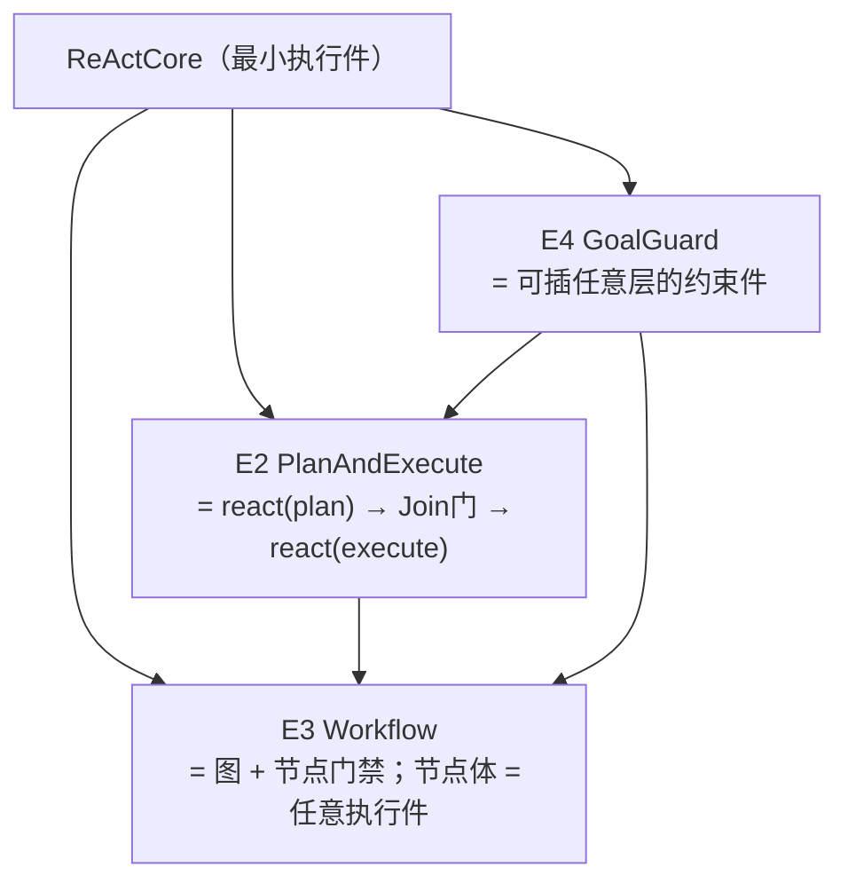

# E2/E3/E4 · 模式：`PlanAndExecute` · `Workflow` · `GoalGuard`

> **记号约定**：本文档中 `§N`（N ≥ 10）指 [13-ReAct跨切面约束](13-ReAct跨切面约束.md) 的节；裸 `§N`（N ≤ 9）指本文档内的节；`03 §6` 指 [03-组装检查树](03-组装检查树.md) 的「判据与反例集」。

> **适用范围**：三种**由组合得到**的执行件模式。
> **共同前提（这是本模块的立场）**：**模式不是引擎** —— 它们都由 `ReActCore` + 插件链 + `Join` 组装出来，**不新增硬编码分支**。
> **相关模块**：[04-递归组合与P&E](04-递归组合与P&E.md) · [12-ReAct类设计](12-ReAct类设计.md) · [13-ReAct跨切面约束](13-ReAct跨切面约束.md) · [21-组装闭环](21-组装闭环.md) · [02-组装器与算子闭集](02-组装器与算子闭集.md)
> **上级索引**：[00-索引.md](00-索引.md)　|　**状态**：设计稿（未实现，未提交 git）

---

## 0. 三者的结构（都是组合，不是分支）



| 模式 | 组合方式 | 关键结构件 |
|---|---|---|
| **E2 P&E** | 两个 `ReActCore` + 一个 `Join` | **`Join.minCompleteness`**（plan→execute 的完备度门） |
| **E3 Workflow** | 图 + 每节点一个执行件 + `Join` | 节点门禁（前驱收敛才放行） |
| **E4 GoalGuard** | 插在任意层的**约束件** | 出口判定 + `gaps` |

## 1. 三集合（三者对照）

| 集合 | E2 P&E | E3 Workflow | E4 GoalGuard |
|---|---|---|---|
| **输入集** | plan 半：任务描述 + 已知资料 + 子代回报；execute 半：**plan 的 required 输出** | 当前节点所需 + 前驱产出 | **Goal + 出口判定所需**（最小） |
| **输出集** | `outer`（结论）· `shared-ctx` · `long-term` · **`plan`（含 `informationState`/`gaps`）必须** | 各节点产出（按节点声明） | `gaps` · **终止建议** |
| **工具集** | 调查类（plan 半）· 执行类（execute 半）· `recruit` / `split` | 节点内所需（按节点声明） | **空**（约束件不执行动作） |

## 2. E2 `PlanAndExecute`

### 2.1 结构

```
react(plan) → [Join: minCompleteness] → react(execute) → [Join] → 出口
```

**为什么两半之间必须有个门**：plan 是 execute 的输入。若 plan 退出时仍有子代在跑、
**而该子代的结果会改变计划**，此时进 execute 等于**用未定稿的计划执行**。

### 2.2 完备度门（**两个出口都要有**）

```python
@dataclass
class PlanOutput:                      # plan 半的 required 输出
    steps: list[Step]
    information_state: Literal['complete', 'partial']
    gaps: list[Gap]                    # partial 时必填
    basis: list[str]                   # 依据了哪些子代结论

async def plan_join_gate(plan_out: PlanOutput, spec: JoinSpec) -> Literal['proceed', 'back_to_plan']:
    if plan_out.information_state == 'complete':
        return 'proceed'
    if spec.on_missing == 'degrade':
        return 'proceed'               # 放行，但 gaps 必须随输出传给 execute
    return 'back_to_plan'              # **回到调查**，不是硬着头皮执行
```

> **只在"满足"一侧有出口，等于把"资料不全"偷偷放过去。**

### 2.3 反例

| # | 反例 | 期望 |
|---|---|---|
| 1 | plan 退出时有未收敛子代、且其结果影响计划，仍进 execute | 拒绝（`back_to_plan` 或 `suspend`） |
| 2 | plan 输出缺 `informationState` / `gaps` | 拒绝（required 输出缺失） |
| 3 | `degrade` 放行但 `gaps` **未传给** execute | 拒绝（资料不全必须显式传递） |
| 4 | 把 P&E 实现成一个新循环（而非两个 ReAct 的组合） | 拒绝（违反"模式不是引擎"） |

## 3. E3 `Workflow`

### 3.1 结构

```python
@dataclass
class WorkflowNode:
    id: str
    body: Executable                  # ← **任意执行件**（ReActCore / P&E / 嵌套 Workflow / 带 GoalGuard）
    predecessors: list[str]
    join: JoinSpec                    # 前驱收敛条件

class Workflow:
    async def step(self, inp: ReactInput) -> Result[ReactOutput]:
        node = self.current_node()
        if not self.gate_open(node):                 # 节点门禁：前驱未收敛则不放行
            return Ok(ReactOutput(needs_decision=['dependency.blocked']))
        out = await node.body.step(inp)              # 进入节点体（可以是另一个模式）
        if out.value.produced.get('node_done'):
            self.advance()                           # 推进到下一节点（**不改恒定区**）
        return out
```

### 3.2 反例

| # | 反例 | 期望 |
|---|---|---|
| 1 | 节点体**不是**执行件（内联了一段专用逻辑） | 拒绝（破坏递归性） |
| 2 | 前驱未收敛就放行节点 | 拒绝（门禁失效） |
| 3 | 节点推进时**重建上下文**（而非只改稳定键） | 拒绝（前缀归零；见 [18](18-ContextAssembler.md)） |
| 4 | 图含环且无迭代上限 | 拒绝（闭包判据，03 §6） |
| 5 | 节点体是嵌套 Workflow 但未声明嵌套深度 | 拒绝（良基判据） |

## 4. E4 `GoalGuard`

### 4.1 结构：**约束件**，不是执行件

```python
class GoalGuard:
    """可插在任意层的出口判定；**工具集为空**（它不执行动作）。"""

    def check(self, produced: dict, goal: Goal) -> GoalVerdict:
        return GoalVerdict(satisfied=..., gaps=[...], suggestion='running' | 'terminate' | 'degrade')
```

**插入位置**：任意执行件的出口（含 P&E 的 plan 半、Workflow 的每个节点）。
**它只给建议**——状态转移仍由 C1 决定（§16）。

### 4.2 反例

| # | 反例 | 期望 |
|---|---|---|
| 1 | GoalGuard **自己执行动作**（用了工具） | 拒绝（工具集必须为空） |
| 2 | GoalGuard 把建议**当成决定**（直接改状态） | 拒绝（状态归 C1） |
| 3 | Goal 判定口径未声明（无法判定达成） | 拒绝（闭包判据，03 §6） |
| 4 | 出口未插 GoalGuard 却声明"目标已达成" | 拒绝（目标闭环缺失） |

## 5. 归属

| 项 | 归属 |
|---|---|
| 模式的**结构**（图/两半/约束位置） | 组装体（C5 持有，C6 变更，C7 校验） |
| 模式内的**节点推进** | 本模块（执行件自身） |
| 状态转移 / 合法集 / 落盘 | **C1**（不由模式决定） |
| 完备度门的**阈值** | `Join.minCompleteness`（组装体声明，C7 校验） |

## 6. 检查树判据

归口处：[03-组装检查树](03-组装检查树.md) §6。与本模块相关的四条：
`Loop 必须有非平凡 P` · `plan→execute 必须声明 minCompleteness` · `嵌套良基` · `Goal 在出口可判定`。

## 7. 与现状差距（核实的）

| 需要 | 现状 | 需做 |
|---|---|---|
| P&E 的两半 | ❌ 无（有 `taskDecomposer` 可作 plan 半的**工具**来源） | 新建 |
| 图结构 | ❌ 无（有 `dispatchGate` 的**依赖门**概念可照抄） | 新建 |
| 约束件 | ⚠️ 有 `goalReanchor`（重锚）与 StopRules（终止），但**不是可插的约束件** | 改造为可插形态 |
| 6 个固定 `RoutingMode` | ✅ 存在（DIRECT / DELEGATION / CONSORTIUM / ASSEMBLY_LINE / LITIGATION / REGULATION） | **降级为这四种模式的组合预设**，作回归对照 |

**迁移建议（重要）**：先把 `RoutingMode` 中**最简的 `DIRECT`** 改写成"单节点 Workflow"的**预设**，
跑绿后再逐个改写其余 5 个 —— 每个模式改写后与改写前的行为做 A/B 对齐。
**不要一步删掉 6 个模式**：它们是现成的行为基线，也是唯一的回归对照。

## 8. `gaps` 合并规则（归属复核补，见 [24-归属复核-第二批](24-归属复核-第二批.md)）

`gaps` 有**两个来源**：plan 半的 `PlanOutput.gaps`（资料缺口）与 GoalGuard 的 `GoalVerdict.gaps`（目标缺口）。
**若后写覆盖前写，一类缺口会被另一类吞掉** ⇒ 下游看到的不完整。

```python
def merge_gaps(*sources) -> list[Gap]:
    by_key = {}
    for src in sources:
        for g in src:
            by_key.setdefault(g.key, []).append(g)      # 同 key 保留**多来源**
    return [Gap(key=k, occurrences=v) for k, v in by_key.items()]
```

**判据**：`gaps` 是**单调累积**的（只增不减），直到出口；
出口处必须**完整输出** —— 否则"资料不全"被隐式隐瞒，正是本设计要防的假绿。
